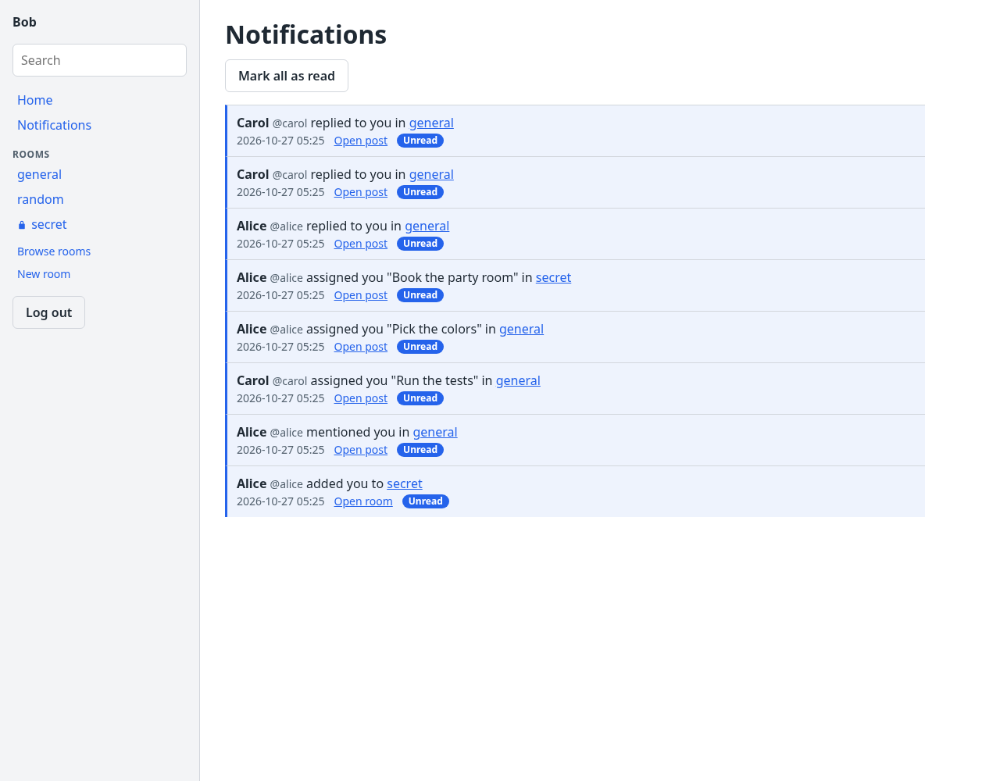
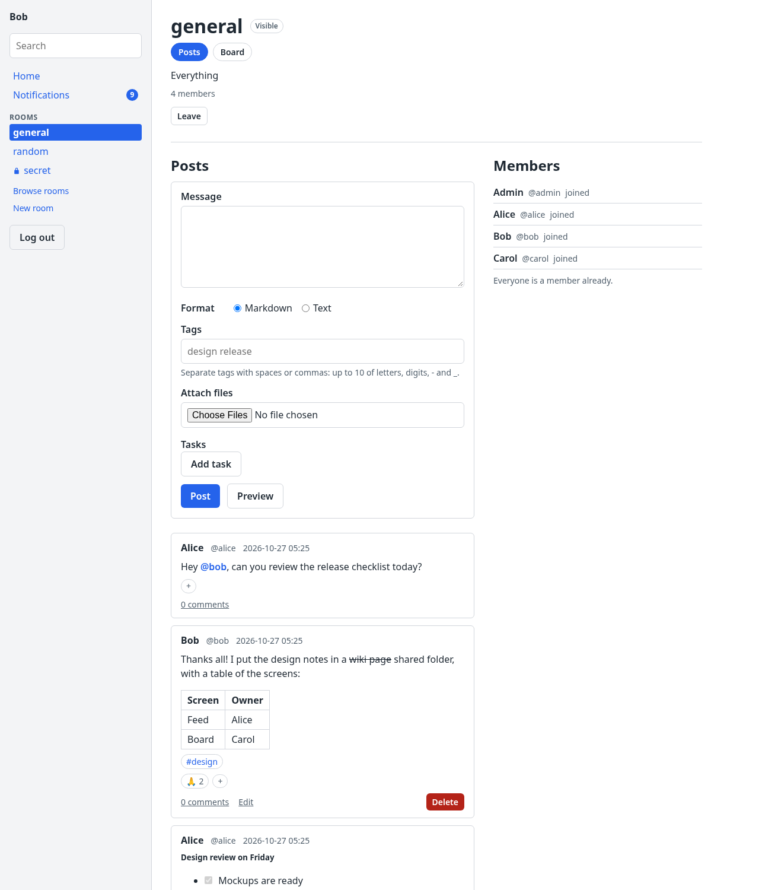
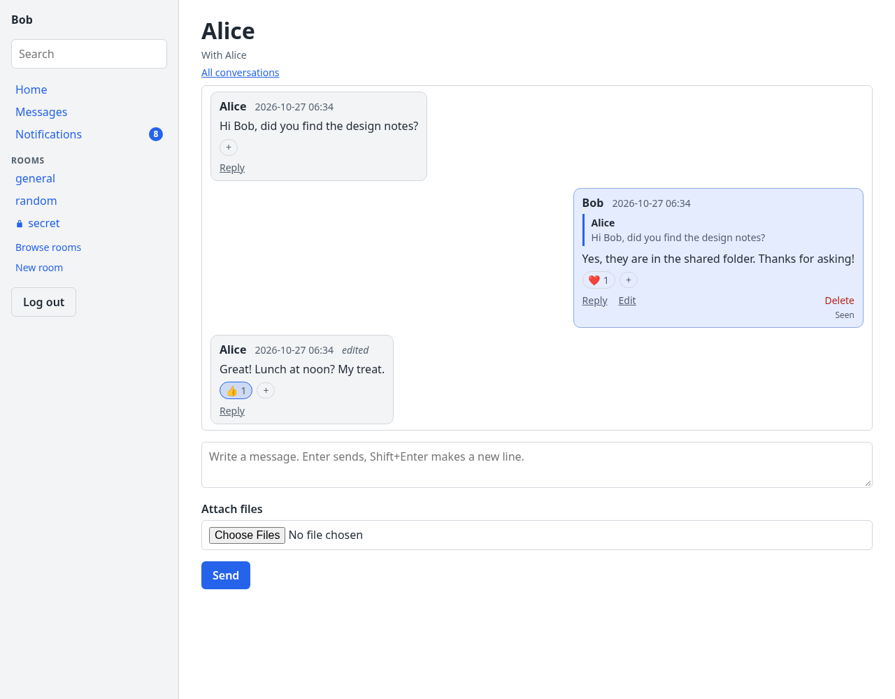
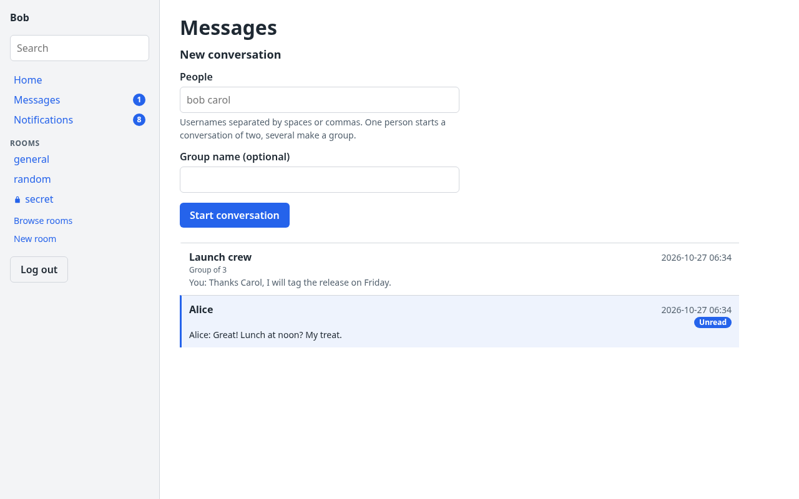
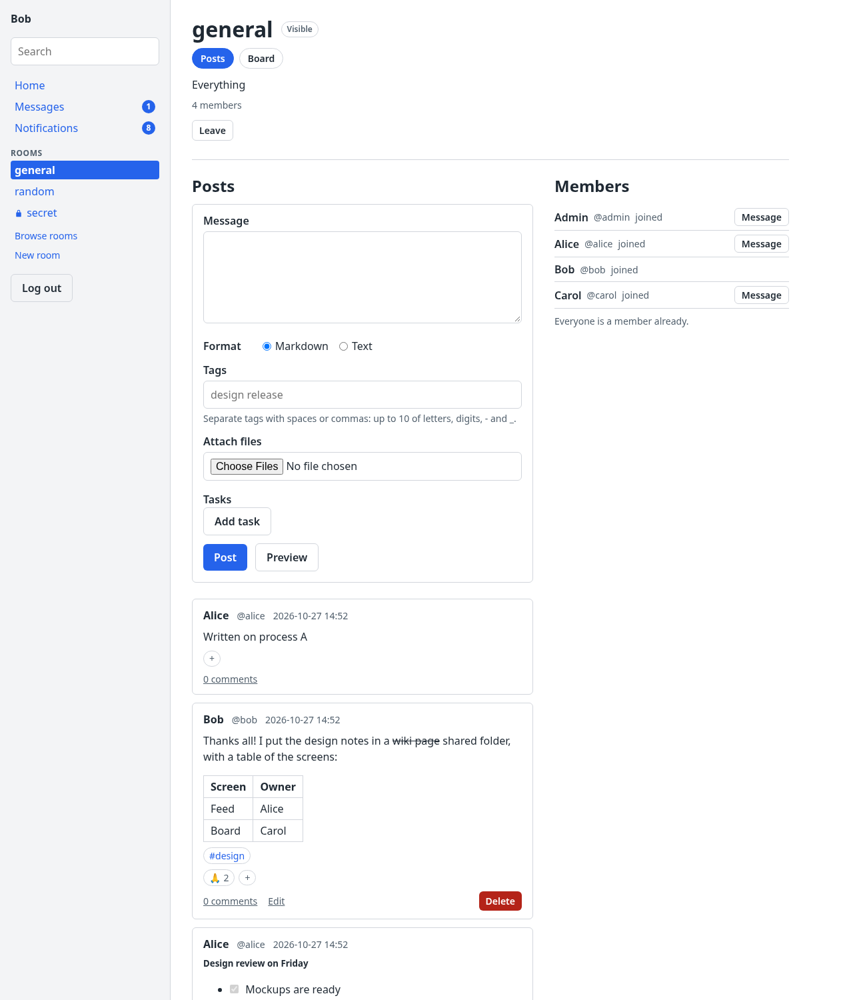

# Implemented steps

This is the log of finished steps from `docs/IMPLEMENTATION.md`, newest at the bottom. An agent adds an entry on the step's branch, as part of the step's commit (`docs/IMPLEMENTATION.md`, rules 10–12). The next step to do is the first step in `docs/IMPLEMENTATION.md` that has no entry here.

## Entry format

Copy this block, fill it in, and keep every heading. Write "none" where something doesn't apply.

```markdown
## <id> <step title>

- **Date:** YYYY-MM-DD
- **Branch:** feat/step-<id>-<slug>
- **Summary:** 2–4 sentences on what now exists and works.
- **Main files:** the packages or files created or changed.
- **Tests:** what was added, and the number of test cases.
- **Checks:** gofmt ✅ · go vet ✅ · golangci-lint ✅ · go test -race ✅ · step's own checks ✅/none
- **Proof:**
  [<id> <name>](implemented-proof-images/<id>-<name>.<ext>) (or `` for an image)
  One sentence describing what the proof shows, as you verified it by looking at it.
- **Manual checks:** the user's answers to the step's manual checks, or "none".
- **Deviations and follow-ups:** differences from SPEC (also recorded in SPEC), and TODOs left for later steps.
```

---

<!-- Entries start below this line. -->

## 0.1 Module and package layout

- **Date:** 2026-10-26
- **Branch:** feat/step-0.1-module-and-package-layout
- **Summary:** The module `github.com/rm4n0s/clowder` (go 1.27) exists with every package of SPEC §6.2, each with a `doc.go`; `cmd/clowder-proof` and `internal/browsertest` carry the `clowder_browser` tag. `internal/config` has the settings of SPEC §11 with their defaults, the secure-cookie rule and `Validate` with tagged errors from `rm4n0s/errors` v0.2.0.
- **Main files:** `go.mod`, `internal/config/config.go`, `*/doc.go`, `cmd/clowder/main.go`, `cmd/clowder-proof/main.go`, `scripts/README.md`.
- **Tests:** `internal/config`: 4 tests, 31 cases with subtests (every tag with its route, the metadata, the secure-cookie rule). Checked by hand that revive flags an undocumented exported function.
- **Checks:** gofmt ✅ · go vet ✅ · golangci-lint ✅ · go test -race ✅ · CGO_ENABLED=0 build ✅ · go generate clean ✅ · go vet -tags clowder_browser ✅
- **Proof:** none
- **Manual checks:** none
- **Deviations and follow-ups:** `BaseURLInvalid` covers both a URL that does not parse (`NewErr`) and one that is not absolute http(s) (`New`). Flags and environment variables come in step 0.3.

## 0.2 Dependencies, templ and static files

- **Date:** 2026-10-26
- **Branch:** feat/step-0.2-dependencies-templ-static
- **Summary:** Every dependency of SPEC D6–D10 and D23 is in `go.mod` (gorm v1.31.2, glebarez/sqlite v1.11.0, datastar-go v1.2.2, goldmark v1.8.6, x/crypto v0.58.0, chromedp v0.21.0, templ v0.3.1100 as runtime and `tool`); the unused ones are held by blank imports in `deps.go` files naming the step that will use them, chromedp only under the `clowder_browser` tag. `datastar.js` v1.0.2 with its MIT license, `app.css` and the `Layout`/`Home` templ views are embedded and generated.
- **Main files:** `go.mod`, `NOTICE`, `internal/web/static/` (`datastar.js`, `datastar.LICENSE`, `app.css`, `static.go`), `internal/web/views/` (`layout.templ`, `home.templ`, `generate.go`, generated `*_templ.go`), `internal/*/deps.go`.
- **Tests:** `views.TestHome` (9 cases), `static.TestFS` (2 cases).
- **Checks:** gofmt ✅ · go vet ✅ · golangci-lint ✅ (also with `--build-tags clowder_browser`) · go test -race ✅ · CGO_ENABLED=0 build ✅ (chromedp not in the default build) · go generate clean ✅
- **Proof:** none
- **Manual checks:** none
- **Deviations and follow-ups:** The SDK does not name its client version. Client v1.0.2 was matched to SDK v1.2.2 by release dates and by `viewTransitionSelector`, which both have and v1.0.1 lacks (recorded in SPEC D7). The SQLite driver brings `modernc.org/sqlite` v1.23.1, the version glebarez/sqlite pins.

## 0.3 `clowder serve`

- **Date:** 2026-10-26
- **Branch:** feat/step-0.3-clowder-serve
- **Summary:** `clowder serve` reads its settings from flags, then `CLOWDER_*` variables, then defaults, validates them, creates the data directory and runs `web.Server` until SIGINT or SIGTERM, then shuts down with a 10 s limit. The server serves the home page and the embedded static files (ETag, `no-cache`, 304), a 404 page for unknown paths (405 kept for a wrong method), and wraps every request in request logging, panic recovery (a logged `HandlerPanicked` and a 500 page) and `http.CrossOriginProtection`. `invite` and `demo` answer `NotImplemented`.
- **Main files:** `cmd/clowder/main.go`, `cmd/clowder/serve.go`, `internal/web/server.go`, `internal/web/middleware.go`, `internal/web/static.go`, `internal/web/views/error.templ`; the config tags are now exported.
- **Tests:** `cmd/clowder` (dispatch, flag/env/default precedence, malformed values, logger levels), `internal/web` (home, 404/405, static files, request log, panics, abort handler, cross-origin refusal, render and write failures, run and shutdown paths), `views.ErrorPage`; every new tag has a route test.
- **Checks:** gofmt ✅ · go vet ✅ · golangci-lint ✅ (both tag sets) · go test -race ✅ · CGO_ENABLED=0 build ✅ · go generate clean ✅
- **Proof:** none (a manual run served `/`, `/static/app.css` and a 404, and logged a clean shutdown on SIGINT)
- **Manual checks:** none
- **Deviations and follow-ups:** A path is a 404 only when no route matches it in any common method, so a wrong method still gets the mux's 405 with `Allow`. `TODO(step 2.2)`: services passed to `web.New`; `TODO(step 7.2)`: close the event streams on shutdown.

## 0.4 Proof tool and browser-test harness

- **Date:** 2026-10-26
- **Branch:** feat/step-0.4-proof-tool-browser-tests
- **Summary:** `internal/browsertest` builds `clowder`, runs `demo` and `serve -addr 127.0.0.1:0` in their own process group (reading the real address from the `server listening` log entry), starts headless Chromium with a temporary profile, and stops and reaps everything; `Start(t)` and `Browser(t, srv)` wrap it for tests and skip when Chromium is missing. `cmd/clowder-proof` uses it to save a screenshot of a page. `clowder demo` prepares an empty data directory. The home page shows a Datastar-driven marker.
- **Main files:** `internal/browsertest/{server,browser,testing}.go`, `cmd/clowder-proof/main.go`, `cmd/clowder/demo.go`, `internal/web/browser_test.go`, `internal/web/views/home.templ`.
- **Tests:** `TestRunDemo` (8 cases with routes); `internal/browsertest` (listen-line parsing, module root, Chromium lookup, every `StartServer` failure, `Stop` against fake servers that exit, ignore SIGINT or die of it, a run of the real binary); `clowder-proof` flag parsing; home page checks.
- **Checks:** gofmt ✅ · go vet ✅ · golangci-lint ✅ (both tag sets) · go test -race ✅ · CGO_ENABLED=0 build ✅ · go generate clean ✅ · browser tests ✅ (`TestHomeDatastar` in Chromium 156) · no Chromium or clowder process left ✅
- **Proof:**
  
  The home page in the base layout (grey sidebar, main column) with "Datastar is running", text set by `datastar.js` in place of the server's "Datastar is not running".
- **Manual checks:** none
- **Deviations and follow-ups:** The harness is Unix-only (`Setpgid`, `syscall.Kill`). Servers started by the harness get `-base-url http://127.0.0.1` without the port, since the port is known only after start: `TODO(step 2.2)`. `-as` of the proof tool is accepted and ignored until step 2.4.

## 1.1 Clock and the store

- **Date:** 2026-10-26
- **Branch:** feat/step-1.1-clock-and-store
- **Summary:** `internal/clock` has the real clock and a concurrency-safe fake. `internal/store` opens SQLite through the pure-Go driver with `busy_timeout(5000)`, `foreign_keys(1)`, `synchronous(NORMAL)`, WAL and `_txlock=immediate`, with GORM's `NowFunc` from the clock, translated duplicate-key errors and a logger that reports only slow queries without their arguments. It migrates (models, then raw SQL migrations recorded in `schema_migrations`), runs transactions (nested ones as savepoints), and tags `NotFound`, `Conflict` and `QueryFailed` where they appear. `storetest.Open` gives each test its own in-memory database. `clowder serve` opens and closes `<data>/clowder.db`.
- **Main files:** `internal/clock/clock.go`, `internal/store/{store,errors,migrate,logger}.go`, `internal/store/storetest/storetest.go`, `cmd/clowder/serve.go`.
- **Tests:** pragmas on every connection, foreign keys enforced, DSN building, idempotent migrations, raw migrations once and in order, failed migration rolled back, invalid migrations, open/close failures, `Tx` (commit, error, inner route kept, panic, begin failure, nesting), the three store tags with routes, 8 concurrent writers (fails with `_txlock=deferred`, so it tests the immediate lock), the fake clock in `CreatedAt`/`UpdatedAt`, the logger, `storetest` isolation, `serve` opening and closing the database.
- **Checks:** gofmt ✅ · go vet ✅ · golangci-lint ✅ (both tag sets) · go test -race ✅ · CGO_ENABLED=0 build ✅ · go generate clean ✅ · browser tests ✅ · no process left ✅
- **Proof:** none
- **Manual checks:** none
- **Deviations and follow-ups:** In-memory databases skip WAL and use one connection (shared-cache locks by table). Times are stored in the driver's text format in UTC; ordering by them works because every time is UTC, but feeds should order by ID. The driver's `_time_format` parameter must not be added: it makes the driver skip `_txlock`. `TODO(step 2.2)`: pass services built on the store to `web.New`.

## 1.2 Models

- **Date:** 2026-10-26
- **Branch:** feat/step-1.2-models
- **Summary:** The 21 models of SPEC §6.3 exist in `internal/store` and are migrated by `AutoMigrate`, with AUTOINCREMENT IDs, `CreatedAt` from the clock, string enums guarded by named CHECK constraints, the unique constraints of §6.3 (room names case-insensitive with `COLLATE NOCASE`), 43 foreign keys with the delete actions §7 implies (rooms and posts cascade, users restrict, replies and read markers set null, audit events keep no link to their room or entity), and named indexes for the feeds, threads, board, notifications, messages and the audit log.
- **Main files:** `internal/store/{users,rooms,posts,tasks,notifications,messages,audit,models}.go`, `internal/store/store.go`; SPEC §6.3 `Post.DeletedAt`.
- **Tests:** 109 cases: round trip of every model, 16 unique constraints, 17 CHECK constraints, every FK and index compared with `PRAGMA` output, `EXPLAIN QUERY PLAN` of 14 queries of §7 using their indexes, cascades of rooms, posts, columns, conversations and messages, 13 RESTRICT cases on users, idempotent migration, IDs never reused.
- **Checks:** gofmt ✅ · go vet ✅ · golangci-lint ✅ (both tag sets) · go test -race ✅ · CGO_ENABLED=0 build ✅ · go generate clean ✅ · browser tests ✅ · no process left ✅
- **Proof:** none
- **Manual checks:** none
- **Deviations and follow-ups:** FKs are declared through relation fields (`Room *Room`) that are never loaded or saved. A top-level post has no `RootID` (a CHECK keeps `ParentID` and `RootID` both set or both null). `AddedBy` is null when a user joined or started a conversation on their own. `Task.DueDate` is midnight UTC. Audit actions are constants without a CHECK. GORM translates an insert's FK violation to `gorm.ErrForeignKeyViolated` but not a RESTRICT on delete: step 2.2 decides how `classify` treats them. The test model `widget` stays for the 1.1 tests that need `UpdatedAt`.

## 2.1 Passwords and tokens

- **Date:** 2026-10-26
- **Branch:** feat/step-2.1-passwords-and-tokens
- **Summary:** `internal/auth` hashes passwords with argon2id (64 MiB, 3 passes, 2 threads) into PHC strings and verifies them with the parameters stored in the hash, rejecting malformed or absurd hashes with `PasswordHashMalformed` and other algorithms or versions with `PasswordHashUnsupported`. It makes 32-byte base64url tokens, hashes them with SHA-256 and compares in constant time.
- **Main files:** `internal/auth/password.go`, `internal/auth/token.go`.
- **Tests:** 10 hash/verify cases, the PHC format, salting, the default parameters, 28 malformed hashes with their routes, tag sentinels, token length, alphabet and uniqueness, SHA-256 vectors, constant-time comparison.
- **Checks:** gofmt ✅ · go vet ✅ · golangci-lint ✅ (both tag sets) · go test -race ✅ · CGO_ENABLED=0 build ✅ · go generate clean ✅ · browser tests ✅ · no process left ✅
- **Proof:** none
- **Manual checks:** none
- **Deviations and follow-ups:** A stored hash is refused above 1 GiB of memory, 100 passes, 64 threads or 1024-byte salts and keys. The salt and token generation tags have no route test: `crypto/rand` cannot be made to fail. `FastHasher` is for tests only.

## 2.2 Accounts service and invitations

- **Date:** 2026-10-26
- **Branch:** feat/step-2.2-accounts-service
- **Summary:** `internal/app` has the `Actor`, the public tags of SPEC §9.1 and the `Accounts` service: invitations (admin-made, or system-made by the command line), invitation checks (unknown, used and expired all answer `NotFound`), sign-up in one transaction with the rules of §7.1, the users list, role changes and disabling (admins only; the last active admin keeps the role and cannot be disabled; an admin cannot disable themselves; disabling deletes sessions). `clowder invite -admin|-member` prints a link; `clowder demo` creates the demo users `admin`, `alice`, `bob`, `carol`.
- **Main files:** `internal/app/{app,accounts}.go`, `internal/store/users_queries.go`, `internal/store/users.go` (`Invitation.CreatedBy` nullable), `cmd/clowder/{invite,demo,main}.go`.
- **Tests:** about 113 cases in `internal/app` (validation tables, single use, expiry, taken username including two concurrent sign-ups, last-admin rules, permission tables, routes), about 70 new in `internal/store`, about 30 new in `cmd/clowder`.
- **Checks:** gofmt ✅ · go vet ✅ · golangci-lint ✅ (both tag sets) · go test -race ✅ · CGO_ENABLED=0 build ✅ · go generate clean ✅ · browser tests ✅ · no process left ✅
- **Proof:** none (manual runs of `clowder demo` and `clowder invite -admin` printed the users and a link)
- **Manual checks:** none
- **Deviations and follow-ups:** `app.TagNotFound` and `app.TagConflict` are the store's tag strings, so store errors reach the web layer untouched (R3) and still match the app's tags. Validation problems travel as one `InvalidInput` error with a `fields` map. `clowder invite` also takes `-invitation-lifetime`. A disabled user never becomes an `Actor` (no session), so the permission tables cover admin, member and empty actors. `TagUnauthenticated` gets its route test in step 2.3.

## 2.3 Sessions, login and sign-up pages

- **Date:** 2026-10-26
- **Branch:** feat/step-2.3-sessions-login-signup
- **Summary:** People log in, sign up from an invitation link and log out. `Accounts` gained `Login` (one answer for unknown users, wrong passwords and disabled users, a dummy hash check for timing, expired sessions of the user deleted), a login limiter (5 failures per username or IP in 15 minutes → `RateLimited`), `SessionActor` (sliding expiry written at most once a minute, expired sessions deleted) and `Logout`. The web layer has the session cookie (HttpOnly, SameSite=Lax, Secure by config, re-sent when the session slides), routes protected by default, redirects to `/login?next=` with safe `next` paths, SSE redirects for Datastar requests, client IPs from `X-Forwarded-For` only with `-trust-proxy`, and the error-to-status mapping of SPEC §9.1. Forms submit with Datastar and get their field errors patched in place.
- **Main files:** `internal/app/{sessions,limiter}.go`, `internal/web/{session,errors,login,signup}.go`, `internal/web/views/{auth,sidebar}.templ`, `internal/config/config.go`, `internal/browsertest` (`InviteMember`, `Fill`), `cmd/clowder-proof` (`-invite`, `-fill`, `-click`).
- **Tests:** about 330 cases: login, limiter, sessions and their routes in `app`; the session queries in `store`; pages, login, sign-up, logout, cookie flags and sliding, `next` validation (17 rows), client IPs (15 rows), protected routes, cross-origin refusals and error mapping in `web`; browser tests logging in and signing up through the Datastar forms.
- **Checks:** gofmt ✅ · go vet ✅ · golangci-lint ✅ (both tag sets) · go test -race ✅ · CGO_ENABLED=0 build ✅ · go generate clean ✅ · browser tests ✅ · no process left ✅
- **Proof:**
  
  The login page: "Log in", username and password fields, the button, no sidebar.
  
  The sign-up form after a real Datastar submit of `ab` / `Dana` / `short`: the username and password fields are red with "Use 3 to 32 characters." and "Use at least 12 characters." under them, and the display name keeps "Dana".
- **Manual checks:** none
- **Deviations and follow-ups:** A Datastar request that fails gets 200 with the patched errors, because `datastar.js` drops the body of other statuses; full pages and plain form posts get 422/429/404 (written into SPEC §9.1). A refused form keeps what the user typed in the password field (Datastar's morph); the server never sends it back. SPEC §11 gained `-trust-proxy`.

## 2.4 Admin users page and logged-in proofs

- **Date:** 2026-10-27
- **Branch:** feat/step-2.4-admin-users-page
- **Summary:** Admins manage users at `/admin/users`: role switches, disable and enable (no disable button on their own row), errors such as the last admin shown above the table, and an invitation form that shows the link once with a copy button. Admin pages and their POSTs answer 404 to members. The sidebar shows the user's name, Home, Admin (admins only) and Log out. Test servers now get a real base URL (a free port is chosen first, retried once if taken), and `browsertest.LogIn` and `clowder-proof -as` log in through the login form.
- **Main files:** `internal/web/admin.go`, `internal/web/views/admin.templ`, `internal/web/views/sidebar.templ`, `internal/browsertest/{server,login}.go`, `cmd/clowder-proof/main.go`, `internal/app/app.go` (`Role` alias), `internal/app/accounts.go` (`User.IsAdmin`).
- **Tests:** admin page handler tests (page, 404s for members on every route, each action by Datastar and plain post, every failure message, invitations whose links sign up with the chosen role), sidebar views, `User.IsAdmin`, free port and bind retries, `LogIn`; browser tests: alice's sidebar and 404 on the admin page; an admin disables and enables carol, meets the last-admin message, copies an invitation link and opens it in a second browser.
- **Checks:** gofmt ✅ · go vet ✅ · golangci-lint ✅ (both tag sets) · go test -race ✅ · CGO_ENABLED=0 build ✅ · go generate clean ✅ · browser tests ✅ · no process left ✅
- **Proof:**
  
  The admin's view of `/admin/users`: the sidebar (Admin, Home, Admin, Log out), the four demo users with role, "Active" and date, "Make member" on the admin's own row and "Make admin" / "Disable" on the others, and the "Invite someone" form.
- **Manual checks:** none
- **Deviations and follow-ups:** `app.Role` is an alias of `store.Role` (with `RoleAdmin`, `RoleMember`) so that `internal/web` never imports `internal/store`. The admin's own row keeps its role switch, which is how the last-admin rule is reached from the page.

## 3.1 Audit log core

- **Date:** 2026-10-27
- **Branch:** feat/step-3.1-audit-log-core
- **Summary:** Services can record audit events inside their own transactions (`recordAudit`: actor, action, room, entity, a summary readable on its own, JSON details with old and new values, never the text of a body), and admins read them with `Audit.Events`: filters by room, actor, entity type, action and time range, 50 per page, newest first, with the actor's names and the details decoded. The action and entity-type constants are re-exported from `app` so the web layer never imports the store.
- **Main files:** `internal/app/audit.go`, `internal/store/audit_queries.go`.
- **Tests:** about 40 store cases (each filter alone and combined, time bounds, paging, routes, index use) and about 70 app cases (commit and rollback, body details without text, JSON round trip, 14 filter rows, paging at 0/49/50/51/101 events, page numbers, actor names, deleted rooms, permission table, error routes).
- **Checks:** gofmt ✅ · go vet ✅ · golangci-lint ✅ (both tag sets) · go test -race ✅ · CGO_ENABLED=0 build ✅ · go generate clean ✅ · browser tests ✅ · no process left ✅
- **Proof:** none
- **Manual checks:** none
- **Deviations and follow-ups:** Pages are numbered from 1 (a smaller number means 1; a page above 1,000,000 is empty without a query). The time range includes its start and excludes its end.

## 3.2 Rooms service

- **Date:** 2026-10-27
- **Branch:** feat/step-3.2-rooms-service
- **Summary:** `app.Rooms` creates rooms (visible by admins, private by anyone, with the columns To do / In progress / Done), lists visible rooms, the actor's rooms and (admins) all rooms, and handles join, leave, add member (any member adds any active user), remove member (admins), rename and delete (admins and the creator). A private room stays invisible to non-members, admins included (`NotFound`, D29). Every change writes its `room.*` or `member.*` audit event with a summary in names; no-ops and failures write none. The reading helpers (`loadReadableRoom`, `canRead`, `isMember`) work inside transactions for later services. `clowder demo` creates `general`, `random` and the private `secret` (alice, bob).
- **Main files:** `internal/app/rooms.go`, `internal/store/rooms_queries.go`, `cmd/clowder/demo.go`; SPEC D29.
- **Tests:** a permission table per method (admin, admin outside a private room, creator, member, non-member of visible and private rooms, missing room), validation tables (lengths, Unicode, case-insensitive names), every audit event and none for no-ops and failures, default columns, cascades with the audit events kept, empty private rooms, demo rooms; store queries with their routes. Coverage: app 91 %, store 98 %.
- **Checks:** gofmt ✅ · go vet ✅ · golangci-lint ✅ (both tag sets) · go test -race ✅ · CGO_ENABLED=0 build ✅ · go generate clean ✅ · browser tests ✅ · no process left ✅
- **Proof:** none
- **Manual checks:** none
- **Deviations and follow-ups:** Room names are compared with Unicode case folding in Go (the `NOCASE` index only folds a–z and still catches races). `Update` takes the whole form, so an empty description clears it. Member events use the membership row as their entity. `TODO(step 11.1)`: notify an added member. Decision D29 (made by the manager): admins see every room in the admin list but read private rooms only as members.

## 3.3 Rooms pages

- **Date:** 2026-10-27
- **Branch:** feat/step-3.3-rooms-pages
- **Summary:** Every logged-in page has the sidebar with the user's rooms (private ones with a padlock, the current one highlighted), "Browse rooms" and "New room". `/rooms` lists visible rooms with Join; `/rooms/new` creates a room (members always make private ones); `/rooms/{id}` shows the header with join, leave, rename and delete for those allowed, an empty feed, and the members panel with "added by", an add-member picker of active non-members (`Rooms.Candidates`) and remove buttons for admins. A private room's non-member, admins included, gets 404 on the page and every action. The proof tool resolves `{room:name}` from the sidebar.
- **Main files:** `internal/web/rooms.go`, `internal/web/views/{rooms,sidebar}.templ`, `internal/app/rooms.go` (`Candidates`), `cmd/clowder-proof/main.go`, `internal/web/static/app.css`.
- **Tests:** handler tests for every route as Datastar and plain posts (success, 404 tables for private rooms of others, 403 for members making visible rooms, validation patches, missing rooms, bad IDs, sessions, methods, oversized forms); view tests; `Candidates` permissions and content; browser tests: alice creates "plans", adds bob, bob sees it in his sidebar; carol joins "random" from the browse page; room lookup of the proof tool.
- **Checks:** gofmt ✅ · go vet ✅ · golangci-lint ✅ (both tag sets) · go test -race ✅ · CGO_ENABLED=0 build ✅ · go generate clean ✅ · browser tests ✅ · no process left ✅
- **Proof:**
  
  Alice's view of `secret`: her sidebar with general, random and the highlighted, padlocked secret; the header with the Private badge, "Just for a few of us", 2 members, Leave and Delete, "Rename or describe"; "No posts yet"; the members Alice ("joined") and Bob ("added by Alice") with the add-member picker.
- **Manual checks:** none
- **Deviations and follow-ups:** Admins manage private rooms they are not in only from the admin rooms page of step 3.4 (D29); the `/rooms/{id}/…` routes answer 404 to them. A Datastar action on a room that is gone or hidden redirects to the room's URL, which shows the 404 page. Leaving goes to `/rooms`. Error pages have no sidebar. `TODO(step 4.3)`: the feed.

## 3.4 Audit log page and admin rooms

- **Date:** 2026-10-27
- **Branch:** feat/step-3.4-audit-and-admin-rooms
- **Summary:** The admin pages share a tab bar (Users, Rooms, Audit log). `/admin/rooms` lists every room, private ones included (D29), with visibility, members, creator and date, and lets admins rename, delete and open the members list to remove members (`Rooms.AdminMembers`). `/admin/audit` shows the audit events newest first with actor, room (a link while the room exists, "(deleted)" after), action, summary and a details table of old and new values (a body change shows only its length); filters by room, actor, entity type, action and UTC dates update the table with Datastar and keep a shareable URL; Newer/Older links keep the filters. Members get 404 on all of it.
- **Main files:** `internal/web/{admin_rooms,admin_audit}.go`, `internal/web/views/{admin_rooms,admin_audit,admin}.templ`, `internal/web/views/audit.go`, `internal/app/rooms.go` (`AdminMembers`), `cmd/clowder/serve.go`.
- **Tests:** `AdminMembers` permissions and content; admin rooms page (all rooms, members toggle, rename, delete, remove, gone rooms, 404s for members in both modes); audit page (rows, links, details, body-change shape, 17 filter cases, date edges, paging over 130 events, Datastar patch with URL, 404s, 405s); views; browser tests: the admin filters the log by alice, removes bob from `secret` and finds "Admin removed Bob from #secret"; a member meets 404s.
- **Checks:** gofmt ✅ · go vet ✅ · golangci-lint ✅ (both tag sets) · go test -race ✅ · CGO_ENABLED=0 build ✅ · go generate clean ✅ · browser tests ✅ · no process left ✅
- **Proof:**
  
  The audit log of the demo data (1280×1080): the tab bar, the filter form, and the nine events from "Admin created #general" to "Alice added Bob to #secret", with room links and Details toggles.
  
  The admin rooms list: general (Visible, 4 members), random (Visible, 3 members) and secret (Private, 2 members, created by Alice), each with Delete, Rename or describe and Members.
- **Manual checks:** none
- **Deviations and follow-ups:** The audit proof was taken at 1280×1080 so all nine events fit. After a rename, the row's members list closes.

## 4.1 Markdown and text rendering

- **Date:** 2026-10-27
- **Branch:** feat/step-4.1-markdown
- **Summary:** `internal/markdown` renders bodies safely. Markdown goes through goldmark with GFM in safe mode (raw HTML omitted), with its own renderers for links (only http, https, mailto and relative; `rel="nofollow noopener noreferrer"`, `target="_blank"`; other schemes keep their text), images (only http(s), lazy), and headings (shifted down two levels, no ids); task-list boxes are disabled. Text is escaped with paragraphs, line breaks and linked http(s) URLs. `Mentions` returns the `@usernames` of a body, skipping code, link destinations and e-mail addresses.
- **Main files:** `internal/markdown/{doc,markdown,text}.go`.
- **Tests:** 208 cases: 20 markdown features, a 50-row injection table checked by parsing the output's tags and attributes against an allow-list, dropped links, link attributes, 30 text cases and 8 text injections, the unknown-format route, 69 mention cases, 64 concurrent renders under `-race`.
- **Checks:** gofmt ✅ · go vet ✅ · golangci-lint ✅ (both tag sets) · go test -race ✅ · CGO_ENABLED=0 build ✅ · go generate clean ✅ · browser tests ✅ · no process left ✅
- **Proof:** none
- **Manual checks:** none
- **Deviations and follow-ups:** A backslash before `@` cancels a mention. In the text format a mention inside a URL counts (the whole body is scanned, as specified).

## 4.2 Posts service

- **Date:** 2026-10-27
- **Branch:** feat/step-4.2-posts-service
- **Summary:** `app.Posts` creates posts (members of the room; text or markdown; up to 20,000 characters; up to 10 normalized tags), edits them (author only, `EditedAt` from the clock, tags replaced), deletes them (author or admin; a post with replies stays as an empty "deleted" placeholder without tags, reactions, mentions or attachments, D21), lists a room's feed (top-level posts newest first, 30 a page, cursor by ID) and suggests tags from rooms the actor can read. Views carry the rendered HTML, tags, comment count and what the actor may do. Every change writes its audit event without the body text. `clowder demo` writes 8 posts.
- **Main files:** `internal/app/posts.go`, `internal/store/posts_queries.go`, `cmd/clowder/demo.go`.
- **Tests:** permission tables for every method (failures write no audit event), 28 validation rows, edit audit cases with the body never in the stored JSON, D21 with and without replies, feed paging at 0/30/31/61/120 posts, HTML by format, 15 tag-suggestion cases; store queries with the feed's query plan and 21 failure routes; demo posts.
- **Checks:** gofmt ✅ · go vet ✅ · golangci-lint ✅ (both tag sets) · go test -race ✅ · CGO_ENABLED=0 build ✅ · go generate clean ✅ · browser tests ✅ · no process left ✅
- **Proof:** none
- **Manual checks:** none
- **Deviations and follow-ups:** `FeedPage.NextBefore` gives the next cursor. Edit compares tags as sets (a reorder alone is no change). Tag suggestions match the prefix literally (no wildcards). `TODO(step 6.1)`: remove attachment files on delete; `TODO(step 9.1)`: tasks of a kept placeholder; `TODO(step 7.1)`: live events; `TODO(step 11.1)`: mentions.

## 4.3 Editor and feed

- **Date:** 2026-10-27
- **Branch:** feat/step-4.3-editor-and-feed
- **Summary:** Members write posts in a room with the editor (body, Markdown/Text switch, a server-rendered preview, a separate tags field with suggestions; field errors shown in place with the input kept). The room page shows the feed newest first, 30 at a time, and loads older posts when the end comes into view (`data-on-intersect__once` on a sentinel; an "Older posts" link without JavaScript). Posts show author, time, "edited", the rendered body, tag links to the search, the comment count, and edit in place and delete for those allowed. Each post has its own page. Non-members of a visible room are asked to join; private rooms of others answer 404.
- **Main files:** `internal/web/posts.go`, `internal/web/views/{posts.templ,posts.go,rooms.templ}`, `internal/app/posts.go` (`Preview`), `internal/web/login.go` (`parseBodyForm`, 512 KB), `cmd/clowder/serve.go`.
- **Tests:** about 150 cases: create, validation, preview, tag suggestions with private-room exclusion, feed paging and sentinel, edit/cancel/save, delete with and without replies, the post page, every route for non-members and without login, form size; view tests including escaping; browser tests: alice previews, uses a tag suggestion, posts markdown with two tags, edits and deletes it; 35 seeded posts load 30 then 40 on scroll.
- **Checks:** gofmt ✅ · go vet ✅ · golangci-lint ✅ (both tag sets) · go test -race ✅ · CGO_ENABLED=0 build ✅ · go generate clean ✅ · browser tests ✅ · no process left ✅
- **Proof:**
  
  Alice's view of `general`: the editor with the Markdown/Text switch, tags field, Post and Preview; the members panel; Bob's post rendered with strikethrough, a table and a `#design` tag, and Alice's post below it.
- **Manual checks:** none
- **Deviations and follow-ups:** `Posts.Preview` was added so the web layer never renders markdown itself. Post forms accept up to 512 KB (a 20,000-character body of 4-byte characters). Cancel uses `GET /posts/{id}/view`. `TODO(step 5.2)`: the thread on the post page.

## 5.1 Comments service

- **Date:** 2026-10-27
- **Branch:** feat/step-5.1-comments-service
- **Summary:** `Posts.Reply` writes comments under a post or another comment to any depth, with the same body, format and tag rules, as `Post` rows with `ParentID` and `RootID`. `Posts.Thread` returns a post's whole thread (asked by the post or any comment, which becomes the focus) as a depth-first list, siblings oldest first, with each comment's depth and the author it answers, from one query. Edit and delete work for comments with `comment` audit events; deleting a row also removes deleted placeholders left without replies, up to the post itself. Comment counts skip deleted rows. `clowder demo` writes two threads (three and four levels deep) with a deleted comment kept for its reply.
- **Main files:** `internal/app/posts.go`, `internal/store/posts_queries.go` (`ThreadComments`), `cmd/clowder/demo.go`.
- **Tests:** about 92 cases: permission tables for `Reply`, `Thread`, `Edit`, `Delete`, `Get` on comments; 15 validation rows; replies to deleted rows; `RootID`/`ParentID` at depths 1–4; tree order for seven shapes and the focus; placeholders and six clean-up chains with one audit event per delete; comment counts; store ordering and routes; demo threads.
- **Checks:** gofmt ✅ · go vet ✅ · golangci-lint ✅ (both tag sets) · go test -race ✅ · CGO_ENABLED=0 build ✅ · go generate clean ✅ · browser tests ✅ · no process left ✅
- **Proof:** none
- **Manual checks:** none
- **Deviations and follow-ups:** Clean-ups of empty placeholders write no audit event (their deletion was already recorded). `TODO(step 7.1)`: live events; `TODO(step 11.1)`: reply and mention notifications.

## 5.2 Threads in the UI

- **Date:** 2026-10-27
- **Branch:** feat/step-5.2-threads-ui
- **Summary:** A post's page shows its whole thread: comments indented by depth up to 6 with guide lines, deeper ones capped with "replying to @user", deleted comments as "This comment was deleted." with their replies below. A comment's link opens its root's thread with that comment highlighted and scrolled into view. Every item has Reply, which opens the editor in place; a new comment re-renders the thread at its place. Edit and delete work for comments and keep their indentation; deleting re-renders the thread (placeholders appear or are cleaned up). Feed counts read "N comments" and link to the thread. The proof tool resolves `{post:<text>}`.
- **Main files:** `internal/web/{posts,server}.go`, `internal/web/views/{posts.templ,posts.go}`, `internal/web/static/app.css`, `cmd/clowder-proof/main.go`.
- **Tests:** thread order and depth classes, depth capped at 6, focus by comment ID, reply form and replies in both modes with errors, non-members (no Reply, 403), private rooms of others (404 for every route, admins too), delete with placeholder and clean-up, comment edits; view tests for every comment card variant; browser tests: bob and carol reply in a thread down to depth 4; a comment link focuses its comment in view.
- **Checks:** gofmt ✅ · go vet ✅ · golangci-lint ✅ (both tag sets) · go test -race ✅ · CGO_ENABLED=0 build ✅ · go generate clean ✅ · browser tests ✅ · no process left ✅
- **Proof:**
  
  Alice's view of Bob's "where do we keep the design notes" post: alice's comment, bob's reply and carol's reply indented one level more each, the dashed "This comment was deleted." placeholder, and alice's reply to it below.
- **Manual checks:** none
- **Deviations and follow-ups:** A focused comment is scrolled into view with `data-init` (no scroll plugin in `datastar.js` v1.0.2). Re-rendering the thread after a reply or delete closes any other open editors in it.

## 6.1 Attachment storage and service

- **Date:** 2026-10-27
- **Branch:** feat/step-6.1-attachments-service
- **Summary:** `internal/files` stores uploads under `<data>/files` by random 64-hex keys (validated before any disk access), writes through a temp directory cleaned at start, stops one byte past the size limit (`TooLarge`), sniffs the content type and reads image sizes (PNG, JPEG, GIF, and WebP from its header). `Posts.Upload` saves a file with a cleaned name; posts and comments take uploads (at most 10 per post; the body may be empty when there are attachments), edits keep or remove attachments, and `Posts.Attachment` opens a file for readers of its room only. No orphan files: a failed call removes its uploads, and the files of edited-out attachments, deleted posts, cleaned placeholders and deleted rooms are removed after the commit. Audit details count attachments and list added and removed names. `clowder demo` attaches a PNG and a text file.
- **Main files:** `internal/files/files.go`, `internal/app/{attachments,posts,rooms}.go`, `internal/store/attachments.go`, `cmd/clowder/{serve,demo}.go`.
- **Tests:** files (limits, sniffing and sizes for every type, bad keys including traversal, temp clean-up, cancellation, every route); store queries; app (name cleaning, uploads, limits, empty bodies, failures removing uploads, forged uploads, keep/remove on edit, file removal for posts, chains and rooms, the `Attachment` permission table, views); demo files.
- **Checks:** gofmt ✅ · go vet ✅ · golangci-lint ✅ (both tag sets) · go test -race ✅ · CGO_ENABLED=0 build ✅ · go generate clean ✅ · browser tests ✅ · no process left ✅
- **Proof:** none
- **Manual checks:** none
- **Deviations and follow-ups:** A file that sniffs as an image but whose header cannot be read is stored as `application/octet-stream`. Upload keys are checked to exist with their size and to be unused, so a forged key cannot take or delete another post's file. Failed removals after a commit are logged. Step 6.2 maps `TooLarge` to 413.

## 6.2 Upload and download

- **Date:** 2026-10-27
- **Branch:** feat/step-6.2-upload-download
- **Summary:** The editor sends files as `multipart/form-data` (Datastar sends the form's `FormData`; the form also works without JavaScript); handlers stream the parts to `Posts.Upload` under a whole-request cap, refuse more than the allowed number of files, map `TooLarge` to a field error and 413, and discard saved uploads when they stop early. Editing lists the current attachments with remove boxes. `GET /files/{id}/{name}` serves files to readers of the room only, inline for PNG, JPEG, GIF and WebP and as downloads (`application/octet-stream`) for everything else, with `nosniff`, a sandboxing CSP, RFC 5987 file names, private caching, ranges and `Last-Modified`. Posts and comments show images inline at their stored size (lazy) and other files as links with sizes.
- **Main files:** `internal/web/{uploads,files,posts,errors,server}.go`, `internal/web/views/{posts.templ,posts.go}`, `internal/app/attachments.go` (`DiscardUploads`, `CreatedAt`).
- **Tests:** about 220 cases: multipart create, reply and edit in both modes, empty bodies with files, keep/remove/add, too large (413, nothing left on disk), too many, the request cap, preview without files; download headers per type including fake images and SVG, file names, ranges, 304, HEAD, permission table, deleted posts, missing blobs; views; browser test: alice attaches a PNG and a text file, sees the image at its size, removes the file by editing; carol gets 404 on a `secret` file.
- **Checks:** gofmt ✅ · go vet ✅ · golangci-lint ✅ (both tag sets) · go test -race ✅ · CGO_ENABLED=0 build ✅ · go generate clean ✅ · browser tests ✅ · no process left ✅
- **Proof:**
  
  The demo post "Design review on Friday": the rendered markdown, the 320×200 gradient PNG inline, the `notes.txt` link with "92 B", and the tags.
- **Manual checks:** none
- **Deviations and follow-ups:** The Preview button disables the file input around its request, so previews never upload files. Kept attachments are sent as hidden `keep` fields minus the ticked `remove` boxes. A request over the cap is answered like a file over the limit.

## 7.1 The hub

- **Date:** 2026-10-27
- **Branch:** feat/step-7.1-live-hub
- **Summary:** `internal/live` has the event hub: events carry only a topic, a kind and IDs; `Publish` never blocks and delivers to the subscribers of the topic; each subscription has a buffer of 64 and is closed (`Dropped`) when it fills, so a slow page reconnects instead of holding the hub; cancelling the context or `Close` removes it; the hub runs no goroutines. `Rooms` and `Posts` publish their events (posts and comments to the room and thread topics, memberships to the room and the affected user, room updates and deletions to the room and every former member) only after their transaction committed. `serve` owns one hub and closes it after the server stops. A `Recorder` serves tests.
- **Main files:** `internal/live/{event,hub,recorder}.go`, `internal/app/{publish,rooms,posts}.go`, `cmd/clowder/serve.go`.
- **Tests:** hub fan-out, topics, order, the buffer boundary (64 fit, the 65th drops), cancellation, closing, non-blocking publish, heavy concurrency under `-race`, no goroutine leak; 62 service cases (every publishing method, no-ops and failures publish nothing), publishing only after commit (mutation-checked), store errors publish nothing.
- **Checks:** gofmt ✅ · go vet ✅ · golangci-lint ✅ (both tag sets) · go test -race ✅ · CGO_ENABLED=0 build ✅ · go generate clean ✅ · browser tests ✅ · no process left ✅
- **Proof:** none
- **Manual checks:** none
- **Deviations and follow-ups:** When a clean-up removes the root post, the room gets `post.deleted` instead of `post.updated`. Creating a room publishes nothing (only its creator is in it). `TODO(step 7.2)`: the SSE streams and closing them on shutdown.

## 7.2 Streams of feeds and threads

- **Date:** 2026-10-27
- **Branch:** feat/step-7.2-live-streams
- **Summary:** Room and post pages open a Datastar SSE stream (`retry: 'always'`, `openWhenHidden: true`) that subscribes before its first write and patches the page per subscriber: new posts at the top (remove-then-prepend, so never a duplicate), edits into a `post-content` wrapper (open reply editors and the author's open edit form are never overwritten), deletions, new comments inserted at their place in thread order, comment counts, members, the member count, the composer, the room header and the sidebar. A reconnection (`Last-Event-ID`) re-renders what can be stale; a first connection catches up only if the page is behind. Lost access, a deleted room or an ended session redirects away and ends the stream. A ping every 25 s keeps proxies open and re-checks the session; shutdown closes the hub so streams end at once. The proof tool can act as a second user (`-other`).
- **Main files:** `internal/web/stream.go`, `internal/web/{server,rooms,posts}.go`, `internal/web/views/{layout,posts,rooms}.templ`, `cmd/clowder/serve.go`, `cmd/clowder-proof/main.go`.
- **Tests:** stream tests over a real `httptest` server (feed, room, thread and sidebar patches, access lost, room deleted, non-members, connect modes, pings, session end, hub close, quick shutdown); browser tests: bob sees alice's post live and alice sees one card; alice's comment reaches bob's thread while his reply editor keeps its text; bob is sent away when removed from `secret`; carol's sidebar follows being added. Also fixed a race in the harness test `TestStopServer` (the fake server's trap now comes before its listen line).
- **Checks:** gofmt ✅ · go vet ✅ · golangci-lint ✅ (both tag sets) · go test -race ✅ · CGO_ENABLED=0 build ✅ · go generate clean ✅ · browser tests ✅ (twice) · no process left ✅
- **Proof:**
  
  Bob's view of `general` (1280×1500) after alice posted from another browser: her "Live from **alice**" post at the top of his feed without reload, without Edit/Delete (not his), above his own post which has them.
- **Manual checks:** none
- **Deviations and follow-ups:** The create response also removes-then-prepends, since it can arrive after the stream's event. A reconnection loses loaded older feed pages and open reply editors. Edits made during the gap before a first connection are not caught up (new and removed items are). The keep-alive re-check slides the session while a page is open.

## 8.1 Reactions

- **Date:** 2026-10-27
- **Branch:** feat/step-8.1-reactions
- **Summary:** Members react to posts and comments with an emoji: `Posts.ToggleReaction(ctx, actor, postID, emoji)` adds the (post, user, emoji) row or removes it in one transaction, validates that the emoji is exactly one emoji (trimmed, at most 32 bytes: a unit of an emoji code point with an optional variation selector and skin tone, up to 4 units joined by ZWJ, a flag of two regional indicators, a keycap, or a tag sequence), is not audited, and publishes `reaction.changed` to the room and the thread after the commit. `Post.Reactions` (`ReactionCount{Emoji, Count, Mine, Names}`, ordered by first use) and `Post.CanReact` come with every post of a feed, a thread and `Get`, from one extra query. Every post and comment shows a reaction bar inside its content (chips with counts, highlighted when the viewer reacted, the names as the title; a `<details>` picker of 24 emoji and a field for any emoji); `POST /posts/{id}/reactions` patches `#reactions-N`. The room and post streams re-read the post per subscriber and patch only the chips (`#reactions-N`; the add button and picker are the sibling `#reaction-picker-N`, patched only after the person's own reaction or a mistake in the field), so each viewer sees their own highlighted chips. `clowder demo` adds 13 reactions.
- **Main files:** `internal/app/reactions.go`, `internal/app/posts.go`, `internal/store/reactions.go`, `internal/live/event.go`, `internal/web/{posts,stream,server}.go`, `internal/web/views/{posts.templ,posts.go}`, `internal/web/static/app.css`, `cmd/clowder/demo.go`, `cmd/clowder-proof/main.go`, `docs/SPEC.md` §7.4.
- **Tests:** emoji table (24 picker emoji, skin tones, a family, flags, keycaps, `©️`, about 50 rejected inputs including `👍🎉`, `🇬🇷🇫🇷` and a lone regional indicator, the 32 byte limit); toggle, counts and `Mine` per actor, order by first use, names, post/feed/thread views, the permission table for posts and comments (member, non-member of a visible room 403, private room 404 also for admins), deleted and missing posts, no audit event, events only after commit and none on failure; store queries and failure routes; handler tests for Datastar and plain posts, the picker field error, non-members, comments, bars on the feed and the post page, the 20-name title; stream tests (each subscriber gets their own `Mine`, comments, older pages, thread streams); demo reactions; browser test `TestLiveReactionsReachOtherPages` (alice reacts from the picker, bob and carol see it, bob's open picker and typed text survive alice's reaction, bob clicks it: count 2 and highlighted for him only, a typed emoji, taking it back). About 170 test cases in all.
- **Checks:** gofmt ✅ · go vet ✅ (both tag sets) · golangci-lint ✅ (both tag sets) · go test -race ✅ · go test -tags clowder_browser ✅ · CGO_ENABLED=0 build ✅ · go generate clean ✅
- **Proof:**
  
  Bob's view of `general` (1280×2300): the demo's chips under the posts (his own ✅ and 🚀 highlighted) and, on the newest post, the 🎉 chip with count 1 next to the demo's 🙏 2, which alice added from her picker in another browser without a reload.
- **Manual checks:** none
- **Deviations and follow-ups:** The proof tool's `-click` and `-other-click` are now repeatable (a closed picker needs two clicks). A live edit of the post itself (`post-content` patch) still re-renders the picker, which closes it.

## 9.1 Tasks and columns service

- **Date:** 2026-10-27
- **Branch:** feat/step-9.1-tasks-service
- **Summary:** Posts and comments carry tasks (`PostInput.Tasks`: title, assignees who are room members, a due date at midnight UTC; up to 20 per post); new tasks go to the end of the board's first column, edits keep, update, delete and append them by ID, and deleting a post (or keeping it as a placeholder) deletes its tasks. A post may have an empty body when it has tasks. `app.Board` shows a room's board (columns in order with their cards, `Last`, `Overdue` from the clock, `CanEdit`) and lets any member move cards (positions stay dense), update a card's title, assignees and due date, and add, rename, move and delete columns (not one with cards, not the last one; names unique per room). Every change writes its `task.*` or `column.*` audit event with a readable summary and publishes `board.changed` (and the post's update events) after the commit. An assignee who left the room may stay on a task; only new assignees must be members. `clowder demo` adds 9 tasks.
- **Main files:** `internal/app/{tasks,board,posts}.go`, `internal/store/tasks_queries.go`, `internal/live/event.go`, `cmd/clowder/demo.go`.
- **Tests:** task validation, tasks through create/reply/edit/delete and placeholders, former members kept or refused (10 rows), the board view with `Overdue`, permission tables for every board method, a 15-row move table keeping positions dense, column rules, exact audit summaries and details, live events after commit only, store queries, demo tasks.
- **Checks:** gofmt ✅ · go vet ✅ · golangci-lint ✅ (both tag sets) · go test -race ✅ · CGO_ENABLED=0 build ✅ · go generate clean ✅ · browser tests ✅ · no process left ✅
- **Proof:** none
- **Manual checks:** none
- **Deviations and follow-ups:** An edit that changes only tasks counts as a post edit (`EditedAt`, `post.edited` with the tasks added, edited and removed). `DeleteColumn` refuses the last column before checking its cards. No-op moves and patches write and publish nothing. Moving or deleting columns publishes only `board.changed`, so pages showing tasks refresh on it. `TODO(step 11.1)`: notify new assignees. The `internal/app` tests now take about 110 s under `-race`.

## 9.2 Tasks in the editor and in posts

- **Date:** 2026-10-27
- **Branch:** feat/step-9.2-tasks-in-editor
- **Summary:** The editor has a Tasks section: rows with title, assignees (the room's members; a former member already assigned stays selectable, labelled as having left), due date and a hidden ID; "Add task" fetches a new row from `GET /editor/task-row` (Datastar), "remove" drops a row in the page; fields are `tasks[N][id|title|assignees|due]` in both encodings; blank new rows are ignored; errors read "Task N: …" with the rows kept. Editing pre-fills the rows. Posts and comments list their tasks under the body with the column as a badge (done in the last column), assignees, the due date (red when overdue) and a link to the card. Room and thread streams refresh the content of posts with tasks on `board.changed`.
- **Main files:** `internal/web/{tasks,posts,rooms,stream,server}.go`, `internal/web/views/{posts.templ,posts.go}`, `internal/app/board.go` (`TaskCard.Done`), `cmd/clowder/serve.go`.
- **Tests:** create with tasks in both encodings and modes, tasks-only posts, five kinds of task mistakes with routes, row parsing, edit pre-fill and keep/update/remove/add, former members, the task-row route's permissions, display with badges, overdue and done; stream tests for column renames and card moves in rooms and threads; view tests; browser test: alice posts two tasks (one for bob with a due date), then removes one and renames the other.
- **Checks:** gofmt ✅ · go vet ✅ · golangci-lint ✅ (both tag sets) · go test -race ✅ · CGO_ENABLED=0 build ✅ · go generate clean ✅ · browser tests ✅ · no process left ✅
- **Proof:**
  
  Carol's "Release checklist" post: "Run the tests" (In progress, Bob, 2026-10-28), "Tag the release" (To do, Carol, 2026-11-01) and "Write the release notes" (To do, Alice and Carol, 2026-10-25 in red), each with "On the board".
- **Manual checks:** none
- **Deviations and follow-ups:** New rows need JavaScript (existing rows submit without it). A row with a task ID is never ignored, so clearing its title is an error rather than a deletion. Board links point to `/rooms/{id}/board#task-N`, the page of step 9.3.

## 9.3 The board

- **Date:** 2026-10-27
- **Branch:** feat/step-9.3-board
- **Summary:** `/rooms/{id}/board` shows the room's Kanban board (Posts / Board links in the header): columns side by side with their cards (title, assignees, due date red when overdue, done cards struck through, a link to the post). Members drag cards with `board.js` (HTML drag and drop with delegated listeners; the drop fills a hidden form that Datastar posts, and the server answers with the columns in its own order) or use each card's "Move to…" select; they edit a card's title, assignees and due date in a separate editor panel, and add, rename, move and delete columns (both conflict messages shown at the top). Non-members of a visible room see it read-only; private rooms of others answer 404. A board stream patches only the columns on `board.changed`, so an open card form or new-column form keeps its text, and a held card freezes the board until the drag ends; the page's version hash avoids a needless first refresh. The proof tool resolves `{board:<room>}`.
- **Main files:** `internal/web/{board,board_stream,server}.go`, `internal/web/views/{board.templ,board.go,rooms.templ}`, `internal/web/static/{board.js,app.css,static.go}`, `cmd/clowder-proof/main.go`.
- **Tests:** handler tests (page, read-only, 404s for private rooms on every route, nine move positions in both modes, the select, card updates with former members and due-date clearing, column add/rename/move/delete and both conflicts), stream tests (moves reaching another member, read-only renders, connect modes, access lost, membership, renames, pings), view tests; browser tests dispatching real drag events: alice drags a card and bob sees it without reload, the select, a held card, columns and a card form surviving a live update, read-only for carol.
- **Checks:** gofmt ✅ · go vet ✅ · golangci-lint ✅ (both tag sets) · go test -race ✅ · CGO_ENABLED=0 build ✅ · go generate clean ✅ · browser tests ✅ · no process left ✅
- **Proof:**
  
  The board of `general` as alice (1440×1000): To do (4 cards, "Write the release notes" overdue in red), In progress (2), Done (1, struck through), each card with assignees, date, Open post, Details and Move to…, the column controls and the New column form.
- **Manual checks:** none
- **Deviations and follow-ups:** Touch drag is not supported (the select works everywhere). A live update can replace a column's rename field while someone types in it. Skipped patches during a drag are recovered by the drop's answer or a refresh when the drag is cancelled.

## 10.1 Search index and service

- **Date:** 2026-10-27
- **Branch:** feat/step-10.1-search-service
- **Summary:** FTS5 is compiled into the pure-Go SQLite (tested). Migration `0001_posts_fts` creates `posts_fts` (unicode61, diacritics removed; one row per post or comment: body, attachment names and task titles) and backfills existing posts; `ReindexPost` keeps it exact in the same transaction as every create, edit, delete, placeholder, clean-up, task change (also from the board) and room delete. `ParseQuery` reads words (prefix), "phrases", `#tags`, `room:`, `from:`, `after:`, `before:` and `is:post`/`is:comment`, quoting every term so no FTS operator can be injected. `Search.Query` returns 20 results a page from visible rooms and the actor's private rooms only (admins included, D29), ranked by bm25 then newest (newest first without words), with snippets highlighted by private-use markers turned into `<mark>` after escaping.
- **Main files:** `internal/store/{migrations,search}.go`, `internal/app/search.go`, `internal/app/{posts,tasks,rooms}.go`.
- **Tests:** FTS5 availability, the tokenizer, match expressions, reindexing and backfill in two phases, rollback, store-level and service-level injection tables (300 `(` and 300 `"` included), about 70 parser rows and 11 bad dates with routes, permissions for six users, every filter, tags, ordering, pages of 0 to 41 results, snippets with `<script>` and marker characters, diacritics, attachment names, exact index state after every kind of change.
- **Checks:** gofmt ✅ · go vet ✅ · golangci-lint ✅ (both tag sets) · go test -race ✅ · CGO_ENABLED=0 build ✅ · go generate clean ✅ · browser tests ✅ · no process left ✅
- **Proof:** none
- **Manual checks:** none
- **Deviations and follow-ups:** Only the first 500 characters and 32 terms of a query count (FTS5 expression depth). Invalid `#tags`, empty filter values and unknown keys are words; terms without a letter or digit are dropped; the last of a repeated filter wins. `Search` takes a markdown renderer it does not use yet (step 10.2 removes it).

## 10.2 Search page

- **Date:** 2026-10-27
- **Branch:** feat/step-10.2-search-page
- **Summary:** `GET /search` shows the search box with a one-line help, the parsed filters as chips (each with an × link that removes it from the query), and 20 results a page: the room, the author, the time, a "comment" marker, the highlighted snippet, the tags, and a link to the post (or to `/posts/<root>#post-<id>` for a comment). Newer/Older links keep `q`. With Datastar the form patches the results panel and keeps the URL shareable. Without JavaScript the plain GET works. A bad date shows the field message (Datastar 200, plain 422). The sidebar has a search box on every page except `/search`, so tag links in posts land here. `app.NewSearch` takes only the store; `web.Services.Search` is built by `serve`. The flaky `TestAliceWritesAndEditsAPost` had two causes. The first was a real race: the create answer and the room stream each did "remove the card, then prepend it", and the client could interleave the two into two cards. Both now prepend, then remove `#post-N ~ #post-N`. The second was a stale tag-suggestion answer moving the feed under a click; the test now sets the second tag in one step.
- **Main files:** `internal/web/{search,posts,stream,server}.go`, `internal/web/views/{search.templ,search.go,sidebar.templ}`, `internal/web/static/app.css`, `internal/app/search.go`, `cmd/clowder/serve.go`.
- **Tests:**
  - Handler tests: the empty query, words with highlight, tag links, filters and chip removal, no results, bad dates in both modes, pagination, private rooms hidden from non-members (admins included), comment anchors, escaped `<b>`, the sidebar box, the login redirect, and the duplicate-removal patch on create.
  - View tests.
  - Browser test: alice follows `#design`, adds a word and removes the chip; carol finds nothing from `secret`.
  - The fixed post test failed 0 of 100 runs under CPU load.
- **Checks:** gofmt ✅ · go vet ✅ · golangci-lint ✅ (both tag sets) · go test -race ✅ · CGO_ENABLED=0 build ✅ · go generate clean ✅ · browser tests ✅ (5 consecutive full runs) · no process left ✅
- **Proof:**
  
  The search page as alice for `design #release`: the `#release ×` chip and one result in `general` with "Design" highlighted, its tags and its link.
- **Manual checks:** none
- **Deviations and follow-ups:** Results update on submit, not while typing. A tag-suggestion answer that arrives after a post is made can still show a stale list in the fresh editor until the next keystroke (harmless).

## 11.1 Mentions and notifications service

- **Date:** 2026-10-27
- **Branch:** feat/step-11.1-notifications-service
- **Summary:**
  - **Mentions.** Creating or editing a post or comment rebuilds its mentions. They come from the `@username`s outside code that belong to enabled users who can read the room. An edit rebuilds them only when the body or format changed, and only new mentions notify.
  - **Notifications.** They are written in the action's transaction for four kinds:
    - mention;
    - reply (a comment directly under the user's post or comment);
    - assigned (new assignees only, through post create, comment create, post edit and the board's card editor);
    - added to a room by someone else.
  - **Rules.** Nobody is notified of their own action or while disabled. One action gives a user at most one notification, ranked assigned > reply > mention. Deleting a post, a placeholder, a task or a room deletes its notifications.
  - **`Notifications` service.**
    - `List` returns 30 a page, newest first. Each item has the actor, the room, the post with its thread root, and the task title.
    - `UnreadCount` counts the unread ones.
    - `MarkRead(upToID)` marks read everything up to that ID.
    - All three hide the notifications of rooms the user can no longer read.
  - **Live events.** `notification.created` and `notification.read` go to `user:<id>` after the commit.
  - **Mention links.** A saved mention renders as `<a class="mention" href="/search?q=from%3A<user>">` in text and markdown, never inside code. Search snippets stay plain.
  - **Demo.** The demo now makes 17 notifications.
- **Main files:** `internal/app/{notifications,posts,tasks,board,rooms}.go`, `internal/store/{notifications_queries,posts_queries}.go`, `internal/markdown/{mention,markdown,text}.go`, `internal/live/event.go`, `cmd/clowder/demo.go`.
- **Tests:**
  - Each kind, including a reply at depth.
  - The self rule for every kind.
  - The edit rule.
  - Mentions of users who cannot read the room (admins included) and of disabled users.
  - One notification per action.
  - Assigned through every path.
  - Clean-up on every kind of delete.
  - Paging, own-only lists, hiding after lost access, and `MarkRead` limits.
  - Event order after the commit, and no events on refusal.
  - About 27 rendering cases (code, links, raw HTML, escaping).
  - Web feed, thread and search checks.
  - Demo counts.
- **Checks:** gofmt ✅ · go vet ✅ · golangci-lint ✅ (both tag sets) · go test -race ✅ · CGO_ENABLED=0 build ✅ · go generate clean ✅ · browser tests ✅ · no process left ✅
- **Proof:** none (service step)
- **Manual checks:** none
- **Deviations and follow-ups:**
  - SPEC §7.9 now says "added to a room" (any room, not only private ones).
  - D30 records the full ranking and that a self-mention is linked but not notified.
  - Events carry `UserID`, `RoomID` and `PostID`, not a notification ID.
  - The preview shows mentions as plain text.

## 11.2 The bell and the notifications page

- **Date:** 2026-10-27
- **Branch:** feat/step-11.2-notifications-page
- **Summary:**
  - **The bell.** The sidebar of every logged-in page has a "Notifications" link with an unread badge (`#notification-count`, hidden when empty).
  - **Live updates (D31).** A page keeps one stream:
    - The room, thread and board streams patch the badge on `notification.created` and `notification.read` through a shared `countOps` helper. Step 12.2 adds the messages count to it.
    - Every other logged-in page opens `GET /me/stream`. It follows only `user:<id>` and sends the count when it opens; on a reconnect it sends the whole sidebar. It patches the room list on membership changes and has the same pings, session checks and shutdown handling as the other streams.
  - **`/notifications`.**
    - Lists 30 at a time, newest first, with "Older" links.
    - Each item shows who acted, a sentence for its kind, the room link, the time, "Open post" (`/posts/<root>#post-<id>`) or "Open room", and an "Unread" pill.
    - Opening the page marks read everything up to the newest it shows. The marks stay on that view, and the badge drops.
    - New notifications appear at the top live as unread.
    - "Mark all as read" (Datastar or plain POST) clears the marks through a `readUpTo` signal and updates the badge.
- **Main files:** `internal/web/{notifications,me_stream,stream,board_stream,rooms,server}.go`, `internal/web/views/{notifications.templ,notifications.go,sidebar.templ}` and the pages that now open `/me/stream`, `internal/web/static/app.css`, `cmd/clowder/serve.go`.
- **Tests:**
  - **Handler tests:** the badge on 11 page cases and the stream each one opens, item text and links per kind, escaping, pagination (30 + 6), only one's own notifications, hidden rooms, the marking limits, mark-all in both modes and on failure, and session and method checks.
  - **`/me/stream` tests:** the first count, count patches, membership patches, reconnects, pings, a disabled user, hub close, and the live list.
  - **Room, thread and board stream tests:** the badge.
  - **View tests.**
  - **Browser tests:**
    - bob's badge rises live on a room page;
    - it rises on `/search` through `/me/stream`;
    - bob opens `/notifications`: the badge drops to 0, a live mention appears at the top, and "Mark all as read" clears the marks;
    - a board assignment raises the badge live.
- **Checks:** gofmt ✅ · go vet ✅ · golangci-lint ✅ (both tag sets) · go test -race ✅ · CGO_ENABLED=0 build ✅ · go generate clean ✅ · browser tests ✅ (two full runs) · no process left ✅
- **Proof:**
  
  Bob's notifications page: 8 demo notifications, all unread (replies, three assignments with task titles, a mention, "added you to secret" with "Open room"). The sidebar badge is gone because opening the page marked them read.
  
  Bob on `general` after alice posts "Hey @bob, …" in another browser: the badge shows 9 and the post is at the top of his feed with the `@bob` link.
- **Manual checks:** none
- **Deviations and follow-ups:**
  - Opening the newest page also marks older pages read; D30 now says "everything up to the newest it shows".
  - The room, thread and board streams don't resend the count when they open; a reconnect resends the sidebar.
  - The live list inserts at most 30 new notifications at once.

## 12.1 Conversations and messages service

- **Date:** 2026-10-27
- **Branch:** feat/step-12.1-messages-service
- **Summary:** `app.Messages`, built by `NewMessages(st, clk, files, cfg, pub)`, implements SPEC §7.11 with D32. Every method checks membership; a non-member, a member who left, an admin or a missing conversation gets `TagNotFound`.
  - **Starting:**
    - `StartDirect` is unique per pair through `DirectKey` "min:max", and re-reads the conversation on a conflict.
    - `StartGroup` needs 2 or more other enabled users and allows 50 members at most and a name up to 80 characters.
  - **Groups:** `AddMembers` also re-adds people who left; `Rename` and `Leave` work on groups only.
  - **Reading:**
    - `Conversations` returns the newest first, with the display name, members, a preview of the last message and the unread mark, in at most 4 queries.
    - `Conversation` returns the members, each one's last-read message, and `CanSend`.
    - `History` returns 50 messages at a time, oldest first, with older pages through a cursor. Each message has its quote, attachments and reactions.
  - **Writing:**
    - `Send` takes a body up to 4,000 characters, a reply in the same conversation and attachments through the post upload checks (now shared as `checkUploadFiles`). Sending marks the conversation read.
    - `Edit` and `Delete` are for the author only. A deleted message stays as "message deleted"; its attachments, their files (after commit) and its reactions are removed.
    - `React` uses the same emoji rules as posts.
  - **Read state:** `MarkRead` never moves back. `UnreadCount` is a single query.
  - **Files:** `Attachment` serves members only. `Upload` and `DiscardUploads` are there for the pages of step 12.2.
  - **Live events, published after commit:**
    - On `conversation:<id>`: `message.created`, `message.updated`, `message.deleted`, `message.reaction`, `conversation.updated` and `conversation.read`.
    - On `user:<id>`: `conversation.changed` to current, added and leaving members, and `conversation.read` to the reader.
  - **Not included:** no audit events and no notifications.
  - **Demo:** an alice–bob direct conversation with a reply, a reaction and an edit, and the group "Launch crew". Bob has 1 unread conversation.
- **Main files:** `internal/app/{messages,messages_send,attachments}.go`, `internal/store/{messages_queries,attachments}.go`, `internal/live/event.go`, `cmd/clowder/demo.go`.
- **Tests:**
  - A permission table of 11 methods by 6 actors.
  - The direct pair is unique, including 8 concurrent starts under `-race`.
  - Group limits, re-adding after leaving, and leaving.
  - Body and reply rules.
  - Edit and delete rules: the placeholder, the quote of a deleted message, and file removal.
  - Reactions.
  - A direct conversation with a disabled user.
  - Read state and unread count.
  - History pages.
  - Conversation order and previews.
  - Exact events, none on refusal, published after commit.
  - Routes asserted with `HasRoute`.
  - Store queries, including a query-count test.
  - Demo data.
- **Checks:** gofmt ✅ · go vet ✅ · golangci-lint ✅ (both tag sets) · go test -race ✅ · CGO_ENABLED=0 build ✅ · go generate clean ✅ · browser tests ✅ · no process left ✅
- **Proof:** none (service step)
- **Manual checks:** none
- **Deviations and follow-ups:**
  - The constructor also takes a clock and a config.
  - A member who is added back keeps their old read position.
  - Deleted messages and one's own messages never count as unread.
  - The `StartDirect` conflict path is tested at store level, because immediate-lock transactions serialize concurrent starts.

## 12.2 Messages pages

- **Date:** 2026-10-27
- **Branch:** feat/step-12.2-messages-pages
- **Summary:**
  - **Sidebar:** a "Messages" link with a live badge (`#message-count`) showing the number of unread conversations. Every stream keeps the badge current through `countOps` (D31).
  - **`/messages`:**
    - Lists the conversations: name, members, the last message with its author, the time and an unread mark.
    - A "New conversation" form takes usernames: one person opens the direct conversation, several make a group with an optional name (D33).
    - With `/me/stream?messages=1` the list stays live.
  - **`/messages/{id}`, the page:**
    - The header shows the members; groups get add, rename and leave.
    - Messages run oldest to newest and the page opens at the bottom. Older pages load when the reader scrolls up (`data-on-intersect`; `messages.js` keeps the scroll position), or through an "Older messages" link.
    - Each message has its reply quote, plain-text body, attachments (images inline), reactions and picker, and Reply / Edit / Delete. A deleted message stays as a placeholder.
    - In direct conversations, "Seen" shows under the newest own message the other person has read.
  - **Composer:** Enter sends, Shift+Enter makes a new line, and there is a Send button.
    - It takes attachments and a reply-to with a cancel button.
    - When the other person is disabled, a notice replaces the composer.
  - **`/messages/{id}/stream`:**
    - New messages are appended, with duplicates removed, and marked read (D33).
    - Edits, deletes, reactions, header changes and "Seen" update live.
    - A member who leaves loses the stream.
    - A reconnect re-sends the page's current state.
  - **Rooms:** each member in a room's member list has a "Message" button that opens the direct conversation.
  - **Downloads:** `GET /messages/files/{id}/{name}` serves files to members only.
  - **Plain forms:** every write also works without JavaScript, through redirects and `?reply=`.
  - **Proof tool:** a new `{conversation:a,b}` placeholder for `-page`.
- **Main files:**
  - `internal/web/{messages,messages_stream,stream,me_stream,uploads,files,rooms,server}.go`
  - `internal/web/views/{messages.templ,messages.go,sidebar.templ,rooms.templ}`
  - `internal/web/static/{messages.js,app.css,static.go}`
  - `internal/app/{messages,messages_send}.go` (`ResolveUsernames`, `Message`, `Quote`)
  - `internal/store/messages_queries.go`
  - `cmd/clowder/serve.go`, `cmd/clowder-proof/main.go`, `CLAUDE.md`
- **Tests:**
  - **Handler tests:**
    - every route in both modes, with 404 for non-members, members who left and admins;
    - the new-conversation form;
    - rendering of every message state, "Seen" and escaping;
    - pagination;
    - send with files and limits, edit, delete, react;
    - group actions;
    - download headers.
  - **Stream tests:** every event kind, mark-read, "Seen", a member who left, counts on all streams, the live list, pings and reconnects.
  - **View tests.**
  - **Browser tests (5):**
    - bob sees alice's message live and alice sees "Seen" move;
    - bob's badge rises while he is in `general`;
    - reply, react, edit and delete appear live for the other person;
    - the room "Message" button;
    - with 63 messages: the page opens at the bottom, scrolling up loads older ones and keeps the position, and new messages scroll only when the reader is near the bottom.
- **Checks:** gofmt ✅ · go vet ✅ · golangci-lint ✅ (both tag sets) · go test -race ✅ · CGO_ENABLED=0 build ✅ · go generate clean ✅ · browser tests ✅ (two full runs) · no process left ✅
- **Proof:**
  
  - The alice–bob conversation as bob.
  - Bob's reply quotes alice's first message, has a ❤️ reaction and shows "Seen".
  - Alice's last message shows "edited" and bob's 👍.
  - The composer is at the bottom.

  
  - Bob's Messages page before opening anything.
  - The sidebar shows Messages 1 and Notifications 8.
  - "Alice" is marked unread; "Launch crew" (a group of 3) is not.
  - The New conversation form is above the list.
- **Manual checks:** none
- **Deviations and follow-ups:**
  - The edit is saved at `POST /messages/m/{id}/edit`, because `POST /messages/m/{id}` conflicts with `/messages/{id}/members` in `ServeMux`.
  - When one person is given with a group name, the conversation is direct and the name is ignored.
  - A page of older messages (`?before=`) does not receive new messages live.

## 13.1 Performance

- **Date:** 2026-10-27
- **Branch:** feat/step-13.1-performance
- **Summary:**
  - **Large demo (D35).** `clowder demo -size large` builds the §10 data set in about 8 s, on top of the unchanged small demo:
    - 200 users and 100 rooms (14 private);
    - 100,000 posts and comments, 20,000 tasks;
    - tags, reactions, mentions and attachments;
    - 13 conversations.

    Rooms, memberships and conversations go through the services. The rest is written in bulk, with audit events and a full rebuild of the search index. The data is the same on every run (seeded). The command fails with `DemoInconsistent` if any service rule is broken.
  - **Benchmarks.** The feed page and search have Go benchmarks that run on `CLOWDER_BENCH_DB` and are skipped when it is not set.
  - **Fan-out and memory.** `scripts/perf.sh` with `cmd/clowder-perf` measures:
    - how long a new post takes to reach 200 live room streams;
    - server memory with 200 idle streams.
  - **Fixes.**
    - The connection pool of a file database is bounded at 2 per CPU, from 8 to 32 (D34). New SQLite connections had taken 53% of the CPU, and the slowest fan-out dropped from 369 ms to 26 ms.
    - The search tag filter uses one `EXISTS` per tag, cutting a common-word search with two tags from 138 to 67 ms.
  - **Test suites.**
    - `storetest.Open` copies a database that was migrated once, instead of migrating per test.
    - 597 tests now run in parallel.
    - With `-race`, `internal/app` went from 179 s to 31–40 s, `internal/web` from 165 s to 30–37 s, and the whole suite takes about 41 s.
- **Main files:** `cmd/clowder/{demo,demo_large,demo_words}.go`, `cmd/clowder-perf/`, `scripts/perf.sh`, `internal/store/{bulk,stats,template,store,search}.go`, `internal/store/storetest/storetest.go`, `internal/{app,web}/bench_test.go`, `docs/PERFORMANCE.md`.
- **Tests:**
  - The large demo at a reduced scale: counts, every consistency check, the same data on a second run, logins, files, and routes.
  - Bulk, stats, template and pool tests.
  - `clowder-perf` flags.
  - Both large packages pass `-count=3 -shuffle=on`.
- **Checks:** gofmt ✅ · go vet ✅ · golangci-lint ✅ (both tag sets) · go test -race ✅ · CGO_ENABLED=0 build ✅ · go generate clean ✅ · browser tests ✅ · perf.sh ✅ · no process left ✅
- **Proof:** method B, `scripts/perf.sh` and the benchmarks, recorded in `docs/PERFORMANCE.md`:

  | Target (§10) | Measured |
  |---|---|
  | Feed page < 50 ms | 2.8–7.1 ms ✅ |
  | Search, words + two tags < 100 ms | 28–32 ms; 66–72 ms with a very common word ✅ |
  | New post reaching 200 streams < 200 ms | p50 18.8 ms, max 73 ms (manager's run) ✅ |
  | Idle memory with 200 streams < 150 MB | 117 MiB ✅ |
- **Manual checks:** none
- **Deviations and follow-ups:**
  - Memory peaks at about 200 MiB while 200 streams render a new post at once; this is recorded.
  - The tests now use file databases, and CLAUDE.md and SPEC §12 are updated to say so.
  - The bulk data makes no notifications, edits or deletions.

## 13.2 Security review and README

- **Date:** 2026-10-27
- **Branch:** feat/step-13.2-security-readme
- **Summary:** I reviewed every route and service method against access, streams, sessions, cross-origin rules, headers, uploads, output escaping, authentication, input limits and server settings. Eight findings were fixed, each with tests. `docs/SECURITY.md` has the full table.
  - **S1 (high):** a crafted login `next` link could close the inline redirect script that the Datastar SDK writes, then inject HTML. `next` now refuses markup characters. Redirects and URL changes are now a `data-init` element holding one escaped JS string, so pages no longer need inline scripts.
  - **S2:** every response now carries these headers, including errors, redirects and streams:
    - a CSP: `script-src 'self' 'unsafe-eval'`, no inline scripts or styles;
    - `nosniff`, `Referrer-Policy: same-origin`, `X-Frame-Options: DENY`;
    - COOP and CORP set to same-origin;
    - `Cache-Control: no-store`;
    - HSTS when the base URL is https.
  - **S3:** disabling a user, changing a role or logging out now publishes `user.changed`, and every stream re-checks its session at once. Before, a stream could last up to 25 s as the old actor.
  - **S4:** password hashing runs at most 2×CPU (2–8) at a time, so parallel logins cannot exhaust memory. A waiting request whose client gives up fails with `HashWaitCanceled`.
  - **S5:** `IdleTimeout`, `MaxHeaderBytes`, a deadline on reading each request body (lifted once the body has been read), and a write deadline on each stream write.
  - **S6:** invitation tokens in unmatched paths are no longer logged.
  - **S7:** search `page` is capped.
  - **S8:** `clowder.db` is created with mode 0600.

  New tests found no problem in these areas: private data on 45 routes, as a non-member and as the admin; admin routes; objects of another parent; body caps; cross-origin refusal on every POST route; and escaping of user text everywhere.

  `README.md` is new. It covers what Clowder is, screenshots, building, the first admin, every configuration flag and variable, Caddy and nginx examples with SSE, online backups and restore, the demo, development and the license. SPEC D36 (CSP and headers) and D37 (hashing gate, timeouts) are added.
- **Main files:** `internal/web/{security,session,middleware,server,stream,login,errors,search,admin_audit}.go`, `internal/app/{gate,accounts,sessions,search}.go`, `internal/live/event.go`, `internal/store/store.go`, `cmd/clowder/serve.go`, `README.md`, `docs/SECURITY.md`.
- **Tests:**
  - redirect injection and the JS string literal;
  - the header table, including streams and downloads, and HSTS only on https;
  - 15 cases of streams ending on account changes;
  - the hashing gate;
  - server timeouts and slow bodies;
  - the log redaction;
  - the search page bound;
  - the database file mode;
  - plus the review tables above. The route tables fail when a new POST route has no row.
- **Checks:** gofmt ✅ · go vet ✅ · golangci-lint ✅ (both tag sets) · go test -race ✅ · CGO_ENABLED=0 build ✅ · go generate clean ✅ · browser tests ✅ (two full runs, under the new CSP) · perf.sh ✅ (max 25 ms, 109 MiB) · no process left ✅
- **Proof:** method B: `docs/SECURITY.md` (findings table) and `README.md`.
- **Manual checks:** none
- **Deviations and follow-ups:**
  - Accepted risks, recorded in SECURITY.md:
    - markdown may embed external `http:` and `https:` images (`img-src`);
    - downloads keep `private, max-age=86400`;
    - read-marking on GET (D33).
  - `govulncheck` was not run, because it is not an allowed tool. Dependency versions are listed. The bundled SQLite (`modernc.org/sqlite v1.23.1`, SQLite 3.41) is the oldest part.

## 13.3 Release 1.0

- **Date:** 2026-10-27
- **Branch:** feat/step-13.3-release
- **Summary:** Every check and every browser test was run on the final tree. The SPEC status is now 1.0. The step is merged, milestone M13 is pushed, and the annotated tag `v1.0.0` is made on the merge commit and pushed.
- **Main files:** `docs/SPEC.md`, `docs/IMPLEMENTED.md`.
- **Tests:** the whole suite. `go test -race ./...` passes in about 41 s, and the browser suite `go test -tags clowder_browser ./...` passes in about 89 s.
- **Checks:** gofmt ✅ · go vet ✅ · golangci-lint ✅ (both tag sets) · go test -race ✅ · CGO_ENABLED=0 build ✅ · go generate clean ✅ · browser tests ✅ · no process left ✅
- **Proof:** method B: `git ls-remote --tags origin v1.0.0` shows the tag on `origin`.
- **Manual checks:** none
- **Deviations and follow-ups:** The SPEC §16 recommendations stand as written: admins don't read private messages, and messages are not audited or searched in 1.0. The owner may revise them, along with the decisions D29–D37 that the manager made.

## 14.1 The store on PostgreSQL

- **Date:** 2026-10-27
- **Branch:** feat/step-14.1-store-on-postgres
- **Summary:** `clowder serve`, `invite` and `demo` (both sizes) run on PostgreSQL when `-database-url` / `CLOWDER_DATABASE_URL` is set, with search; SQLite stays the default and unchanged. `internal/store` has `OpenPostgres` and a `dialect` that chooses the raw migrations, the full-text search (`posts_search` with a generated `tsvector` over the `clowder_search` configuration, `ts_rank`, snippets rebuilt in Go with the same markers), the stats, the sequences after `BulkCreate` and the conflict mapping (SQLSTATE 23505). The database URL is validated and only ever logged with its password redacted.
- **Main files:** `internal/store/{store,migrate,migrations,search,search_postgres,bulk,stats,errors}.go`, `internal/config/config.go` (`DatabaseURL`, `RedactURL`, `TagDatabaseURLInvalid`), `cmd/clowder/database.go` (one opener for serve, invite and demo), `go.mod` (`gorm.io/driver/postgres` v1.6.3, `pgx/v5` v5.10.0).
- **Tests:** 18 new test functions and about 66 new table cases: config validation and redaction (no password in errors), the migration lists of both dialects, the dialect through `Tx`, the tsquery builder (with injection strings), the snippet overlay, `OpenPostgres` failures without a server (routes, no password leak), the 23505 mapping, the choice of opener in `cmd/clowder`. Three route assertions changed for the new `openStore->openStoreWith` frames.
- **Checks:** gofmt ✅ · go vet ✅ (also `-tags clowder_browser`) · golangci-lint ✅ (both tag sets) · go test -race ✅ · CGO_ENABLED=0 build ✅ · go generate clean ✅
- **Proof:**
  [14.1 postgres-serve](implemented-proof-images/14.1-postgres-serve.txt)
  `clowder demo` on a `postgres:18` container, its tables and the filled `posts_search`, then `clowder serve` on it: the login page, a login with a cookie, the room page showing "Release checklist", a prefix search and a two-word search with their marks, a clean stop, and no password in the server's log.
- **Manual checks:** none
- **Deviations and follow-ups:** the PostgreSQL details found here (the `clowder_search` configuration, the ICU `nocase` collation for the `COLLATE NOCASE` columns, `json_valid` with `pg_input_is_valid`, UTC scanning of `timestamptz`; PostgreSQL 16+ with ICU and `unaccent`) are recorded in SPEC D38. The manager replaced the worker's plpgsql `json_valid` (an exception block, ~300 ms per 500-row audit batch in the large demo) with `pg_input_is_valid`. For 14.2: the SQLite-only store tests (`EXPLAIN QUERY PLAN`, `sqlite_master`, FTS5 tables, constraint message texts), microsecond precision on PostgreSQL, `--shm-size` for the test container. For 15.2: two processes migrating an empty database at once need an advisory lock around the migrations.

## 14.2 The test suite on PostgreSQL

- **Date:** 2026-10-27
- **Branch:** feat/step-14.2-tests-on-postgres
- **Summary:** With `CLOWDER_TEST_POSTGRES` set, `storetest.Open` gives each test its own PostgreSQL database copied from a template migrated once per test binary (`store.PostgresTemplate`, `CREATE DATABASE … TEMPLATE`, dropped at cleanup, leftovers older than an hour swept by the next run). `scripts/test-docker.sh` starts `postgres:18` and `redis:8` on free ports, runs `go test -race` with both variables and removes the containers; the whole suite passes on PostgreSQL and on SQLite, and the script is now a standard check.
- **Main files:** `internal/store/pgtemplate.go`, `internal/store/storetest/storetest.go`, `internal/store/migrations.go` (migration `0002_posts_feed_roots`), `scripts/test-docker.sh`, the PostgreSQL branches of the store tests (`pgtest_test.go`, `models_test.go`, `posts_queries_test.go`, `audit_queries_test.go`, `search_test.go`, `stats_test.go`, `bulk_test.go`), `internal/web/stream_test.go`, `internal/browsertest/server_test.go`.
- **Tests:** new `TestOpenOnPostgres`, `TestPostgresTemplateOnAServer` (independence, drop on release, 8 concurrent copies, the sweep), `TestPostgresSearchIsAvailable` (these three run with the variable and skip without it), `TestPostgresTemplateFailures` (6 route cases, no password leak) and `TestDatabaseNames`; PostgreSQL versions of the index, plan, foreign-key, check-constraint and search-index tests.
- **Checks:** gofmt ✅ · go vet ✅ (also `-tags clowder_browser`) · golangci-lint ✅ (both tag sets) · go test -race ✅ (64 s) · scripts/test-docker.sh ✅ (62 s) · CGO_ENABLED=0 build ✅ · go generate clean ✅ · browser tests ✅
- **Proof:**
  [14.2 test-docker](implemented-proof-images/14.2-test-docker.txt)
  `scripts/test-docker.sh -count=1 ./...` with every package `ok` on PostgreSQL, then `go test -race -count=1 ./...` with every package `ok` on SQLite.
- **Manual checks:** none
- **Deviations and follow-ups:**
  - The feed query sorted all the root posts of a room on PostgreSQL, because its planner treats `parent_id IS NULL` as a filter. The new migration `0002_posts_feed_roots` adds a partial index there (a no-op on SQLite). It is recorded in SPEC D38.
  - Time precision is microseconds on PostgreSQL. One test advanced the fake clock by 1 ns and now advances it by 1 µs; nothing in the program depends on finer precision.
  - Stream tests in `internal/web` flaked under load. `drain` waited only the quiet time for the first event; it now waits up to `streamTimeout` (raised from 3 s to 10 s, the failure limit only), and `drainQuiet` keeps the old behaviour where no event is expected.
  - SQLite-only on purpose: `TestFTS5IsAvailable`, the large-demo benchmarks, the tests of the SQLite opener, and the tests that open the real binary's data directory.
  - The manager fixed `TestStopServer` in `internal/browsertest`, which failed on this machine before this step too. A child of the killed shell is reaped by the subreaper after `Stop`, so the test now waits up to 2 s for the process group to go instead of checking once.

## 14.3 Docker image and compose

- **Date:** 2026-10-27
- **Branch:** feat/step-14.3-docker
- **Summary:**
  - `docker compose up` runs Clowder on PostgreSQL 18, configured by a `.env` made from `.env.example`.
  - The `Dockerfile` builds the cgo-free binary on `golang:1.27` (Go 1.27.3) and puts it on `gcr.io/distroless/static-debian13:nonroot` (38 MB). The image runs as `nonroot`, keeps its data in `/data` and checks itself with `clowder healthcheck`.
  - `GET /healthz` pings the database within 2 s and answers `ok` (200) or `unavailable` (503). A successful check is logged at debug level only.
  - `scripts/compose-smoke.sh` builds the image, brings up the composition under its own project name and checks the first admin and the logged-in page. It removes everything it made.
- **Main files:**
  - The container files: `Dockerfile`, `.dockerignore`, `compose.yaml`, `.env.example`, `scripts/compose-smoke.sh`.
  - The health check: `internal/app/health.go`, `internal/web/health.go`, `internal/web/{server,middleware}.go`, `internal/store/store.go` (`Ping`), `cmd/clowder/{healthcheck,main,serve}.go`.
  - The docs: `README.md` (running with Docker, backups and restore, PostgreSQL without Docker), `scripts/README.md`.
- **Tests:** about 45 cases:
  - `Store.Ping` (4)
  - `Health.Check` (3)
  - `/healthz` (6 table rows, plus no-session, 405 and HSTS)
  - the address mapping of `healthcheck` (14)
  - the `healthcheck` command (7, plus the `CLOWDER_ADDR` default, timeout and bad-URL cases, and the usage text)

  Each of the 5 new tags has a route test.
- **Checks:** gofmt ✅ · go vet ✅ (also `-tags clowder_browser`) · golangci-lint ✅ (both tag sets) · go test -race ✅ · scripts/test-docker.sh ✅ · CGO_ENABLED=0 build ✅ · go generate clean ✅ · browser tests ✅ · scripts/compose-smoke.sh ✅
- **Proof:**
  [14.3 compose](implemented-proof-images/14.3-compose.txt)
  - The image is built and the composition comes up, with both `clowder` and `postgres` shown as `(healthy)` in `docker compose ps`.
  - `invite -admin` prints a link, and the sign-up through it answers 303.
  - The logged-in home page shows "Smoke Admin", and `/healthz` answers 200 `ok`.
  - Everything is taken down at the end, its volumes included.
- **Manual checks:** none
- **Deviations and follow-ups:**
  - `Services.Health` is an interface, so that a test can block it past the deadline.
  - The failures of `clowder healthcheck` print `clowder: healthcheck: <reason>`.
  - The smoke script builds its own image tag, so it never overwrites `clowder:local`.
  - `.env.example` also has `CLOWDER_DB_USER`, `CLOWDER_DB_NAME`, `CLOWDER_TRUST_PROXY` and `CLOWDER_LOG_LEVEL`.
  - `-cluster` of the smoke script is left for step 15.2.

## 15.1 Live events through Redis

- **Date:** 2026-10-27
- **Branch:** feat/step-15.1-redis-events
- **Summary:**
  - `clowder serve -redis-url` (`CLOWDER_REDIS_URL`; refused without PostgreSQL) gives every service a `cluster.Bridge` as its Publisher.
  - The bridge delivers each event to the local hub at once. It also queues the event (up to 1024; a full queue drops it with a rate-limited warn and never blocks) for the Redis channel `clowder:events`, as JSON with the process's random origin.
  - A receiver goroutine delivers the events of the other processes to the local hub, skips its own and logs malformed ones without their payload.
  - When go-redis re-subscribes after a broken connection, a "subscribe" confirmation arrives again, and the bridge then calls the new `Hub.DropAll`, so every page reloads.
  - `Close` stops and waits for both goroutines. Events still queued get up to a second to reach Redis.
- **Main files:** `internal/cluster/{doc,client,wire,bridge,redis}.go`, `internal/live/hub.go` (`DropAll`), `internal/config/config.go` (`RedisURL`, `TagRedisURLInvalid`, `TagRedisNeedsPostgres`), `cmd/clowder/serve.go` (`newPublisher`, the order of the closes: bridge, hub, store), `go.mod` (`github.com/redis/go-redis/v9` v9.23.0).
- **Tests:**
  - `internal/cluster`: 26 tests.
    - With a fake broker, two or three processes: delivery exactly once, no echo, 9 kinds of malformed message, log rate limiting, reconnects dropping the subscriptions, receive retries, a full queue, publish and encode failures, and `Close` (no goroutine left, idempotent, concurrent, bounded).
    - With real Redis: delivery, the first confirmation not counted as a reconnect, and a real reconnect forced with `CLIENT KILL TYPE pubsub`.
  - `internal/live`: `TestDropAll` (4 cases) and `TestDropAllAfterClose`.
  - `internal/config`: about 16 rows, and no password leaks.
  - `cmd/clowder`: the choice of publisher, and the routes.
  - Each of the 11 new tags has a route test.
- **Checks:** gofmt ✅ · go vet ✅ (also `-tags clowder_browser`) · golangci-lint ✅ (both tag sets) · go test -race ✅ · scripts/test-docker.sh ✅ · CGO_ENABLED=0 build ✅ · go generate clean ✅ · browser tests ✅
- **Proof:**
  [15.1 bridge](implemented-proof-images/15.1-bridge.txt)
  The verbose run of `internal/cluster` through `scripts/test-docker.sh`: 57 passing tests and subtests, no SKIP, and the real-Redis delivery and reconnect tests among them.
- **Manual checks:** none
- **Deviations and follow-ups:**
  - Only `serve` takes `-redis-url`, because `invite` and `demo` publish no events.
  - go-redis writes its own "failed to dial" lines to stderr through its package-level logger. Replacing that logger would be global mutable state, so it is left as it is. The lines name the address, not the password.
  - A half-open TCP connection is noticed only through the kernel keepalive that go-redis sets.

## 15.2 Shared state and the cluster composition

- **Date:** 2026-10-27
- **Branch:** feat/step-15.2-cluster
- **Summary:**
  - Two Clowder processes on one PostgreSQL, one Redis and one data volume behave as one Clowder.
  - With Redis set, the login limiter counts failures in Redis (`cluster.LoginCounter`: one sorted set per hashed key, written atomically, with times from the limiter's clock). When Redis fails during a login, the limiter fails open with a warning.
  - On PostgreSQL the migrations run under an advisory lock, so processes that start together do not race.
  - `compose.cluster.yaml` adds Redis, a second process and Caddy, which balances between the two by round robin with health checks.
  - A browser test and `clowder-proof -cluster` show a post made on one process appearing live on the other.
- **Main files:** `internal/app/limiter.go` (`FailureCounter`; `Allow`, `Fail` and `Reset` now take `ctx`), `internal/cluster/{counter,redis}.go`, `internal/store/{migrate,pgtemplate,users_queries}.go`, `internal/app/accounts.go`, `internal/files/files.go`, `cmd/clowder/serve.go`, `compose.cluster.yaml`, `deploy/Caddyfile.cluster`, `scripts/compose-smoke.sh` (`-cluster`), `internal/browsertest/server.go` (`DatabaseURL`, `RedisURL`, `DataDir`, `SkipDemo`, `StartCluster`), `internal/web/browser_cluster_test.go`, `cmd/clowder-proof` (`-cluster`), `README.md`, SPEC §8.1.
- **Tests:** about 100 cases:
  - the limiter's table on the memory counter and on real Redis, two limiters sharing one Redis, and the fail-open case
  - `LoginCounter` on a fake backend and on real Redis (40 concurrent adds among them)
  - the migration lock (4 concurrent opens on an empty database; this fails without the lock)
  - `LockAdmins`, with a concurrent last-admin race
  - `files.New` keeping fresh tmp files
  - the wiring in `cmd/clowder`
  - `StartCluster`
  - the cross-process browser test (both directions, and one session on both processes)

  Every new tag has a route test.
- **Checks:** gofmt ✅ · go vet ✅ (also `-tags clowder_browser`) · golangci-lint ✅ (both tag sets) · go test -race ✅ · scripts/test-docker.sh ✅ · cluster browser test on PostgreSQL+Redis ✅ · browser tests ✅ · compose-smoke (both modes) ✅ · CGO_ENABLED=0 build ✅ · go generate clean ✅
- **Proof:**
  
  Bob's room page on server B shows "Written on process A", which alice posted on server A, at the top of the feed. [15.2 cluster-live.txt](implemented-proof-images/15.2-cluster-live.txt) names both servers and their shared database and Redis.
  [15.2 compose-cluster](implemented-proof-images/15.2-compose-cluster.txt)
  All five containers are healthy, one login works on both processes, Caddy spreads 12 requests 6 to each, and a post written on `clowder` arrives in the stream of `clowder2`.
- **Manual checks:** none
- **Deviations and follow-ups:**
  - The review of in-memory state found two bugs, both fixed with tests:
    - `files.New` emptied `files/tmp` at start, so a starting process would delete another process's uploads in progress. It now removes only entries untouched for an hour.
    - The last-admin check was a check-then-write race on PostgreSQL. `SetRole` and `SetDisabled` now lock the admin rows first.
  - The fail-open limiter and the other findings are recorded in SPEC §8.1.
  - The limiter's counter uses its own Redis client, separate from the bridge's.
  - The cluster screenshot is taken with `-height 1500` so that the post is in view.
  - Each process holds up to 32 PostgreSQL connections; the README says to raise `max_connections` to match.

## 16.2 Rooms, posts, comments and reactions

- **Date:** 2026-10-27
- **Branch:** feat/step-16.2-api-rooms-posts
- **Summary:**
  - The API gets the 21 routes that SPEC §7.12 lists under Rooms and under Posts and comments, plus `GET /tags`: rooms, members, candidates, the paged feed (`before`, `limit` up to 100), posts and comments, the thread, reactions and tag suggestions.
  - A post or comment carries its `body` and its rendered `html`, author, tags, tasks, attachments, reactions (with the caller's own marked), comment count, edited and deleted state and `can_edit`/`can_delete`.
  - Reactions are idempotent `PUT`/`DELETE` that answer with the post's reactions.
  - The thread is `{post, comments: [{depth, comment}], focus_id}` in reading order, with no depth limit.
  - A `PATCH` keeps every field that is absent; a list that is present replaces the whole list.
  - Every rule comes from the services: a private room is 404 to a non-member, admins included for reads (D29).
- **Main files:**
  - The API: `internal/api/{handlers_rooms,handlers_posts,types_rooms,types_posts,fields}.go`, `openapi.json` (21 operations, 20 schemas).
  - The services: `internal/app/{rooms,posts,reactions}.go` (new `Rooms.Available`, `Rooms.Patch`, `Rooms.SearchCandidates`, `Posts.SetReaction`).
  - The store: `internal/store/{reactions,posts_queries}.go`.
  - The client: `cmd/clowder-apicheck` (the `rooms` scenario).
- **Tests:**
  - `internal/api`: 1064 passing cases, among them the access matrix extended to every new route, feed paging, the PATCH rules, the emoji escaping, the field-name mapping, the request schemas and the audit events written through the API (and none when a change fails).
  - `internal/app`: 98 cases with permission tables for the 4 new methods.
  - `internal/store`: the reaction queries, and `TestReplacePostTagsWithTheSameNewTagAtOnce` (8 concurrent transactions). This test fails on PostgreSQL without the fix below.
  - `cmd/clowder-apicheck`: 31 cases.
  - Each of the 5 new tags has a route test.
- **Checks:** gofmt ✅ · go vet ✅ (also `-tags clowder_browser`) · golangci-lint ✅ (both tag sets) · go test -race ✅ · scripts/test-docker.sh ✅ · browser tests (`internal/web`) ✅ · CGO_ENABLED=0 build ✅ · go generate clean ✅
- **Proof:**
  [16.2 apicheck](implemented-proof-images/16.2-apicheck.txt)
  `clowder-apicheck` as alice on demo data runs 29 requests, all with their expected statuses. The rooms scenario leaves and rejoins a room, makes a private room with a member, posts, comments twice, reacts and unreacts, edits, reads the thread, deletes a comment that is then shown as deleted, and deletes the room (404 afterwards).
- **Manual checks:** none
- **Deviations and follow-ups:**
  - Fixed on the manager's review: two requests creating the same new tag at once got a 409 on PostgreSQL, from the pages too. `ReplacePostTags` now inserts missing tags with `ON CONFLICT DO NOTHING`, sorted by name so that transactions cannot deadlock, and reads the IDs back.
  - Left as it is: the same user joining one room twice at the same instant gets 409 `conflict`, as documented. The apicheck tests give each scenario its own server for that reason.
  - The feed's largest page went from 50 to 100.
  - The admin, thread and PATCH decisions are recorded in SPEC D42 and §7.12.
  - The task errors of a post come back under `tasks`, because the service has one field for all its tasks.
  - `upload_ids` is refused (422) until 16.3 adds `POST /uploads`.

## 16.3 Attachments, board, search and notifications

- **Date:** 2026-10-27
- **Branch:** feat/step-16.3-api-board-search
- **Summary:**
  - `POST /uploads` stages one file (multipart, the limits of §7.5, the body cut early). A staged upload is bound to its uploader by a note in the shared `files/notes/`, used once, and removed after 24 hours if no post takes it. A sweep runs at start and every hour; it is owned by `serve` and safe in several processes.
  - Posts and comments take `upload_ids`.
  - `GET /attachments/{id}` sends the same headers as the pages' downloads, now shared through `internal/files.ServeDownload`.
  - The board routes are in: `GET /rooms/{id}/board`, columns create, rename, move and delete, and task `PATCH` and move. Moves answer 204. A task `PATCH` keeps an absent field, and `due_date: null` clears the date.
  - `GET /search` gives its snippets as text/match segments, so a client needs no HTML.
  - `GET /notifications` is paged by id, and `POST /notifications/read` marks them read.
- **Main files:**
  - The API: `internal/api/{handlers_uploads,handlers_board,handlers_search,types_board}.go`, `openapi.json`.
  - The services: `internal/app/{staged,board,search,notifications}.go`.
  - The files: `internal/files/{notes,serve}.go`, `internal/web/files.go`.
  - The server and the client: `cmd/clowder/{serve,sweep}.go`, `cmd/clowder-apicheck` (the `board` scenario, `-other-username`/`-other-password`).
  - SPEC D42, §7.12 and §8.1.
- **Tests:**
  - `internal/api` now has 110 top-level tests, among them the access matrix extended to the 12 new routes.
  - The uploads: over the limit, no file, two files, not multipart, someone else's upload id, a failed create discarding its uploads, a body cut mid-file.
  - The download headers, the board moves and column rules, the task `PATCH` semantics, search paging and segments, and notifications paging.
  - The staged sweep: age, taken uploads, concurrent sweeps, the messages scope, and the serve goroutine stopping.
  - `TestAPIUploadHasTheUploadDeadline` in `internal/web`.
  - Every new tag has a route test.
- **Checks:** gofmt ✅ · go vet ✅ (also `-tags clowder_browser`) · golangci-lint ✅ (both tag sets) · go test -race ✅ · scripts/test-docker.sh ✅ · CGO_ENABLED=0 build ✅ · go generate clean ✅ · browser tests: not listed for this step; the extra run could not be made (see below)
- **Proof:**
  [16.3 apicheck](implemented-proof-images/16.3-apicheck.txt)
  `clowder-apicheck` as alice with bob as the second user runs 55 requests on demo data. Two files are uploaded and posted with a task, the card is moved and dated, a column is added, renamed, moved and deleted, both attachments are downloaded, and the post is found by a word and a tag. Then bob, as the assignee, reads his notifications and marks them read.
- **Manual checks:** none
- **Deviations and follow-ups:**
  - Added on the manager's review: the 24-hour sweep of uploads that no post takes.
  - The notifications' largest page went from 50 to 100.
  - There is a small accepted window: a 24-hour-old upload being taken at the moment of a sweep could lose its file.
  - On this run the host was short of memory: a QEMU VM of 11 GB, full swap and a RAM-backed `/tmp`. Test processes were killed by the system, never failed. The suites were therefore run package by package (`-p 1`), on SQLite and through `scripts/test-docker.sh`, retrying a package only when it was killed from outside. Every package passed on both databases.
  - The browser tests, which this step does not list, were killed each time. They are run again in a later step.
  - `.gitignore` now has `/.tmp/` (a `TMPDIR` on disk for local test runs).

## 16.4 Messages and admin

- **Date:** 2026-10-27
- **Branch:** feat/step-16.4-api-messages-admin
- **Summary:**
  - The API gets private messages: conversations listed, started and read, renamed, members added, left. Messages are paged oldest first and can be sent with uploads and a reply, edited, deleted, reacted to and marked read, and message attachments are downloaded.
  - Starting with one other user opens the direct conversation: 201 when it is new, 200 when it already existed.
  - A conversation carries `can_send` and `seen_up_to_id`. A deleted message keeps its author and place.
  - One `POST /uploads` serves posts and messages: a staged id is used once, by the user who uploaded it.
  - Admin routes (403 for members): users with role and disable changes, invitations (the link built from the base URL), every room with its members, and the audit log with validated filters.
  - Disabling a user ends their API tokens too.
- **Main files:**
  - The API: `internal/api/{handlers_messages,handlers_admin,types_messages,types_admin,api,fields,respond,handlers_uploads}.go`, `openapi.json` (20 operations, 18 schemas).
  - The services and the store: `internal/app/{messages,messages_send,staged}.go` (`OpenDirect`, `SetReaction`, `Summary`, `Messages.StagedUploads`/`ForgetStaged`), `internal/store/messages_queries.go`.
  - The client: `cmd/clowder-apicheck` (the `messages` and `admin` scenarios, `-third-username`, `-admin-username`/`-admin-password`).
  - SPEC §7.12.
- **Tests:**
  - `internal/api` has 133 top-level tests, among them:
    - a 42-case privacy table (non-members, admins and members who left all get 404)
    - the start rules, sending, replying, editing and deleting, history paging, reactions, uploads and downloads, read state and `can_send`
    - admin 403 for members, the role and disable rules with the last admin, `user.changed`, a disabled user's token turning 401, invitation links, the audit filters and paging, and the check that the enums equal the document
  - The new service methods have permission tables.
  - Each of the 5 new tags has a route test.
- **Checks:** gofmt ✅ · go vet ✅ (also `-tags clowder_browser`) · golangci-lint ✅ (both tag sets) · go test -race ✅ · scripts/test-docker.sh ✅ · CGO_ENABLED=0 build ✅ · go generate clean ✅. The tests ran package by package because of the host's memory (see 16.3). No page changed, so no browser tests are needed.
- **Proof:**
  [16.4 apicheck](implemented-proof-images/16.4-apicheck.txt)
  All five scenarios of `clowder-apicheck` run on demo data, 102 requests with their expected statuses:
  - the session
  - rooms
  - the board
  - messages: a direct conversation with a file, bob's reply, a reaction, an edit, a delete and the read state; then a group that is renamed and left
  - admin: the users, an invitation shown as `.../invite/<token>`, the rooms and the audit log, and a member refused with 403
- **Manual checks:** none
- **Deviations and follow-ups:**
  - The audit filters of the API are 422 when they are not valid, where the page ignores them.
  - The admin scenario of apicheck runs by default; `-admin-username ""` leaves it out.
  - The manager stopped a `clowder serve` that a browser test killed by the system had left running under `.tmp/`.

## 16.5 WebSocket

- **Date:** 2026-10-27
- **Branch:** feat/step-16.5-websocket
- **Summary:**
  - `GET /api/v1/ws` (coder/websocket v1.8.15, with the library's origin check) checks the bearer token before the upgrade. It speaks the protocol of SPEC §7.13: the client sends subscribe, unsubscribe and ping; the server sends ack, error, pong, event and resync.
  - Each connection has one hub subscription whose topics are added and removed in place (`live.Subscription.AddTopics`/`RemoveTopics`). The user's own topic is subscribed from the start.
  - Topics are checked like the pages' streams: all or nothing per request, and 404 for what the user may not read.
  - Every event is checked again for the user and carries `data` built by the same code as the REST answers. A lost room or conversation drops its topics with an `error`.
  - Session changes close the connection: 4001 when it ended, 4002 when the role changed. Overflow and a Redis reconnect send a `resync` (with the new `live.DropReason`) and close with 1013. Shutdown closes each socket with 1001, and `api.Server.Drain` waits for them.
  - Each connection has three goroutines (the handler, which is the only writer, a reader and a pinger), all waited for.
- **Main files:** `internal/api/{ws,ws_topics,ws_events,api,respond}.go`, `openapi.json` (the `GET /ws` operation and 12 `Ws*` schemas), `internal/live/hub.go`, `internal/web/server.go` (`Drain` after `Shutdown`), `cmd/clowder/serve.go`, `cmd/clowder-apicheck` (`-watch`, `-other-base-url`, `-event-timeout`), `go.mod`.
- **Tests:**
  - About 110 `TestWS*` cases in `internal/api`: the handshake and origin, the protocol and close codes, topic syntax and limits (including the exact 200 boundary), permissions, each event kind's `data` validated against `WsServerMessage` and compared with the matching GET answer, lost access, overflow and reconnect, sessions ending (4001) or changing (4002), and shutdown with no goroutine left.
  - 8 cases in `internal/live`, 5 for apicheck's watch scenario, and 1 shutdown test in `internal/web`.
  - Each of the 10 new tags has a route test.
- **Checks:** gofmt ✅ · go vet ✅ (also `-tags clowder_browser`) · golangci-lint ✅ (both tag sets) · go test -race ✅ · scripts/test-docker.sh ✅ (both run package by package because of the host's memory) · browser tests ✅ (`internal/web`, `internal/browsertest`, `cmd/clowder-proof`; they could not run in 16.3) · CGO_ENABLED=0 build ✅ · go generate clean ✅
- **Proof:**
  [16.5 websocket](implemented-proof-images/16.5-websocket.txt)
  - Part 1, one process on SQLite: alice watches while bob posts, comments, reacts, moves the card and sends her a message. Each write is followed by its events, such as `post.created`, `board.changed`, `comment.created` and `post.updated`, `reaction.changed`, `message.created` and `conversation.changed`, each with its `data`. Deleting the room sends `room.deleted`, and logging out closes the socket with 4001.
  - Part 2, two processes on one PostgreSQL and one Redis: alice's socket is on the first process and bob's writes go to the second, and the same events arrive through Redis.
- **Manual checks:** none
- **Deviations and follow-ups:**
  - The choices this step made are recorded in SPEC §7.13 and D44: valid JSON with an unknown type gets an `error` and the connection stays open, a resync closes with 1013, and `post:<id>` must be a top-level post.
  - A write timeout could not be tested reliably. A dead client is tested instead, and the `SocketWriteFailed` route is tested directly.
  - `notification.created` sends one event for each notification newer than the newest the connection has seen.

## 17.1 Security review, documentation and performance
- **Date:** 2026-10-27
- **Branch:** feat/step-17.1-review-docs-perf
- **Summary:**
  - Security review of the 1.1 surface, recorded in the "Clowder 1.1" part of `docs/SECURITY.md`. Covered: every API route and the WebSocket, tokens, JSON, uploads, PostgreSQL and Redis, Docker and Caddy, and the upgrade from 1.0.
  - Found and fixed:
    - S9: an ID above 2^63-1 caused a 500. IDs are now parsed with 63 bits everywhere (pages, API, WebSocket topics, audit filters), and a JSON body with such a number is a 422 naming the field.
    - S10: the usage text of `serve`, `invite` and `demo` printed the database and Redis URLs, passwords included. `urlFlag` gives the flag an empty default and reads the variable only when the flag is not given.
    - S11: `.dockerignore` now also leaves out `.env.*`, database files and `.tmp/`.
  - Accepted and recorded (D47):
    - no limit on sign-up tries, because an invitation token is 256 random bits;
    - no cap per user on sockets, streams or staged bytes (a recommendation for a later release);
    - the cross-origin protection of the pages also covers the unsafe methods of the API.
  - `docs/API.md` is the guide for client writers. Its curl session was run against a real server and its Go WebSocket example compiles.
  - The README has new sections:
    - an API section and Upgrading;
    - PostgreSQL rights and TLS;
    - Redis: ACL, password and `rediss://`;
    - an nginx WebSocket configuration and binding to loopback.
  - Performance on PostgreSQL, in `docs/PERFORMANCE.md` (D48). Every target of SPEC §10 is met on PostgreSQL and across two processes with Redis. Two fixes came out of the measurement:
    - `Store.Analyze` runs after the large demo's bulk load, so the feed uses its index at once.
    - The hashing gate calls `debug.FreeOSMemory` when the last Argon2id hash ends. Before, one login kept 64 MiB in the process, and a process with 100 streams reached 155 MiB.
  - Perf tooling: `clowder-perf` takes `-base2` and `-pid2`. `scripts/perf.sh` takes `DATABASE_URL`, `REDIS_URL` and `PROCESSES=2`. `scripts/perf-postgres.sh` is new, and the benchmarks take `CLOWDER_BENCH_DATABASE_URL`.
- **Main files:**
  - Docs: `docs/{SECURITY,PERFORMANCE,API}.md`, `README.md`, `docs/SPEC.md` (D47, D48).
  - Code: `internal/api/{respond,auth,handlers_posts,handlers_admin,ws_topics}.go`, `internal/web/*` (ID parsing), `internal/app/{gate,accounts}.go`, `internal/auth/password.go`, `internal/store/bulk.go`, `cmd/clowder/{serve,invite,demo,demo_large}.go`, `cmd/clowder-perf`, `scripts/{perf,perf-postgres}.sh`, `.dockerignore`.
- **Tests:**
  - About 75 new cases. `internal/api/hardening_test.go` covers huge IDs, hostile JSON, odd search queries, and tokens in answers and logs; `internal/web/ids_test.go` covers huge IDs in the pages.
  - In `cmd/clowder`: `secrets_test.go` (no password in usage text) and `deploy_test.go` (Dockerfile, `.dockerignore`, compose and Caddyfile).
  - Also `internal/store/upgrade_test.go`, `TestAnalyze`, the gate and `MemoryBytes` tests, and 5 tests of `clowder-perf`.
  - No new error tags.
- **Checks:** gofmt ✅ · go vet ✅ (also `-tags clowder_browser`) · golangci-lint ✅ (both tag sets) · go test -race ✅ · scripts/test-docker.sh ✅ · browser tests ✅ · compose-smoke ✅ (both modes) · CGO_ENABLED=0 build ✅ · go generate clean ✅
- **Proof:**
  [17.1 perf on PostgreSQL](implemented-proof-images/17.1-perf-postgres.txt) · [17.1 perf across two processes](implemented-proof-images/17.1-perf-cluster.txt)
  - On the large demo on PostgreSQL:
    - the feed takes 3–6 ms and the search with words and two tags 11 ms;
    - the fan-out to 200 streams peaks at 37–155 ms (155 ms was one round where the write stalled on a loaded machine);
    - the idle memory with 200 streams is 80 MiB.
  - Across two processes with Redis (100 streams each), the fan-out peaks at 31–37 ms and each process uses about 70 MiB.
- **Manual checks:** none
- **Deviations and follow-ups:**
  - The measurements were taken on a shared, loaded machine (load average 9–13), with PostgreSQL and Redis on their default config.
  - `govulncheck` is not installed and was not run.

## 17.2 Release 1.1
- **Date:** 2026-10-27
- **Branch:** feat/step-17.2-release-1.1
- **Summary:** Clowder 1.1 (PostgreSQL, several processes with Redis, and the REST API and WebSocket for desktop clients) is released as `v1.1.0`. The SPEC's status says so.
- **Main files:** `docs/SPEC.md` (status), `docs/IMPLEMENTED.md`
- **Tests:** none new
- **Checks:** run on `ed5c7fc`, the code of this release (this step changes only docs): gofmt ✅ · go vet ✅ (also `-tags clowder_browser`) · golangci-lint ✅ (both tag sets) · go test -race ✅ · scripts/test-docker.sh ✅ · browser tests ✅ · compose-smoke ✅ (both modes) · CGO_ENABLED=0 build ✅ · go generate clean ✅. The static checks were run again on this branch ✅.
- **Proof:** the tag `v1.1.0` on `origin`
- **Manual checks:** none
- **Deviations and follow-ups:** the recommendations of D47 (caps per user on sockets, streams and staged bytes) are left for a later release.

## 18.1 The settings page, profile, avatar and password
- **Date:** 2026-10-28
- **Branch:** feat/step-18.1-settings
- **Summary:**
  - `/me/settings` has four sections:
    - **Profile:** the display name and the avatar.
    - **Password:** checks the current password through the hashing gate, counts a wrong one in the limiter, and in one transaction sets the new hash, ends every other session (browser and API) and writes `user.password_changed`.
    - **Appearance:** System, Light or Dark, set as `data-theme` on `<html>`.
    - **Sessions:** `/me/sessions` now redirects here.
  - Avatars:
    - PNG, JPEG or GIF (first frame), up to 2 MiB and 4096×4096 px, with the size checked from the header before decoding.
    - The centre square is scaled to 256×256 with a box filter written in the code, and stored as a PNG under `files/avatars/`.
    - Served at `/avatars/{id}` and `/api/v1/avatars/{id}`, with versioned addresses.
    - At most 2 are decoded at once (a gate, which returns the memory afterwards).
    - Avatars, or initials on one of 8 colours chosen by user ID, appear wherever users are shown.
  - The audit log has account events: entity type `user`, `RoomID` 0 meaning "no room", and an "Accounts" filter. Migration `0003_audit_entity_user` rebuilds `audit_events` on SQLite and changes the CHECK constraint on PostgreSQL, keeping every row and ID.
  - `user_settings` rows are made lazily: the defaults (System, sound on, browser notifications off) apply until the first save.
  - API: `PATCH /me`, `GET`/`PATCH /me/settings`, `PUT`/`DELETE /me/avatar`, `POST /me/password` and `GET /avatars/{id}`, plus `avatar_url` on user objects. The WebSocket carries `user.updated` and `settings.changed` on the user's own topic.
  - The demo draws cat avatars for admin, alice and bob, and apicheck has a `settings` scenario.
  - The 1.2 plan was revised on this branch with the owner's answers:
    - Sunbeam in light and dark (D57);
    - notifications like Mattermost's and their texts (§7.15, D50, steps 18.3–18.4);
    - one-to-one calls with pion (§7.18, D63–D65, milestone M22, so operations moved to M23 and the release to M24).
- **Main files:** `internal/app/{avatar,profile,accounts}.go`, `internal/store/{settings,users_queries,audit,migrations}.go`, `internal/web/{settings,stream}.go`, `internal/web/views/{settings,avatar}.templ`, `internal/api/` (the settings handlers, `openapi.json`), `cmd/clowder-apicheck/settings_scenario.go`, `cmd/clowder/demo.go`, `docs/SPEC.md`, `docs/IMPLEMENTATION.md`, `CLAUDE.md`.
- **Tests:** new test files:
  - `internal/store/settings_test.go`;
  - `internal/store/migrate_audit_test.go`: both dialects keep the rows, IDs, times and indexes, and a second run changes nothing;
  - `internal/app/profile_test.go`: permission tables, the image table, sessions ending, the limiter, audit with and without an event, and route tests for every new tag;
  - `internal/web/settings_test.go`;
  - `internal/web/browser_settings_test.go`: 3 browser tests;
  - `internal/web/views/avatar_test.go`;
  - `internal/api/settings_test.go`: every answer validated against the schema.
- **Checks:** gofmt ✅ · go vet ✅ (also `-tags clowder_browser`) · golangci-lint ✅ (both tag sets) · go test -race ✅ · scripts/test-docker.sh ✅ · browser tests ✅ · CGO_ENABLED=0 build ✅ · go generate clean ✅
- **Proof:**
  [18.1 settings](implemented-proof-images/18.1-settings.png) · [18.1 avatars in a thread](implemented-proof-images/18.1-feed-avatars.png) · [18.1 password change](implemented-proof-images/18.1-password.txt)
  - The settings page as alice, with her avatar.
  - A post with its thread, showing the avatars of bob and alice and carol's initials.
  - The apicheck `settings` scenario: a second login's token gets 401 after the password change, and the current one still works.
- **Manual checks:** none
- **Deviations and follow-ups:**
  - Other users see a new name or avatar on their next page load. Only the user's own pages update live.
  - `openapi.json` keeps `info.version` 1.1.0 until the release step.
  - `TestRunInvite` timed out once under CPU load from another project's tests, and passed on every rerun.

## 18.2 Password reset links
- **Date:** 2026-10-28
- **Branch:** feat/step-18.2-reset-links
- **Summary:**
  - An admin makes a one-time reset link for a user from Admin › Users › Reset password, or through `POST /api/v1/admin/users/{id}/reset-link`. The link:
    - is 32 random bytes, stored as SHA-256;
    - lasts 24 hours and is used once;
    - replaces older unused links of that user;
    - is refused for a disabled user.

    The page shows it once, with a copy button.
  - `/reset/{token}` asks for the new password twice. In one transaction it sets the hash, ends every session of the user (browser and API), starts a new browser session and marks the link used. A conditional update makes sure a second concurrent use fails.
  - It clears the user's login-limiter failures. An unknown, used, expired or disabled link always gets the same 404 page.
  - `clowder reset-password -user <name>` prints the link and its expiry, reading `-data`, `-database-url` and `-base-url`.
  - Audit events: `user.reset_link_created` and `user.password_reset`. A link made by the CLI names the user as the actor and says "made on the command line", because `actor_id` has a foreign key to the users; the manager decided this, §7.10.
  - Reset tokens are hidden in the request log. `clowder-proof -reset <user>` opens a reset page.
- **Main files:** `internal/app/reset.go`, `internal/store/{users,users_queries,models,audit}.go`, `internal/web/{reset,admin,middleware}.go`, `internal/web/views/{auth,admin}.templ`, `internal/api/{handlers_admin,types_admin}.go`, `openapi.json`, `cmd/clowder/reset_password.go`, `cmd/clowder-proof`, `internal/browsertest/server.go`.
- **Tests:** about 117 new cases:

  | Package | Cases |
  |---|---|
  | store | 10 |
  | app | 32 |
  | web | 45 |
  | api | 9 |
  | cmd/clowder | 21 |

  New rows were also added to existing tables. The cases cover:
  - the permission table (admin, the admin themselves, member, disabled admin, revoked role, disabled target, unknown target);
  - the link's life (valid, expired at exactly 24 h, used, replaced, unknown, user disabled in between) and a concurrent double use;
  - all sessions ending, and the audit events with no event on a failure;
  - the pages over a plain POST and over Datastar, the cross-origin check, and log redaction;
  - the API validated against the schema, and the CLI's output.
- **Checks:** gofmt ✅ · go vet ✅ (also `-tags clowder_browser`) · golangci-lint ✅ (both tag sets) · go test -race ✅ · scripts/test-docker.sh ✅ · browser tests ✅ · CGO_ENABLED=0 build ✅ · go generate clean ✅
- **Proof:**
  [18.2 reset page](implemented-proof-images/18.2-reset.png) · [18.2 reset on the command line](implemented-proof-images/18.2-reset-cli.txt)
  - The reset page opened from a link.
  - `clowder reset-password` refuses an unknown user, then makes bob's link. Setting the password gives a 422 for a short one, then a 303 with a session ("Signed in as Bob").
  - The link then answers 404, apicheck logs in with the new password, and the old one gets 401.
- **Manual checks:** none
- **Deviations and follow-ups:**
  - Using a link in a browser that was logged in as someone else ends that session too.
  - `PasswordReset` is created by AutoMigrate on both dialects; no raw migration was needed.

## 18.3 Notification preferences
- **Date:** 2026-10-28
- **Branch:** feat/step-18.3-notification-prefs
- **Summary:**
  - The global choices are on `user_settings`:
    - *Notify me about*: all, mentions with direct and group messages (the default), or nothing;
    - *Sound* (on by default) with its name: Purr, Chirp, Bell or Meow;
    - *Browser notifications* (off by default);
    - *Replies*: threads I follow, or only direct replies. Until 18.4 there are no follows, so the first acts like the second.
  - `place_prefs` holds one row per user and room, or per user and conversation, with CHECK constraints on both dialects:
    - notify: default, all, mentions or nothing;
    - sound: default, on or off;
    - ignore group mentions (used from 18.4);
    - mark unread (rooms; used from 20.2);
    - muted.

    A missing row means every default. A row back to all defaults is deleted, and leaving a place, or being removed from it, deletes its row in the same transaction.
  - `ringFor` in `internal/app/ring.go` is the one pure function that decides whether an event rings, and with which sound. The server computes it per recipient, puts `ring`, `sound` and `browser` in that user's event, and the page only obeys.
    - A muted place never rings. A mention in it still reaches the bell.
    - A place's own choice wins over the global one, as in Mattermost.
    - A conversation left on default rings for every message unless the global choice is Nothing.
  - A new top-level post rings the members whose choice for the room is All, and a message rings the members of the conversation. The settings and place preferences of all recipients come from one query. The events carry IDs only, never the body.
  - The `Notice` texts follow §7.15 ("Bob mentioned you in #general", "Bob replied in «…» in #general", "Bob posted in #general", …).
  - `notify.js` makes the four sounds with Web Audio. It plays at most one sound every 2 s and nothing before the first gesture on the page.
    - One tab shows each event, elected through `BroadcastChannel("clowder-notify")`.
    - Nothing rings for the place open in the focused tab, and a click on a browser notification opens the place.
    - The test hook `window.__clowderNotifyLog` records each decision.
  - Pages:
    - the Notifications section of the settings, with Play buttons and the list of places that have their own preferences;
    - the "Notification preferences" dialog on rooms and conversations;
    - muted places dimmed, with a bell-off icon and moved to the end, and a muted conversation left out of the unread count of conversations.
  - API:
    - `notify`, `sound_name` and `replies` in `/me/settings`;
    - `GET` and `PUT` on `/rooms/{id}/notification-prefs` and `/conversations/{id}/notification-prefs` (a partial PUT; 404 for a place the user cannot read);
    - the WebSocket event `place_prefs.changed`, plus `ring`, `sound` and `browser` on the events that ring.

    The apicheck scenario `prefs` exercises them.
  - Demo data: alice has #secret on Mentions with the sound off.
- **Main files:** `internal/app/{ring,prefs,notice,notifications,posts,messages,messages_send,rooms}.go`, `internal/store/{place_prefs,settings,models,messages_queries}.go`, `internal/web/{notify,me_stream,settings,rooms,messages}.go`, `internal/web/views/{notify,settings,sidebar,rooms,messages}.templ`, `internal/web/static/notify.js`, `internal/api/{handlers_prefs,handlers_settings,ws_events}.go`, `openapi.json`, `internal/cluster/wire.go`, `cmd/clowder-apicheck/prefs_scenario.go`.
- **Tests:** 38 new test functions, most of them tables:

  | Package | Functions |
  |---|---|
  | store | 5 |
  | app | 14 |
  | api | 4 |
  | web | 8 |
  | views | 5 |
  | browser | 2 |

  There are also the apicheck scenario test and a demo test. They cover:
  - the full ringing table (global × place × mute × kind × mention);
  - the permission tables of the new methods;
  - a mention in a muted room reaching the bell without ringing;
  - a muted conversation leaving the unread count;
  - the preferences deleted on leave;
  - the one-query fan-out;
  - events with no body;
  - two tabs of bob: one tab rings, with the chosen sound, nothing when muted, and nothing for the open conversation.
- **Checks:** gofmt ✅ · go vet ✅ (also `-tags clowder_browser`) · golangci-lint ✅ (both tag sets) · go test -race ✅ · scripts/test-docker.sh ✅ · browser tests ✅ · CGO_ENABLED=0 build ✅ · go generate clean ✅
- **Proof:**
  [18.3 settings](implemented-proof-images/18.3-notifications.png) · [18.3 place dialog](implemented-proof-images/18.3-place-prefs.png) · [18.3 muted sidebar](implemented-proof-images/18.3-muted-sidebar.png) · [18.3 ring log](implemented-proof-images/18.3-ring.txt)
  - The Notifications section saved with All and Bell, listing #secret with its own preferences.
  - The dialog of the "Launch crew" group set to Mentions.
  - `random` muted in the sidebar and "Launch crew" muted in the list, dimmed and last, changed live from a second browser.
  - The ring decisions logged by the browser test.
- **Manual checks:** the sounds themselves have not been listened to by a person; the test hook checks which sound is chosen.
- **Deviations and follow-ups:**
  - Datastar evaluates every `data-text` attribute, so the ring element uses `data-notice` instead.
  - The sidebar badge of mentions in a muted room waits for the unread counts of step 20.2 (`TODO(step 20.2)`).
  - The muted icon of a conversation sits under its time, because an existing test pins the title's markup.

## 18.4 Group mentions, keywords, presence and following posts
- **Date:** 2026-10-28
- **Branch:** feat/step-18.4-mentions-following
- **Summary:**
  - **Group mentions:** `@room` (or `@all`) and `@here` work in posts and comments of a room, and in messages of a group conversation, never in a direct conversation or inside code.
    - They reach every member, or only the online ones for `@here`. The author is left out, and so is anyone who ignores group mentions in that place or has turned them off globally.
    - In a room they make the bell notification `group_mention`. In a conversation they set the mention flag of the ringing decision.
    - Over 5 people, the new-post, comment and message forms ask "This will notify N people. Send anyway?" and create nothing until Send is pressed. Editing never asks, and neither does the API: `GET …/group-mention-count` lets a client ask its own user.
    - `room`, `all` and `here` are reserved usernames at sign-up.
  - **Keywords:** up to 10 per user, 1 to 32 characters each, phrases allowed, matched as whole words, case-insensitively and outside code. A match in a room makes the notification `keyword`.
    - A user gets one notification per action, by rank: assigned, direct reply, `@username`, reply from following, group mention, keyword.
    - Kept in `user_settings.keywords` as JSON. `group_mentions` is stored inverted as `group_mentions_off`, because GORM rewrites a false value of a `default:true` column.
  - **Presence:** a user is online while any page stream or WebSocket of theirs is open.
    - In one process it is counted in memory (`live.MemoryPresence`). With Redis, `cluster.Presence` keeps a set per process with a TTL of 60 s, refreshed every 20 s by a goroutine stopped in `Close`, and a heartbeat sorted set read on the Redis clock.
    - `GET /api/v1/me/presence?user_ids=`. Online dots in the members lists of rooms and groups, rendered when the page loads.
  - **Following:** `post_follows` makes a user follow a post when they write it, comment under it or are `@username`-mentioned in it. An unfollow sticks: the row keeps an `unfollowed` flag.
    - Follow and Unfollow on the post card, `PUT` and `DELETE /api/v1/posts/{id}/follow`, and `following` on posts.
    - With *Threads I follow*, a comment notifies every follower except its author. Replies within 1 minute of an unread reply notification fold into it ("Dave and 2 others replied …"), publish `notification.changed`, and do not ring again.
  - Raw migration `0004_notification_kinds` widens the kind CHECK on both dialects and adds `notifications.others` and `mentions.kind`.
  - The notifications page now says "replied in" for every reply (the manager's change, to match §7.15). It said "replied to you in", which was wrong for replies from followed threads.
  - Demo data: dave, erin and frank join #general, so `@room` there notifies 6 people, and a third commenter under carol's checklist gives a folded notification. The apicheck has a new scenario `follow`.
  - `clowder-proof -other-hold` keeps the `-other` user's browser open until the screenshot, so that user is online.
- **Main files:** `internal/app/{mentions,follow,presence,posts,notifications,notice,ring,messages_send,profile}.go`, `internal/store/{post_follows,migrations,notifications_queries,settings,place_prefs}.go`, `internal/markdown/keyword.go`, `internal/live/presence.go`, `internal/cluster/presence.go`, `internal/api/handlers_mentions.go`, `openapi.json`, `internal/web/{follow,mentions}.go`, `internal/web/views/mentions.templ`, `cmd/clowder/{serve,demo}.go`, `cmd/clowder-proof`, `cmd/clowder-apicheck/follow_scenario.go`.
- **Tests:** about 340 new test functions, most of them tables:

  | Package | Functions |
  |---|---|
  | app | about 100 |
  | store and markdown | 21 |
  | Redis presence | 14 |
  | web and api | 22 |
  | cmd | 5 |

  There are also the migration's upgrade tests. They cover:
  - group mentions (place and global ignore, `@here` with presence, code, direct conversations), keywords (whole words, phrases, case, code, the limits);
  - one notification per action, and edits;
  - follows (automatic, sticky unfollow, on a comment), *Threads I follow* versus *Only direct replies*, the folded burst with no second ring, and a new notification after the minute;
  - one table run on both presence implementations, a dead process expiring, and `Close`;
  - the confirmation;
  - the permission tables of `Follow`, `Unfollow`, `GroupMentionCount` and `Presence.Online`;
  - a route test for every tag, and the OpenAPI parity test.
- **Checks:** gofmt ✅ · go vet ✅ (also `-tags clowder_browser`) · golangci-lint ✅ (both tag sets) · go test -race ✅ · scripts/test-docker.sh ✅ · browser tests ✅ · CGO_ENABLED=0 build ✅ · go generate clean ✅
- **Proof:**
  [18.4 room mention](implemented-proof-images/18.4-room-mention.png) · [18.4 bell](implemented-proof-images/18.4-room-mention-bell.png) · [18.4 following](implemented-proof-images/18.4-following.png) · [18.4 presence](implemented-proof-images/18.4-presence.png)
  - Alice's `@room` in #general asks "This will notify 6 people. Send anyway?".
  - Carol's bell after Alice sent it.
  - Carol's folded "Dave and 2 others replied in general".
  - The online dots of Alice and of Bob, whose browser is held open.
- **Manual checks:** none
- **Deviations and follow-ups:**
  - The dots are not live: they are rendered when the page loads, with no presence event, as the brief decided.
  - Following is not audited and publishes no event.
  - With Redis unreadable, `@here` and the dots count nobody else as online, and `GET /me/presence` answers 500.
  - The notifications page names the room without the thread's name or "#", as it has since 1.0. The redesign of M21 can align it with the browser notification texts.

## 19.1 SSH keys and the SSH server
- **Date:** 2026-10-28
- **Branch:** feat/step-19.1-ssh-server
- **Summary:**
  - `ssh_keys` and `ssh_codes`:
    - a fingerprint is unique over all users;
    - a new code marks the older ones as replaced, so the limit of 10 codes in 15 minutes is a count of rows that works across processes;
    - rows older than 24 hours are pruned when a code is issued;
    - `ConsumeSSHCode` (a conditional update) is ready for 19.2;
    - on PostgreSQL a row lock on the user holds the limits of 10 keys and 10 codes across processes.
  - `SSHKeys.Add`, `Remove` and `List` need the current password and accept the key types of §7.16 (RSA from 3,072 bits). They write `user.ssh_key_added` and `user.ssh_key_removed`, which carry the fingerprint and never the key.
  - `SignIn.KeyAllowed` answers only yes or no. `SignIn.IssueCode` makes 8 characters of Crockford base32 that last 60 s. `NormalizeCode` accepts dashes, lower case, and I, L and O.
  - `internal/sshcode` is the server (`x/crypto/ssh`, no new module):
    - only public-key authentication, 3 attempts, a 10 s handshake and 30 s per connection, at most 64 connections;
    - an address blocked by the limiter is closed at accept;
    - the host key is Ed25519, written to a temporary file and linked into place, so that two processes starting together share one key;
    - the code is written for a shell, or as JSON for the command `json`;
    - other commands and subsystems are refused with "This server only gives sign-in codes." and exit status 1;
    - a PTY, `env` and `x11` are refused without closing the session, because OpenSSH in a terminal asks for a PTY before the shell;
    - the log has the user, the fingerprint and the address, never the code.
  - A connection that offered a public key and failed counts as one failed login of its address, however many keys it offered. A connection that offered none (a port scan, a banner check, a password) is not counted. The manager changed the worker's version, which counted every unauthenticated connection and could lock web logins behind a shared address. §7.16 has the note.
  - Configuration: `-ssh-addr`, `-ssh-host-key` and `-ssh-public-host`, with their variables and validation.
    - Compose publishes `CLOWDER_SSH_PORT` (2222), and in the cluster file only on the first process.
    - The smoke script checks the SSH banner.
  - Settings › Sign-in lists the keys and has Remove (with the password) and an Add form. It shows the command and the host fingerprint, or that the server is not running.
  - API: `GET`, `POST /me/ssh-keys` and `DELETE /me/ssh-keys/{id}`, with `current_password` as for `/me/password` (a wrong one is 422 as there). A refused key is 422, a duplicate or the eleventh key 409. The apicheck has a new scenario `sshkeys`.
  - `clowder-proof -ssh` starts the SSH server of the proof.
  - The manager's fix to 18.1: the password form and the key form are emptied after a save. Datastar's morph kept what was typed in fields with no `value`, so a saved password stayed on the page.
- **Main files:** `internal/sshcode/{server,hostkey}.go`, `internal/app/{sshkeys,signin,accounts}.go`, `internal/store/ssh.go`, `internal/config`, `cmd/clowder/serve.go`, `internal/web/{signin,settings}.go`, `internal/web/views/signin.templ`, `internal/api` (the key routes), `openapi.json`, `compose.yaml`, `compose.cluster.yaml`, `scripts/compose-smoke.sh`, `cmd/clowder-apicheck`, `cmd/clowder-proof`.
- **Tests:** about 280 table cases, plus one browser test. They cover:
  - every accepted and refused key type, RSA 2,048 and 3,072, duplicates, the limit, a wrong password, and the audit events;
  - the permission tables;
  - a real `x/crypto/ssh` client against the server: codes through shell and `json`, refused keys, users and methods, PTY, `env`, commands, subsystems and forwarding, the deadlines, the cap, the limiter (one failure per connection that offered a key, none for one that offered no key), and no goroutine left on shutdown;
  - concurrent host-key creation;
  - the code's format, expiry, single use, replacement, limit and pruning;
  - the configuration's route tests;
  - the OpenAPI parity test.

  Two tags could not be triggered in a test (a failing random source, a failing host-key write).
- **Checks:** gofmt ✅ · go vet ✅ (also `-tags clowder_browser`) · golangci-lint ✅ (both tag sets) · go test -race ✅ · scripts/test-docker.sh ✅ · browser tests ✅ · CGO_ENABLED=0 build ✅ · go generate clean ✅ · scripts/compose-smoke.sh ✅
- **Proof:**
  [19.1 ssh](implemented-proof-images/19.1-ssh.txt) · [19.1 keys](implemented-proof-images/19.1-keys.png)
  - The real OpenSSH client against `clowder serve -ssh-addr` on demo data:
    - a code, plain and with `json`;
    - refused: an unregistered key, alice's key as bob, a password, `-tt` and `ls -la`;
    - the host key with mode 0600, and the log without codes.
  - The Sign-in section with a key and the command.
- **Manual checks:** none
- **Deviations and follow-ups:**
  - The second process of the cluster file runs no SSH server, so its settings page says the server is not running. A process with no SSH server must not skip the code at login, so step 19.2 gives every process of the cluster the same `-ssh-addr` (the host key is shared through the data volume) and publishes the port from the first only.
  - With `ssh -tt` the client closes at the refused PTY. The shell request it had already sent still makes a code that it never shows.

## 19.2 The SSH code at login
- **Date:** 2026-10-28
- **Branch:** feat/step-19.2-login-code
- **Summary:**
  - `pending_logins` holds a token stored as SHA-256, the user, an expiry of 5 minutes, the wrong tries and `next`. `user_settings.ssh_code_required` is written only by its own store function.
  - A code is asked for after the right password when the user has the code on and the process has an SSH address.
    - Pages: `Accounts.Login` returns a pending login, then 303 to `/login/code` with the cookie `clowder_pending` (HttpOnly, SameSite=Strict, Path=/login, 5 minutes).
    - `CompleteLogin` deletes the pending row, consumes the code and makes the session in one transaction.
    - A wrong code counts in the limiter for the username and the address. The fifth deletes the pending login.
    - "Start again" cancels it. An expired one goes back to `/login?expired=1`.
  - API: `POST /auth/login` takes `ssh_code`. Without one it answers 401 `ssh_code_required`, only after the right password. A wrong one is 401 `unauthenticated`.
  - `EnableSSHCode` needs the password, the server on and a key that has fetched a code. `DisableSSHCode` needs the password and works with the server off. The admin's `RemoveSSHCode` turns it off for another user. All three are idempotent and audited.
  - Removing the last key while the code is on is refused.
  - A password change, a reset link and disabling a user delete the user's pending logins. Sign-up and a reset link never ask for a code.
  - Pages:
    - the switch in Settings › Sign-in;
    - Admin › Users: an SSH code column and "Turn off SSH code";
    - a warning when the server is off and some user has the code on. The manager narrowed it to that case, so that a Clowder without SSH does not always show it.
  - API:
    - `PUT` and `DELETE /me/ssh-code`, `DELETE /admin/users/{id}/ssh-code`;
    - `ssh_code_required` in `/me/settings` and `/admin/users`.

    The manager made the 409 answers of the SSH code carry their reason as the message, instead of the generic "That clashes with a change made just now.".
  - The cluster: every process runs the SSH server with the same address and the shared host key, and only the first publishes the port. This way no process lets a user skip the code. The cluster smoke test checks that both processes show the same host key.
  - `clowder-apicheck -ssh-key <path> -ssh-addr <host:port>` meets `ssh_code_required`, fetches the code over SSH and logs in with it. `clowder-proof -ssh-code <user>` prepares a user with the code on.
- **Main files:** `internal/app/{sshlogin,sessions,accounts,sshkeys,reset}.go`, `internal/store/{pending_logins,settings,ssh}.go`, `internal/web/{logincode,signin,admin}.go`, `internal/web/views/{auth,signin,admin}.templ`, `internal/api/{respond,handlers_auth,handlers_settings,handlers_admin}.go`, `openapi.json`, `docs/API.md`, `compose.cluster.yaml`, `scripts/compose-smoke.sh`, `cmd/clowder-apicheck/sshcode_login.go`, `cmd/clowder-proof/sshcode.go`.
- **Tests:** about 187 new cases, plus one browser test that logs in through both forms with a code fetched over SSH:

  | Package | Cases |
  |---|---|
  | app | 85 |
  | web | 57 |
  | api | 29 |
  | apicheck | 10 |
  | store | 3 |
  | cmd/clowder | 3 |

  They cover:
  - the login table on the pages and the API: no code, right, wrong, expired, used, replaced, another user's, a dash and lower case, 5 wrong, a pending login that expired, a user disabled in between, a password changed in between, and the server off;
  - the limiter;
  - the cookie's flags, and a missing, forged or expired cookie;
  - the permission tables of the switch and the admin action, with their audit events;
  - the last key refused;
  - the admin warning shown or not;
  - a route test for every tag;
  - the OpenAPI parity test.
- **Checks:** gofmt ✅ · go vet ✅ (also `-tags clowder_browser`) · golangci-lint ✅ (both tag sets) · go test -race ✅ · scripts/test-docker.sh ✅ · browser tests ✅ · CGO_ENABLED=0 build ✅ · go generate clean ✅ · scripts/compose-smoke.sh ✅ (and `-cluster`)
- **Proof:**
  [19.2 login code](implemented-proof-images/19.2-login-code.png) · [19.2 API login](implemented-proof-images/19.2-api-login.txt)
  - The second form of the login.
  - The API proof: 409 before a key has fetched a code, then 204. After that, apicheck gets `ssh_code_required`, fetches the code with the real OpenSSH setup, and logs in. One line was edited after the run for the 409 message change, and the file says so.
- **Manual checks:** none
- **Deviations and follow-ups:**
  - The limiter is checked before the code, so a blocked user gets 429 even with the right code.
  - A code that is not 8 characters is a wrong code with no lookup.

## 20.1 Code highlighting
- **Date:** 2026-10-28
- **Branch:** feat/step-20.1-highlighting
- **Summary:**
  - `github.com/alecthomas/chroma/v2` v2.27.0 (D54) highlights fenced code blocks. It brings in `github.com/dlclark/regexp2/v2` v2.2.1.
    - `CGO_ENABLED=0` still builds.
    - The binary grew by 4.0 MiB (8.7%).
  - `internal/markdown` has its own renderer of fenced blocks: `<pre class="code" data-lang="go"><code>…</code></pre>`.
    - The language is the first word of the info string, kept only if it matches `[A-Za-z0-9_+#.-]{1,32}`.
    - The lexer is found by exact name, alias or extension. It never guesses and there is no fallback lexer.
    - The tokens are classes with the prefix `hl-` and no inline styles, so the CSP stays as it is.
    - A block stays plain when it has no language or an unknown one, or when it is over 32 KiB or 1,000 lines. A lexer error also falls back to plain.
    - Inline code, text posts and messages are untouched.
    - The API's `html` has the same markup.
  - Highlighted blocks are cached per renderer, least recently used first, up to 8 MiB. The manager asked for this: rendering happens on read, and an uncached hostile 32 KiB block would be lexed on every view.
    - A cold feed of 30 posts, each with a 2 KiB Go block, takes about 54 ms. Warm, it takes about 0.4 ms.
    - A cold 32 KiB block takes about 15 ms.
  - `code.css` is generated by `internal/markdown/cmd/gencodecss` (`go generate`) from the chroma styles `github` and `github-dark`, which M21 replaces with the Sunbeam palettes. Its dark rules follow the theme setting, `data-theme` or the system.
  - `code.js` adds a toolbar before each block, with the language label and a Copy button. Where the clipboard API is missing, the button selects the text. A `MutationObserver` also covers blocks that arrive through Datastar patches.
    - `/static/code.css` and `/static/code.js` are served without login.
    - `docs/API.md` documents the markup for clients.
  - Demo: carol's "Release checklist" has Go, Python and shell blocks.
- **Main files:** `internal/markdown/{code,markdown}.go`, `internal/markdown/cmd/gencodecss`, `internal/web/static/{code.css,code.js,app.css,static.go}`, `internal/web/views/layout.templ`, `cmd/clowder/demo.go`, `docs/API.md`, `go.mod`.
- **Tests:**
  - the renderer table (27 rows), the code text kept (7), and the D9 safety table with code blocks (22);
  - `FuzzRenderCode`, with 25 seeds, also fuzzed for 20 s;
  - the cache: eviction (7), keys (4), hits identical to misses, the limit, and 32 goroutines racing;
  - the generator's output equals the committed file;
  - static and layout;
  - the API `html`;
  - browser tests: label, Copy and the clipboard, the dark and light backgrounds, and a block arriving live in a second browser;
  - benchmarks: cold 32 KiB, a cold feed and a warm feed.
- **Checks:** gofmt ✅ · go vet ✅ (also `-tags clowder_browser`) · golangci-lint ✅ (both tag sets) · go test -race ✅ · scripts/test-docker.sh ✅ · browser tests ✅ · CGO_ENABLED=0 build ✅ · go generate clean ✅
- **Proof:**
  [20.1 code](implemented-proof-images/20.1-code.png)
  - carol's post with Go, Python and shell blocks, highlighted, each with its label and Copy button.
- **Manual checks:** none
- **Deviations and follow-ups:**
  - A cold feed is about 54 ms, a little over the 50 ms the manager set. The cache makes repeated views cheap, and the manager accepted this.
  - Chroma's regular expressions have a 250 ms timeout per match. The 32 KiB and 1,000-line caps, and the cache, bound what a hostile block costs.

## 20.2 Unread posts per room
- **Date:** 2026-10-28
- **Branch:** feat/step-20.2-unread-rooms
- **Summary:**
  - New table `room_reads` (user, room, `last_seen_id`, `updated_at`; key (user, room); cascades with both), migration `0005_room_reads` on both dialects.
    - The migration gives every existing membership a row at its room's highest ID.
    - `CreateRoomMember` makes the row and `DeleteRoomMember` deletes it, so a member starts with nothing unread (D55): create, join, add and rejoin.
    - `Stats` checks `MembersWithoutMark` and `StrayMarks`. The large demo starts with nothing unread.
  - One query gives every room's counts: unread top-level posts by others (counted up to 100) and unread mention notifications (`mention`, `group_mention`, `keyword`).
  - `Rooms.MarkRead` (forward only, capped at the room's highest ID) and `Rooms.Visit`: opening the newest feed page or the board moves the mark and reads the room's mention notifications in one transaction. A live post in an open feed moves the mark too.
  - Live event `room.unread`, folded into the fan-out of `postRingEvents` (one event per user), and also sent for mentions, reading notifications, deleting a post and moving a mark.
  - Sidebar: bold with a count ("99+"), a separate mention badge, muted rooms dimmed with only the mention badge, *only mentions* rooms with only the badge.
  - Feed: the "New since your last visit" line at the boundary of unseen and seen posts on the first page, below the oldest unseen one.
  - Tab: `<title>` starts with "(n) " (unread notifications plus unmuted unread conversations) and the favicon switches to `favicon-dot.svg`. Both are patched by the stream without script; the page sends its title to the stream in `X-Page-Title`.
  - API: `unread_posts` and `unread_mentions` in every room (0 for a non-member), `POST /rooms/{id}/read` (204; 422 on `post_id`; 403 for a visible room not joined; 404 for a private one), the WebSocket frame `room.unread`. `openapi.json`, `docs/API.md` and the apicheck are updated.
- **Main files:** `internal/store/{room_reads,migrations,models,stats}.go`, `internal/app/{unread,ring,rooms,posts,notifications}.go`, `internal/live/event.go`, `internal/web/{me_stream,stream,rooms,board}.go`, `internal/web/views/{sidebar,layout,unread}.*`, `internal/web/static/favicon{,-dot}.svg`, `internal/api/{handlers_rooms,types_rooms,ws_events}.go`, `cmd/clowder/demo_large.go`, `cmd/clowder-apicheck`.
- **Tests:**
  - store: the counts table, the cap, a row for every membership after joins, adds, leaves and rejoins, the forward-only mark, the migration's upgrade test, and the plans on the large demo (`TestLargeDemoUnreadPlans`, which fails above 20 ms);
  - app: the permission tables of `MarkRead` and `Visit`, a foreign post ID, mentions cleared by a visit, the live events and their deduplication;
  - web: the sidebar in every preference, the divider (some, all and none unseen; older pages), an open feed keeping the count at 0, the title and favicon rendered and patched;
  - API and WebSocket: the counts, `POST /rooms/{id}/read`, `room.unread`, the OpenAPI parity;
  - browser: `TestUnreadCountsGoUpLiveAndClearOnOpening`.
- **Checks:** gofmt ✅ · go vet ✅ (also `-tags clowder_browser`) · golangci-lint ✅ (both tag sets) · go test -race ✅ · scripts/test-docker.sh ✅ · browser tests ✅ · CGO_ENABLED=0 build ✅ · go generate clean ✅
- **Proof:**
  [20.2 unread](implemented-proof-images/20.2-unread.png) · [20.2 muted](implemented-proof-images/20.2-unread-muted.png) · [20.2 live](implemented-proof-images/20.2-unread-live.png) · [20.2 tab](implemented-proof-images/20.2-tab.txt) · [20.2 plans](implemented-proof-images/20.2-explain.txt)
  - bob's sidebar with a count and a mention badge, and the line under the one unseen post; alice's muted room with only the mention badge; bob posts and alice's count goes from 1 to 2 live; the title going from "(7)" to "(8)".
- **Manual checks:** none
- **Deviations and follow-ups:**
  - Unread posts are counted up to 100 per room (`UnreadPostsCap`; the API's `100` means 100 or more). Uncapped, a user in 100 rooms of the large demo who had read nothing took 29–31 ms on PostgreSQL, over the 20 ms limit. Capped, it is 11.6 ms on PostgreSQL and 9.0 ms on SQLite, with no new index. The manager accepted this.
  - §7.17 says the line goes "above the oldest unseen post". The feed is newest first, so it goes at the boundary, below it (recorded in the SPEC note).
  - One post to a room of N members costs N one-room count queries (0.05–0.5 ms each), spread over the open streams.
  - The favicons are placeholders until M21.

## 20.3 Search in private messages
- **Date:** 2026-10-28
- **Branch:** feat/step-20.3-message-search
- **Summary:**
  - Migration `0006_messages_search`: on SQLite an FTS5 table `messages_fts` with the tokenizer of `posts_fts`; on PostgreSQL a table `messages_search` (message ID, text, a generated `tsvector` with a GIN index, the `clowder_search` configuration), kept like `posts_search`. It fills itself from the existing messages.
    - It covers the body only (D56). `CreateMessage`, `UpdateMessageBody` and `MarkMessageDeleted` reindex the message in their transaction; a deleted message has no row.
    - The large demo rebuilds it in bulk. `Stats` checks `UnindexedMessages` and `StrayMessageIndexRows`.
  - `Messages.Search(ctx, actor, query, before)` reuses the parser of §7.8: words, phrases and prefixes. Filters are refused with 422 (quoting searches them as words), and a query with no word is 422 "Type a word to search the messages."
    - Only conversations the user is a member of now, joined inside the SQL, so a full page is always 30. Admins get nothing more. Messages from before a member joined are found, as the conversation page shows them.
    - Newest first, 30 a page, the cursor `before`. The snippet comes from `snippet()` or `ts_headline` and is escaped with the posts search's code, with the matches in `<mark>`.
  - The Messages page has a search box (`/messages?q=`). Results replace the list, with "No messages match.", "Clear" and "Older results".
    - A result links to `/messages/{id}?msg={m}#msg-{m}`. The conversation page opens the newest page when the message is on it (and marks it read), else the page that ends with the message (not marked read), and highlights it.
  - API: `GET /api/v1/messages/search?q=&before=` gives `{results, next_before}`. It is in `openapi.json` and `docs/API.md`. The apicheck has the scenario `msgsearch`.
  - Demo: two more group messages, so that a search for "notes" finds three in two conversations.
- **Main files:** `internal/store/{messages_search,messages_queries,migrations,stats}.go`, `internal/app/messages_search.go`, `internal/web/messages.go`, `internal/web/views/messages.{templ,go}`, `internal/web/static/app.css`, `internal/api/{handlers_messages,types_messages}.go`, `internal/api/openapi.json`, `cmd/clowder-apicheck/msgsearch_scenario.go`, `cmd/clowder/{demo,demo_large}.go`, `docs/SPEC.md`, `docs/API.md`.
- **Tests:**
  - store: the index follows a create, an edit, a delete and a rolled-back transaction; the rebuild; a word, a prefix, a phrase, two words, accents and case; who finds what (a member who left, one who joined later); paging of 31 into 30 and 1; the snippet markers; the failure routes; the upgrade from 20.2 on both databases; the stats;
  - app: the permission table (member, another user's conversation, a member who left, an admin who is not a member, a disabled user), the query table and the refused queries, `<script>` escaped, and the posts search never returning a message;
  - web and API: search, paging, the 422s, a disabled user, `?msg=` at an older message, the OpenAPI parity; the apicheck scenario;
  - browser: `TestAliceSearchesHerMessages` searches, clicks a result and lands on the message.
- **Checks:** gofmt ✅ · go vet ✅ (also `-tags clowder_browser`) · golangci-lint ✅ (both tag sets) · go test -race ✅ · scripts/test-docker.sh ✅ · browser tests ✅ · CGO_ENABLED=0 build ✅ · go generate clean ✅
- **Proof:**
  [20.3 message search](implemented-proof-images/20.3-message-search.png)
  - alice searches "notes": three messages in two conversations, with the word highlighted.
- **Manual checks:** none
- **Deviations and follow-ups:**
  - The brief's link `#message-{id}` is `#msg-{id}`, the ID the conversation page already uses, with `?msg=` to open an older page.
  - `TestBackfill` on PostgreSQL now drops `messages_search` first, because it depends on the text search configuration that the test drops.

## 21.1 The foundations of the new look
- **Date:** 2026-10-28
- **Branch:** feat/step-21.1-foundations
- **Summary:**
  - The owner's chosen artboards ("A · Sunbeam" and "A · Sunbeam, dark") are copied from the design canvas into `docs/design/` as the reference of M21.
  - `app.css` has three token blocks, named by role (`--c-ground`, `--c-text-muted`, `--c-accent`, `--code-keyword`, …): light on `:root`, dark under `prefers-color-scheme: dark` unless `data-theme="light"`, and on `data-theme="dark"`. They are the only places a colour is written. Every page is readable in both palettes before it is redone.
    - `:focus-visible` draws a 2 px ring; `prefers-reduced-motion` turns motion off.
    - No mockup pair needed a darker or lighter shade to pass 4.5:1.
  - The fonts are self-hosted under `internal/web/static/fonts/`: Bricolage Grotesque, Nunito and JetBrains Mono. Each is variable woff2 in Latin and Latin Extended, 225,396 bytes in all, with its `OFL.txt` and its source in `fonts/README.md`. SPEC §15 and `NOTICE` list them.
  - `gencodecss` writes `code.css` with `var(--code-…)` tokens only, chroma's token types mapped by family; the code colours are the mockup's.
  - The logo (the cat head and "clowder"), `favicon.svg`, and `favicon-dot.svg` for the unread mark of 20.2, plus `favicon-32.png` and `apple-touch-icon.png`, rendered with `clowder-proof -render-icon` (`scripts/README.md`). 22 inline SVG icons in `views/icons.templ`, drawn for Clowder or taken from the mockups.
  - The shell:
    - a header with the logo, the round search box, the bell and Messages with their live counts, and a user menu (`<details>`, no script) with Settings, the theme (System, Light, Dark), Sessions, Admin and Log out;
    - the sidebar of rooms with the counts of 20.2;
    - the pages without a login (login, sign-up, reset, the login code, the error pages) as a card under the logo.
    - The live patch of the sidebar now carries the header and the sidebar as two elements morphed by ID; the streams send the same events as before.
  - `clowder-proof -color-scheme light|dark` emulates the system theme.
- **Main files:** `internal/web/static/{app.css,code.css,static.go,favicon.svg,favicon-dot.svg,favicon-32.png,apple-touch-icon.png}`, `internal/web/static/fonts/`, `internal/markdown/cmd/gencodecss`, `internal/web/views/{layout,sidebar,auth,signin,error,icons,logo}.templ`, `internal/web/{stream,settings}.go`, `cmd/clowder-proof`, `internal/browsertest`, `docs/design/`, `docs/SPEC.md`, `NOTICE`.
- **Tests:**
  - the contrast test: 231 pairs in light and in both dark blocks; every token used as a text colour is in a pair; no colour outside the token blocks; the two dark blocks are the same; `code.css` has tokens only;
  - the static files: fonts as `font/woff2` with their licenses, every `@font-face` URL served;
  - the views: logo, icons, the user menu (Admin only for admins), the theme form, the header IDs;
  - the handlers: the theme posted from the menu, the pages under the logo;
  - browser: the system theme against the chosen one, the focus ring, the fonts loading, and every earlier browser test (the live counts, the title and favicon of 20.2) passing as before;
  - `clowder-proof`: the new flags and `-render-icon`.
- **Checks:** gofmt ✅ · go vet ✅ (also `-tags clowder_browser`) · golangci-lint ✅ (both tag sets) · go test -race ✅ · scripts/test-docker.sh ✅ · browser tests ✅ · CGO_ENABLED=0 build ✅ · go generate clean ✅
- **Proof:**
  [login light](implemented-proof-images/21.1-login-light.png) · [login dark](implemented-proof-images/21.1-login-dark.png) · [shell light](implemented-proof-images/21.1-shell-light.png) · [shell dark](implemented-proof-images/21.1-shell-dark.png) · [shell 390](implemented-proof-images/21.1-shell-390.png)
  - the login card under the logo; alice in `general` with the user menu open and the counts in the header and the sidebar, in both themes and at 390 px.
- **Manual checks:** none
- **Deviations and follow-ups:**
  - The mockup's "+ Find or make a room" is two links, Browse rooms and New room, because they are separate pages. The sidebar has rooms only, as before; Home is the logo.
  - The mockup's input borders have a contrast of about 1.3:1 against the ground; the labels carry the meaning (recorded in the SPEC).
  - Changing the theme from the menu while the settings page is open leaves its Appearance radios as they were until the page is loaded again.

## 21.2 Rooms, feed and threads in the new look
- **Date:** 2026-10-28
- **Branch:** feat/step-21.2-feed
- **Summary:** markup and CSS only. No handler, route, form field, Datastar expression or ID that a stream patches changed.
  - `/rooms` is a grid of room cards (name, description, the private or visible pill, the member count, Join or Open). The new-room page is one form card in the shell.
  - The room header has the name, the pill, the description and member count, Posts/Board as a segmented pill, and the room's actions as quiet pills. The members panel is a card beside the feed from 75 rem, and under it on narrower screens.
  - The composer is one card with one row of controls: Markdown/Text on the existing radios, tags, the attach button on the existing file input (the chosen names stay visible), Add task, Preview and Post. Comments and edits use it smaller.
  - The post card has the avatar, `@user · time · edited`, and a "more" menu (`<details>`, no script; Follow, Edit, Delete).
    - The body has the markdown styles, code blocks with their toolbar, tag pills, task chips and attachment rows.
    - The foot has the reactions (the reader's own in the accent) and the comments link or Reply. Deleted posts are a quiet card.
  - The thread is smaller cards indented per level with a guide line; the comment a link opens has the accent ring.
- **Main files:** `internal/web/views/{posts,rooms,board,icons}.templ`, `internal/web/views/posts.go`, `internal/web/static/app.css`, `internal/web/static/static_test.go`, `internal/web/browser_look_test.go`, `docs/SPEC.md`.
- **Tests:**
  - browser: `TestPostMenuOpensAndItsActionsWork` (the menu opens, Follow works, the menu stays open through the patch, a click outside closes it) and `TestFeedAndPostFitAPhone` (390×844: rooms, the feed with a reaction picker open, the post page and the reply editor no wider than the screen);
  - the contrast pairs of the new uses of the tokens;
  - view, handler and browser tests updated where the markup moved, none weakened.
- **Checks:** gofmt ✅ · go vet ✅ (also `-tags clowder_browser`) · golangci-lint ✅ (both tag sets) · go test -race ✅ · scripts/test-docker.sh ✅ · browser tests ✅ · CGO_ENABLED=0 build ✅ · go generate clean ✅
- **Proof:**
  [feed light](implemented-proof-images/21.2-feed-light.png) · [feed dark](implemented-proof-images/21.2-feed-dark.png) · [feed 390](implemented-proof-images/21.2-feed-390.png) · [post light](implemented-proof-images/21.2-post-light.png) · [post dark](implemented-proof-images/21.2-post-dark.png) · [post 390](implemented-proof-images/21.2-post-390.png) · [rooms](implemented-proof-images/21.2-rooms-light.png)
  - alice on `general` with code, tags, tasks, an attachment and reactions; carol's checklist with its thread of five comments; the room list.
- **Manual checks:** none
- **Deviations and follow-ups:**
  - The members panel moves under the feed below 75 rem, not about 1100 px, so that the feed keeps its width beside the sidebar.
  - The reader's own mentions are not highlighted: a body is rendered once for everyone (D9), and a per-reader style would be inline, which D36 refuses. The manager decided so.
  - The reply editor still opens under the item answered, not at the end of the thread, so that the page does what it did. The manager decided so.

## 21.3 Board, messages, search and notifications in the new look
- **Date:** 2026-10-28
- **Branch:** feat/step-21.3-board-messages
- **Summary:** markup and CSS, with the components of 21.2.
  - **The board:**
    - the room header of 21.2 with Board active;
    - the columns are rounded boxes, each with its name (the rename field), a count pill and a "more" menu (move left, move right, delete) that stays open through live patches;
    - the task cards have an accent stripe, a due-date pill (red when overdue), assignee avatars, Open post, Details and Move to….
    - `.board-scroll` scrolls sideways inside its box, and each column's list scrolls down inside itself; the page never scrolls sideways.
    - Dragging shows the card, the column under the pointer and the drop place; `board.js` is unchanged.
  - **Messages:**
    - the list is rows with the others' avatars (unread in bold, muted dimmed), the new-conversation form as a card beside it from 60 rem, and the search of 20.3 as a pill with its results as cards;
    - a conversation has a header with the people and their presence dots, its actions in a "more" menu in their own row (room for the call button of M22), the bubbles (the reader's own on the right in the accent wash, the others on the left with their avatar), and the composer of 21.2, smaller and in the flow.
  - **Search:** a large box, the filters as pills, the results as small post cards with `<mark>`, the pager as pills, and an empty state with the paw.
  - **Notifications:** rows with the actor's avatar and the sentence of 18.3. The unread ones have the warm ground, the accent dot and an "Unread" pill. "Mark all as read" sits on the title's row.
  - Clowder has no in-page toast (`notify.js` uses the browser's notifications), so none was styled.
  - One handler change: the header patches of a conversation (`groupChanged`, `conversationNotice`, `headerOps`) now pass who is online, so that the presence dots survive a patch.
- **Main files:** `internal/web/views/{board,messages,search,notifications,posts,icons}.templ` and their `.go` helpers, `internal/web/{messages,messages_stream}.go`, `internal/web/static/app.css`, `internal/web/browser_look_test.go`, `docs/SPEC.md`.
- **Tests:**
  - browser: `TestBoardScrollsInsideItsOwnBox` (five columns at 390 and 1280 px; the page does not scroll sideways), `TestBoardDragStatesAreVisible`, `TestPagesOfTheBoardMessagesSearchAndNotificationsFitAPhone` (no sideways scroll, bubbles at most 85%, touch targets of 44 px), `TestConversationMenuOpensTheNotificationPreferences`;
  - views of the board, messages and notifications; `TestMembersListShowsWhoIsOnline` extended to the header's dots; two new contrast pairs;
  - the tests whose markup moved updated, none weakened.
- **Checks:** gofmt ✅ · go vet ✅ (also `-tags clowder_browser`) · golangci-lint ✅ (both tag sets) · go test -race ✅ · scripts/test-docker.sh ✅ · browser tests ✅ · CGO_ENABLED=0 build ✅ · go generate clean ✅
- **Proof:**
  [board light](implemented-proof-images/21.3-board-light.png) · [board dark](implemented-proof-images/21.3-board-dark.png) · [board 390](implemented-proof-images/21.3-board-390.png) · [conversation light](implemented-proof-images/21.3-conversation-light.png) · [conversation dark](implemented-proof-images/21.3-conversation-dark.png) · [conversation 390](implemented-proof-images/21.3-conversation-390.png) · [search light](implemented-proof-images/21.3-search-light.png) · [search dark](implemented-proof-images/21.3-search-dark.png) · [search 390](implemented-proof-images/21.3-search-390.png) · [notifications light](implemented-proof-images/21.3-notifications-light.png) · [notifications dark](implemented-proof-images/21.3-notifications-dark.png) · [notifications 390](implemented-proof-images/21.3-notifications-390.png) · [messages list](implemented-proof-images/21.3-messages-list-light.png)
  - the board of `general`; alice's "Launch crew" with a reply and a reaction; a search for `#design`; alice's notifications (opening the page reads them, as since 11.2, so the bell is empty while the rows still say "Unread"); the Messages list.
- **Manual checks:** none
- **Deviations and follow-ups:**
  - In a group, every message of someone else shows its author: each message arrives as its own patch, so the markup cannot tell that the author changed. In a direct conversation, CSS hides the repeats.
  - A conversation has no "new" line, and the list says "Unread" rather than a number, because the summary has no count per conversation.
  - The composer of a conversation is not sticky: a sticky one covered the last messages on a phone.

## 21.4 Settings, sessions and admin in the new look
- **Date:** 2026-10-28
- **Branch:** feat/step-21.4-settings-admin
- **Summary:** markup and CSS, with the components of 21.2 and 21.3.
  - **Settings:**
    - one column of cards with anchor pills at the top; each card has its heading, a muted hint, and a foot with the "Saved" note and the accent save button;
    - Profile has the avatar (96 px) with its upload, and Remove as a quiet danger button;
    - Appearance has System, Light and Dark as cards on the existing radios;
    - Notifications have choice pills, switches on the checkboxes, the sounds as rows with Play, the keywords as pills, and the places with their own preferences as rows;
    - Sign-in has the SSH keys as rows (the fingerprint in mono), the command in a code box, and the SSH-code state as a tinted line.
  - **Sessions:** a list with the client name, a Browser or App pill, "This device" in sage, the times, and End as a quiet danger button.
  - **Admin:**
    - the tabs are a segmented pill;
    - the tables are in cards that scroll sideways on a phone, their row actions kept on one line;
    - the users table has avatars and pills for the role, the state and the SSH code;
    - the invitation and reset links are in mono in a tinted box, and the SSH warning is a notice card;
    - rooms are cards, and the audit log has its times in mono and its actions as pills.
  - One handler change closes what 21.1 left open: the theme chosen in the user menu also checks the matching card in Appearance when the settings page is open (`themeRadioJS`).
- **Main files:** `internal/web/views/{settings,signin,notify,admin,admin_rooms,admin_audit}.templ`, `internal/web/settings.go`, `internal/web/static/app.css`, `internal/web/static/static_test.go`, `internal/web/browser_look_test.go`, `docs/SPEC.md`.
- **Tests:**
  - browser: `TestSettingsSessionsAndAdminFitAPhone` (390×844 on settings, sessions and the three admin pages: no sideways scroll, 44 px targets, the users and audit tables scrolling inside their cards) and `TestSettingsThemeMenuMovesTheChoiceCards`;
  - `TestThemeMenuRoute` checks the new patch; two contrast pairs;
  - the tests whose markup moved (the SSH keys and sessions are lists now) updated, none weakened.
- **Checks:** gofmt ✅ · go vet ✅ (also `-tags clowder_browser`) · golangci-lint ✅ (both tag sets) · go test -race ✅ · scripts/test-docker.sh ✅ (`internal/api` failed once on PostgreSQL, in a test run while the machine was short of memory, and passed when run again) · browser tests ✅ · CGO_ENABLED=0 build ✅ · go generate clean ✅
- **Proof:**
  [settings light](implemented-proof-images/21.4-settings-light.png) · [settings dark](implemented-proof-images/21.4-settings-dark.png) · [settings 390](implemented-proof-images/21.4-settings-390.png) · [users light](implemented-proof-images/21.4-admin-users-light.png) · [users dark](implemented-proof-images/21.4-admin-users-dark.png) · [users 390](implemented-proof-images/21.4-admin-users-390.png) · [audit light](implemented-proof-images/21.4-audit-light.png) · [audit dark](implemented-proof-images/21.4-audit-dark.png) · [audit 390](implemented-proof-images/21.4-audit-390.png) · [sessions](implemented-proof-images/21.4-sessions-light.png)
  - alice's settings with an SSH key and a client session; the admin's users with an invitation link; the audit log; alice's sessions.
- **Manual checks:** none
- **Deviations and follow-ups:**
  - The profile avatar is the 96 px size, not `xl` (42 px), which is too small for a profile.
  - A session's address is not shown: Clowder does not store it. The SSH command has no Copy button, as before.
  - The admin's user actions stay inline buttons, not a "more" menu, so that keyboards and tests reach them directly. On a phone they stay on one line and the table scrolls (the manager's fix, which brought the rows from about 120 px down to 70 px).
  - "Change password" stays the accent save button of its card, although it ends the other sessions: it is the card's main action (the manager's decision).

## 21.5 Phones and the installed app
- **Date:** 2026-10-28
- **Branch:** feat/step-21.5-phones-app
- **Summary:**
  - **The room drawer:** `#sidebar` is a `popover`, and the header starts with a 44 px menu button (`popovertarget="sidebar"`). No script of ours is involved.
    - Above 40 rem the sidebar is the column it was. At 40 rem and below it is a drawer from the left over a scrim, with a close button that takes the focus.
    - It closes with Escape, the scrim or that button, and stays open through the stream's patches.
    - A dot on the button, and ", with unread posts" in its name, show when any room waits. Both are CSS on the list itself (`:has`), so they follow its live patches.
  - **Phones:**
    - every page fits 360 and 390 px, with the search box on its own row and the word "clowder" visually hidden under 24 rem;
    - the safe-area insets pad the header, the drawer and the shell (`viewport-fit=cover`);
    - every touch target is at least 44 px, small links in rows of pills with a 44 px hit area.
  - **The installed app:**
    - `/manifest.webmanifest` (`application/manifest+json`, standalone, scope `/`), linked from every page, with `icon-192.png`, `icon-512.png` and their maskable versions, rendered with `clowder-proof -render-icon` (`scripts/README.md`);
    - two `theme-color` metas for System, or one for a chosen theme, swapped by the theme form.
  - **The service worker:** `/sw.js` is served at the root (`text/javascript`, `no-cache`, an ETag, the D36 headers), with a hash of the embedded static files filled in. Registration is in `code.js`.
    - It answers only GETs of `/static/` on this site, cache first from `clowder-static-<version>`, and deletes the other versions' caches on `activate`. Pages, `/api/`, `/files/`, `/avatars/`, streams and other methods never reach `respondWith`.
    - The static URLs of the pages carry `?v=<version>`, so a new release's page never gets an old release's files from the cache.
- **Main files:** `internal/web/views/{sidebar,layout}.templ`, `internal/web/views/theme.go`, `internal/web/static/{app.css,code.js,static.go,sw.js,manifest.webmanifest,icon-*.png,icon-maskable.svg}`, `internal/web/{static,server,settings}.go`, `docs/SPEC.md`, `docs/SECURITY.md`, `scripts/README.md`.
- **Tests:**
  - Go: `TestManifest` (the fields, the four icons decoded at their sizes, the headers), `TestServiceWorkerIsServed`, `TestStaticVersion`, `TestServiceWorkerVersionFollowsTheFiles`, `TestServiceWorkerRules`, the route test of `ServiceWorkerInvalid`, `TestThemeColor`, `TestMenuButtonAndDrawer`, the versioned static URLs;
  - browser:
    - `TestEveryPageFitsAPhone` walks 21 pages at 390×844 and 360×740, as a member, an admin and logged out, checking the width and the 44 px targets;
    - `TestRoomDrawerOnAPhone`: closed on load, opened by the button, the focus in and back, open through a live patch, the dot, the three ways to close it, a room link, and a column at 1280 px;
    - `TestServiceWorkerCachesOnlyStatic` and `TestServiceWorkerSourceRules`;
    - `TestServiceWorkerOnTheLoginPage` and `TestLiveUpdatesUnderTheServiceWorker`.
- **Checks:** gofmt ✅ · go vet ✅ (also `-tags clowder_browser`) · golangci-lint ✅ (both tag sets) · go test -race ✅ · scripts/test-docker.sh ✅ · browser tests ✅ · CGO_ENABLED=0 build ✅ · go generate clean ✅
- **Proof:**
  [feed](implemented-proof-images/21.5-phone-feed.png) · [drawer](implemented-proof-images/21.5-phone-drawer.png) · [post](implemented-proof-images/21.5-phone-post.png) · [board](implemented-proof-images/21.5-phone-board.png) · [conversation](implemented-proof-images/21.5-phone-conversation.png) · [settings](implemented-proof-images/21.5-phone-settings.png) · [login](implemented-proof-images/21.5-phone-login.png) · [feed dark](implemented-proof-images/21.5-phone-feed-dark.png) · [360](implemented-proof-images/21.5-phone-360-feed.png) · [manifest](implemented-proof-images/21.5-manifest.txt)
  - the main pages at 390 px, the drawer open with its dot lit, the feed at 360 px, and the manifest and headers as served.
- **Manual checks:** none
- **Deviations and follow-ups:**
  - The worker first accepted that, just after an upgrade, the old worker could serve last release's files to the new release's first page. The manager sent it back to version the static URLs, which closes that.
  - The search is a row under the header's buttons, not an icon that opens it, because an icon would need a script.
  - A browser without popovers keeps the stacked layout of 21.1.

## 22.1 The media server and its signalling
- **Date:** 2026-10-28
- **Branch:** feat/step-22.1-media-server
- **Summary:**
  - `github.com/pion/webrtc/v4` v4.2.25 (D63) with the pion modules it requires: ice/v4, interceptor, logging, rtcp, rtp, sdp/v3, datachannel, dtls/v3, mdns/v2, randutil, sctp, srtp/v3, stun/v4, transport/v5 and turn/v5. It also brings `github.com/wlynxg/anet` v0.0.5 and `golang.org/x/time` v0.14.0, and moves `google/uuid` to 1.6.0. `CGO_ENABLED=0` still builds. Only `internal/calls` imports pion, and it never imports `internal/store`; a test enforces both.
  - The `calls` table and a `kind` (`text` or `call`) with the call's ID on messages. Partial unique indexes allow one open call per caller and per callee (migration `0007_calls_open`, with its upgrade test). The call entry is a message by the caller, so a missed call raises the callee's unread count. Call entries are not searched.
  - `app.Calls`:
    - `Start`, `Answer`, `Decline`, `Cancel`, `HangUp`, `Current`, the timeout (`Expire`, every second from `serve`) and the joins of the media server;
    - only the two members of a direct conversation (404 for anyone else, admins included), 409 for a group, a busy user, a disabled callee, a full server or calls turned off;
    - a busy callee gets a missed call;
    - disabling a user, logging out, ending a session and changing or resetting a password end the user's call;
    - `call.ringing`, `call.started`, `call.updated` and `call.ended` after the commit, also over Redis.
  - `internal/calls`, the media server:
    - one port for UDP and ICE-TCP, with `-media-public-ip` as the host candidate;
    - Opus and VP8, the server always the offerer with two `sendrecv` transceivers per side, forwarding RTP;
    - PLI forwarded, and a key frame asked when a connection comes up;
    - a screen share is the client's `replaceTrack` on the same sender, with no renegotiation;
    - 2.5 Mbit/s of video per sender (REMB and `b=AS`/`b=TIAS`), the 10-second ICE deadline, the 15-second failed transport, and a 30-second wait for a participant to join;
    - `-max-calls`. It is owned by `serve` and closes everything on shutdown.
  - Signalling: `GET /calls/{id}/ws` for pages (the session cookie and the origin check) and `GET /api/v1/conversations/{id}/call/ws` for clients, with trickle ICE and the microphone and camera state. The REST routes are `call`, `call/answer`, `call/decline`, `call/cancel` and `call/hangup`. All are in `openapi.json` and `docs/API.md`, with how a desktop client takes part.
  - The flags `-media-addr`, `-media-public-ip` and `-max-calls`. `compose.yaml` publishes the media port over UDP and TCP; the cluster composition has calls off until 22.3. A process without Redis ends every open call at start, and every process ends its own calls on shutdown (`server_stopped`).
- **Main files:** `internal/calls/` (with `callstest`, a pion test client), `internal/app/calls.go`, `internal/store/{calls,migrations,models}.go`, `internal/api/{handlers_calls,types_calls}.go`, `internal/api/openapi.json`, `internal/web/calls.go`, `cmd/clowder/calls.go`, `compose.yaml`, `compose.cluster.yaml`, `.env.example`, `Dockerfile`, `scripts/compose-smoke.sh`, `docs/SPEC.md`, `docs/API.md`.
- **Tests:**
  - `internal/calls`: 39, six of them end to end with two pion clients through the real handlers of the pages and the API, a database and the media server on loopback: a call through each, the screen share on one SSRC with no new offer, ICE-TCP alone, nobody answering, a callee disabled and a caller logging out, a participant who never joins;
  - `internal/app`: the permission tables of every method, the state machine with its entries and events, the race of two calls to one user;
  - store, API and web handlers, the flags, the migration's upgrade test on both dialects, a route test for every new tag, the OpenAPI parity;
  - `scripts/compose-smoke.sh` checks the media port (and its absence in the cluster).
- **Checks:** gofmt ✅ · go vet ✅ (also `-tags clowder_browser`) · golangci-lint ✅ (both tag sets) · go test -race ✅ · scripts/test-docker.sh ✅ · browser tests ✅ · compose-smoke ✅ (also `-cluster`) · CGO_ENABLED=0 build ✅ · go generate clean ✅
- **Proof:**
  [22.1 media](implemented-proof-images/22.1-media.txt)
  - a verbose run: the packets each side received through the API and the pages, the call entry "Video call · 1 min", the screen share with 40 more video packets on one SSRC and no new offer, and ICE-TCP alone.
- **Manual checks:** none
- **Deviations and follow-ups:**
  - VP8 is the only video codec (D63 allowed VP8 or H.264), so the two sides never have to agree on a profile.
  - Any session that ends ends the user's open call, because the process cannot tell which session the call's page belongs to.
  - `-max-calls` is a soft limit across PostgreSQL transactions; the unique indexes are the hard rule per user.
  - `scripts/compose-smoke.sh` had been failing on `main` since M21 changed the page title and the user's element; its checks are fixed.
  - The internal test harness of `internal/calls` repeats about 300 lines of `callstest`; 22.3 folds it in.

## 22.2 Calls in the pages
- **Date:** 2026-10-28
- **Branch:** feat/step-22.2-call-pages
- **Summary:**
  - The page routes `POST /messages/{id}/call`, `/call/answer`, `/decline`, `/cancel` and `/hangup` answer with Datastar patches or a redirect. Refusals ("Bob is in another call.", "Calls are turned off on this server.") show in the conversation's header; a stranger gets 404 and a group 409.
  - **Video call** and **Audio call** in the header of a direct conversation (none in groups or with calls off), and "Calling Bob…" with Cancel and a ringback.
  - **The ringing dialog** on every page of the callee: every shell has a `#call-ringing` slot that the user's stream fills on `call.ringing` and empties on answer or end. A page loaded while a call rings renders it at once. It has Answer with video, Answer with audio and Decline, and Escape leaves it as a corner card.
    - The *Purr ring*, made with Web Audio, plays even with the notification sound off, but not in a muted conversation or one set to *Nothing*. A browser that refuses sound before a touch still shows the dialog, and the ring starts at the first touch.
    - The browser notification "Bob is calling you" shows when no page has the focus.
  - **The call view** on the conversation page:
    - the other side large and yourself small, the name, the duration, and the marks of a muted microphone and a camera turned off;
    - the microphone, camera, screen share, devices and Hang up;
    - an audio call shows the avatar and can turn the camera on;
    - beside the conversation on a wide screen; full screen at phone width, with a button that shrinks it to a bar.
    - Leaving the page hangs up (`pagehide` and `sendBeacon`).
  - Answering goes to `/messages/{id}?call=video` or `?call=audio`, and that tab alone takes part; another tab of the same conversation shows "This call is in another window." with Hang up.
  - **The call entries** are a quiet line with the call's text from 22.1, the missed call in the danger colour for the callee.
  - `call.js` is written by hand: `RTCPeerConnection` without ICE servers, the answer to the server's offer on its transceivers, trickle ICE, `replaceTrack` for the screen and the devices, and reconnecting the socket once. The ringing dialog, the ring and the notification are in `notify.js`.
  - The flag `-call-ring-timeout` (`CLOWDER_CALL_RING_TIMEOUT`, default 45 s), so that tests can make a missed call quickly. `browsertest.FakeMedia()` gives Chromium a fake camera, microphone and screen, and `clowder-proof -calls` runs the media server.
  - A fix found on the way: the user's stream no longer ends early with an unauthenticated error for a user who was disabled or removed (an intermittent failure of `TestMeStreamKeepAliveAndEnd`), with its own test.
- **Main files:** `internal/web/{calls_pages,calls,me_stream,messages_stream}.go`, `internal/web/views/{calls.templ,calls.go,messages.templ,layout.templ,icons.templ}`, `internal/web/static/{call.js,notify.js,app.css,static.go}`, `internal/app/calls.go`, `internal/config`, `internal/browsertest`, `cmd/clowder-proof`, `docs/SPEC.md`, `CLAUDE.md` (the proof tool's `-calls`).
- **Tests:**
  - app: the invitation and ringing tables with their permission table, missed marks, the elapsed time;
  - web: the call buttons; the five routes for each kind of user, with and without Datastar; the dialog in nine pages, with and without the ring; the stream's patches; the entries' texts for each outcome and side;
  - 11 browser tests with two Chromium browsers and fake devices:
    - alice calls and bob answers from another page, and each remote `<video>` plays (`videoWidth` and `currentTime`);
    - the microphone and camera marks, the screen share and the hang-up entries;
    - a decline, a missed call, and an audio call turning its camera on;
    - the ring's preferences, sound refused until a touch, the notification with and without focus, the corner card;
    - the socket reconnecting, a second tab, and 390×844 (no sideways scroll, 44 px controls);
  - the new flag, and the contrast pairs of the call tokens.
- **Checks:** gofmt ✅ · go vet ✅ (also `-tags clowder_browser`) · golangci-lint ✅ (both tag sets) · go test -race ✅ · scripts/test-docker.sh ✅ · browser tests ✅ (`internal/web` now takes about 9 minutes, so the suite runs with `-timeout 40m`) · CGO_ENABLED=0 build ✅ · go generate clean ✅
- **Proof:**
  [ringing](implemented-proof-images/22.2-ringing.png) · [call light](implemented-proof-images/22.2-call-light.png) · [call dark](implemented-proof-images/22.2-call-dark.png) · [call phone](implemented-proof-images/22.2-call-phone.png) · [missed](implemented-proof-images/22.2-missed.png)
  - bob's dialog "Alice is calling you" over the feed; alice's call view beside the conversation (Chromium's fake camera), in light, dark and at 390 px; bob's missed call entry.
- **Manual checks:** none. A real browser refusing sound before a touch could not be seen headless; that path is tested by making the page refuse it.
- **Deviations and follow-ups:**
  - The ring's timeout is a flag, added for the tests; its default is the 45 seconds of §7.18.
  - The tab that clicked the start button, or the one that answered, takes part; other tabs of the conversation only show the call and can hang it up.
  - The manager's fix of a test of 21.5: `TestServiceWorkerCachesOnlyStatic` failed once under load, waiting for the worker to claim the page; the helper now waits for the worker to be active and loads the page again when the claim is late.

## 22.3 Calls across processes
- **Date:** 2026-10-28
- **Branch:** feat/step-22.3-cluster-calls
- **Summary:**
  - The home of a call (the process that handled `Start`) holds both peer connections. The media of both participants goes straight to the home's own port, and nothing of the media passes through Redis or another process.
  - `internal/cluster.CallLink`:
    - the Redis channel `clowder:calls:<process>`;
    - the key `clowder:process:<id>` with the process's media address, a TTL of 15 s, refreshed every 5 s by a goroutine that `serve` owns, deleted on a graceful shutdown after the process has ended its calls.
  - **The relay** (`internal/calls/relay.go`, envelopes `join`, `client`, `leave`, `server` and `close`). The process whose socket a participant reached (the edge) keeps the socket, its pings, the session checks and the D44 codes. The home treats that participant like a local one, and `internal/calls` stays free of go-redis.
    - The edge also follows its user's events: `call.ended` closes the socket, so the participant learns of a home that died.
    - A message for an ended call, an unknown participant or a replaced socket is dropped and logged at debug.
  - **Dead homes:** `app.Calls.EndOrphans`, run by every process's expirer every second, ends as `server_stopped` the open calls whose home's key has been missing for longer than a grace period of 20 s, once even with several processes. A Redis that restarts and loses its keys therefore ends no call, because the processes write their keys again within 5 s. A dead home's calls end within about 35 s.
  - `compose.cluster.yaml` turns calls on in both processes, with the media ports 7882 and 7883 (`CLOWDER_MEDIA_PORT2`) over UDP and TCP. `scripts/compose-smoke.sh -cluster` checks both ports and both keys.
  - The internal test client of `internal/calls` is folded into `callstest`.
- **Main files:** `internal/calls/{relay,server,participant}.go`, `internal/cluster/calllink.go`, `internal/app/calls.go`, `cmd/clowder/{calls,serve}.go`, `internal/web/calls.go`, `internal/api/handlers_calls.go`, `compose.cluster.yaml`, `Caddyfile`, `.env.example`, `scripts/compose-smoke.sh`, `docs/SPEC.md`, `docs/API.md`, `README.md`, `CLAUDE.md` (the layout line of `internal/cluster`).
- **Tests:**
  - cluster: the link on a fake Redis and on real Redis (delivery, order, failures, malformed messages, the key's life), and a route test for every new tag;
  - `internal/calls`, on an in-memory relay that always runs: two servers in one call, 13 cases of dropped messages, and the candidates naming the home's port;
  - real Redis:
    - a call across two processes with a screen share both ways, one hang-up entry, through the sockets of the API and of the pages;
    - a role change closing the socket on the edge with 4002;
    - the home stopping, gracefully and by its key expiring;
    - a dead home ended once by two loops;
    - the grace period: a short absence, and all keys lost and written again, end nothing;
  - `EndOrphans` with two processes, and `serve` making and removing its key;
  - browser: `TestACallBetweenTwoProcesses` and `TestTheCallEndsForBobWhenItsHomeStops`.
- **Checks:** gofmt ✅ · go vet ✅ (also `-tags clowder_browser`) · golangci-lint ✅ (both tag sets) · go test -race ✅ · scripts/test-docker.sh ✅ · browser tests ✅ · compose-smoke ✅ (also `-cluster`) · CGO_ENABLED=0 build ✅ · go generate clean ✅
- **Proof:**
  [cluster call](implemented-proof-images/22.3-cluster-call.png) · [relay log](implemented-proof-images/22.3-cluster-call.txt)
  - bob's page on the second process in a call with alice on the first; the relay's log of both processes (the join, the messages by type, the hang-up, the end), 200 audio and 100 video packets each way, and the home stopping.
- **Manual checks:** none. A WebSocket through Caddy was not run; `deploy_test.go` checks that the Caddyfile leaves the upgrade headers alone.
- **Deviations and follow-ups:**
  - With Redis, a restarted process no longer ends its old calls at start: they end when the old key has been missing for the grace period, so a user may see "in another call" for up to about 35 s.
  - The worker first accepted that a Redis that lost its data could end live calls; the manager sent it back to add the grace period.
