# Implemented steps

This is the log of finished steps from `docs/IMPLEMENTATION.md`, newest at the bottom. An agent adds an entry on the step's branch, as part of the step's commit (`docs/IMPLEMENTATION.md`, rules 10–12). The next step to do is the first step in `docs/IMPLEMENTATION.md` that has no entry here.

## Entry format

Copy this block, fill it in, and keep every heading. Write "none" where something doesn't apply.

```markdown
## <id> <step title>

- **Date:** YYYY-MM-DD
- **Branch:** feat/step-<id>-<slug>
- **Summary:** 2–4 sentences on what now exists and works.
- **Main files:** the packages or files created or changed.
- **Tests:** what was added, and the number of test cases.
- **Checks:** gofmt ✅ · go vet ✅ · golangci-lint ✅ · go test -race ✅ · step's own checks ✅/none
- **Proof:**
  [<id> <name>](implemented-proof-images/<id>-<name>.<ext>) (or `` for an image)
  One sentence describing what the proof shows, as you verified it by looking at it.
- **Manual checks:** the user's answers to the step's manual checks, or "none".
- **Deviations and follow-ups:** differences from SPEC (also recorded in SPEC), and TODOs left for later steps.
```

---

<!-- Entries start below this line. -->

## 0.1 Module and package layout

- **Date:** 2026-10-26
- **Branch:** feat/step-0.1-module-and-package-layout
- **Summary:** The module `github.com/rm4n0s/clowder` (go 1.27) exists with every package of SPEC §6.2, each with a `doc.go`; `cmd/clowder-proof` and `internal/browsertest` carry the `clowder_browser` tag. `internal/config` has the settings of SPEC §11 with their defaults, the secure-cookie rule and `Validate` with tagged errors from `rm4n0s/errors` v0.2.0.
- **Main files:** `go.mod`, `internal/config/config.go`, `*/doc.go`, `cmd/clowder/main.go`, `cmd/clowder-proof/main.go`, `scripts/README.md`.
- **Tests:** `internal/config`: 4 tests, 31 cases with subtests (every tag with its route, the metadata, the secure-cookie rule). Checked by hand that revive flags an undocumented exported function.
- **Checks:** gofmt ✅ · go vet ✅ · golangci-lint ✅ · go test -race ✅ · CGO_ENABLED=0 build ✅ · go generate clean ✅ · go vet -tags clowder_browser ✅
- **Proof:** none
- **Manual checks:** none
- **Deviations and follow-ups:** `BaseURLInvalid` covers both a URL that does not parse (`NewErr`) and one that is not absolute http(s) (`New`). Flags and environment variables come in step 0.3.

## 0.2 Dependencies, templ and static files

- **Date:** 2026-10-26
- **Branch:** feat/step-0.2-dependencies-templ-static
- **Summary:** Every dependency of SPEC D6–D10 and D23 is in `go.mod` (gorm v1.31.2, glebarez/sqlite v1.11.0, datastar-go v1.2.2, goldmark v1.8.6, x/crypto v0.58.0, chromedp v0.21.0, templ v0.3.1100 as runtime and `tool`); the unused ones are held by blank imports in `deps.go` files naming the step that will use them, chromedp only under the `clowder_browser` tag. `datastar.js` v1.0.2 with its MIT license, `app.css` and the `Layout`/`Home` templ views are embedded and generated.
- **Main files:** `go.mod`, `NOTICE`, `internal/web/static/` (`datastar.js`, `datastar.LICENSE`, `app.css`, `static.go`), `internal/web/views/` (`layout.templ`, `home.templ`, `generate.go`, generated `*_templ.go`), `internal/*/deps.go`.
- **Tests:** `views.TestHome` (9 cases), `static.TestFS` (2 cases).
- **Checks:** gofmt ✅ · go vet ✅ · golangci-lint ✅ (also with `--build-tags clowder_browser`) · go test -race ✅ · CGO_ENABLED=0 build ✅ (chromedp not in the default build) · go generate clean ✅
- **Proof:** none
- **Manual checks:** none
- **Deviations and follow-ups:** The SDK does not name its client version. Client v1.0.2 was matched to SDK v1.2.2 by release dates and by `viewTransitionSelector`, which both have and v1.0.1 lacks (recorded in SPEC D7). The SQLite driver brings `modernc.org/sqlite` v1.23.1, the version glebarez/sqlite pins.

## 0.3 `clowder serve`

- **Date:** 2026-10-26
- **Branch:** feat/step-0.3-clowder-serve
- **Summary:** `clowder serve` reads its settings from flags, then `CLOWDER_*` variables, then defaults, validates them, creates the data directory and runs `web.Server` until SIGINT or SIGTERM, then shuts down with a 10 s limit. The server serves the home page and the embedded static files (ETag, `no-cache`, 304), a 404 page for unknown paths (405 kept for a wrong method), and wraps every request in request logging, panic recovery (a logged `HandlerPanicked` and a 500 page) and `http.CrossOriginProtection`. `invite` and `demo` answer `NotImplemented`.
- **Main files:** `cmd/clowder/main.go`, `cmd/clowder/serve.go`, `internal/web/server.go`, `internal/web/middleware.go`, `internal/web/static.go`, `internal/web/views/error.templ`; the config tags are now exported.
- **Tests:** `cmd/clowder` (dispatch, flag/env/default precedence, malformed values, logger levels), `internal/web` (home, 404/405, static files, request log, panics, abort handler, cross-origin refusal, render and write failures, run and shutdown paths), `views.ErrorPage`; every new tag has a route test.
- **Checks:** gofmt ✅ · go vet ✅ · golangci-lint ✅ (both tag sets) · go test -race ✅ · CGO_ENABLED=0 build ✅ · go generate clean ✅
- **Proof:** none (a manual run served `/`, `/static/app.css` and a 404, and logged a clean shutdown on SIGINT)
- **Manual checks:** none
- **Deviations and follow-ups:** A path is a 404 only when no route matches it in any common method, so a wrong method still gets the mux's 405 with `Allow`. `TODO(step 2.2)`: services passed to `web.New`; `TODO(step 7.2)`: close the event streams on shutdown.

## 0.4 Proof tool and browser-test harness

- **Date:** 2026-10-26
- **Branch:** feat/step-0.4-proof-tool-browser-tests
- **Summary:** `internal/browsertest` builds `clowder`, runs `demo` and `serve -addr 127.0.0.1:0` in their own process group (reading the real address from the `server listening` log entry), starts headless Chromium with a temporary profile, and stops and reaps everything; `Start(t)` and `Browser(t, srv)` wrap it for tests and skip when Chromium is missing. `cmd/clowder-proof` uses it to save a screenshot of a page. `clowder demo` prepares an empty data directory. The home page shows a Datastar-driven marker.
- **Main files:** `internal/browsertest/{server,browser,testing}.go`, `cmd/clowder-proof/main.go`, `cmd/clowder/demo.go`, `internal/web/browser_test.go`, `internal/web/views/home.templ`.
- **Tests:** `TestRunDemo` (8 cases with routes); `internal/browsertest` (listen-line parsing, module root, Chromium lookup, every `StartServer` failure, `Stop` against fake servers that exit, ignore SIGINT or die of it, a run of the real binary); `clowder-proof` flag parsing; home page checks.
- **Checks:** gofmt ✅ · go vet ✅ · golangci-lint ✅ (both tag sets) · go test -race ✅ · CGO_ENABLED=0 build ✅ · go generate clean ✅ · browser tests ✅ (`TestHomeDatastar` in Chromium 156) · no Chromium or clowder process left ✅
- **Proof:**
  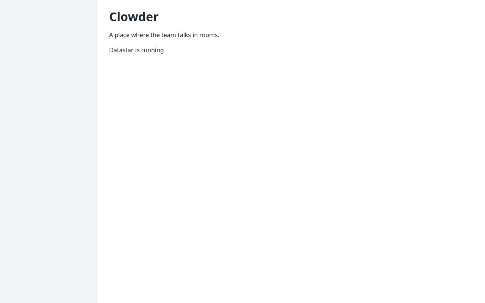
  The home page in the base layout (grey sidebar, main column) with "Datastar is running", text set by `datastar.js` in place of the server's "Datastar is not running".
- **Manual checks:** none
- **Deviations and follow-ups:** The harness is Unix-only (`Setpgid`, `syscall.Kill`). Servers started by the harness get `-base-url http://127.0.0.1` without the port, since the port is known only after start: `TODO(step 2.2)`. `-as` of the proof tool is accepted and ignored until step 2.4.

## 1.1 Clock and the store

- **Date:** 2026-10-26
- **Branch:** feat/step-1.1-clock-and-store
- **Summary:** `internal/clock` has the real clock and a concurrency-safe fake. `internal/store` opens SQLite through the pure-Go driver with `busy_timeout(5000)`, `foreign_keys(1)`, `synchronous(NORMAL)`, WAL and `_txlock=immediate`, with GORM's `NowFunc` from the clock, translated duplicate-key errors and a logger that reports only slow queries without their arguments. It migrates (models, then raw SQL migrations recorded in `schema_migrations`), runs transactions (nested ones as savepoints), and tags `NotFound`, `Conflict` and `QueryFailed` where they appear. `storetest.Open` gives each test its own in-memory database. `clowder serve` opens and closes `<data>/clowder.db`.
- **Main files:** `internal/clock/clock.go`, `internal/store/{store,errors,migrate,logger}.go`, `internal/store/storetest/storetest.go`, `cmd/clowder/serve.go`.
- **Tests:** pragmas on every connection, foreign keys enforced, DSN building, idempotent migrations, raw migrations once and in order, failed migration rolled back, invalid migrations, open/close failures, `Tx` (commit, error, inner route kept, panic, begin failure, nesting), the three store tags with routes, 8 concurrent writers (fails with `_txlock=deferred`, so it tests the immediate lock), the fake clock in `CreatedAt`/`UpdatedAt`, the logger, `storetest` isolation, `serve` opening and closing the database.
- **Checks:** gofmt ✅ · go vet ✅ · golangci-lint ✅ (both tag sets) · go test -race ✅ · CGO_ENABLED=0 build ✅ · go generate clean ✅ · browser tests ✅ · no process left ✅
- **Proof:** none
- **Manual checks:** none
- **Deviations and follow-ups:** In-memory databases skip WAL and use one connection (shared-cache locks by table). Times are stored in the driver's text format in UTC; ordering by them works because every time is UTC, but feeds should order by ID. The driver's `_time_format` parameter must not be added: it makes the driver skip `_txlock`. `TODO(step 2.2)`: pass services built on the store to `web.New`.

## 1.2 Models

- **Date:** 2026-10-26
- **Branch:** feat/step-1.2-models
- **Summary:** The 21 models of SPEC §6.3 exist in `internal/store` and are migrated by `AutoMigrate`, with AUTOINCREMENT IDs, `CreatedAt` from the clock, string enums guarded by named CHECK constraints, the unique constraints of §6.3 (room names case-insensitive with `COLLATE NOCASE`), 43 foreign keys with the delete actions §7 implies (rooms and posts cascade, users restrict, replies and read markers set null, audit events keep no link to their room or entity), and named indexes for the feeds, threads, board, notifications, messages and the audit log.
- **Main files:** `internal/store/{users,rooms,posts,tasks,notifications,messages,audit,models}.go`, `internal/store/store.go`; SPEC §6.3 `Post.DeletedAt`.
- **Tests:** 109 cases: round trip of every model, 16 unique constraints, 17 CHECK constraints, every FK and index compared with `PRAGMA` output, `EXPLAIN QUERY PLAN` of 14 queries of §7 using their indexes, cascades of rooms, posts, columns, conversations and messages, 13 RESTRICT cases on users, idempotent migration, IDs never reused.
- **Checks:** gofmt ✅ · go vet ✅ · golangci-lint ✅ (both tag sets) · go test -race ✅ · CGO_ENABLED=0 build ✅ · go generate clean ✅ · browser tests ✅ · no process left ✅
- **Proof:** none
- **Manual checks:** none
- **Deviations and follow-ups:** FKs are declared through relation fields (`Room *Room`) that are never loaded or saved. A top-level post has no `RootID` (a CHECK keeps `ParentID` and `RootID` both set or both null). `AddedBy` is null when a user joined or started a conversation on their own. `Task.DueDate` is midnight UTC. Audit actions are constants without a CHECK. GORM translates an insert's FK violation to `gorm.ErrForeignKeyViolated` but not a RESTRICT on delete: step 2.2 decides how `classify` treats them. The test model `widget` stays for the 1.1 tests that need `UpdatedAt`.

## 2.1 Passwords and tokens

- **Date:** 2026-10-26
- **Branch:** feat/step-2.1-passwords-and-tokens
- **Summary:** `internal/auth` hashes passwords with argon2id (64 MiB, 3 passes, 2 threads) into PHC strings and verifies them with the parameters stored in the hash, rejecting malformed or absurd hashes with `PasswordHashMalformed` and other algorithms or versions with `PasswordHashUnsupported`. It makes 32-byte base64url tokens, hashes them with SHA-256 and compares in constant time.
- **Main files:** `internal/auth/password.go`, `internal/auth/token.go`.
- **Tests:** 10 hash/verify cases, the PHC format, salting, the default parameters, 28 malformed hashes with their routes, tag sentinels, token length, alphabet and uniqueness, SHA-256 vectors, constant-time comparison.
- **Checks:** gofmt ✅ · go vet ✅ · golangci-lint ✅ (both tag sets) · go test -race ✅ · CGO_ENABLED=0 build ✅ · go generate clean ✅ · browser tests ✅ · no process left ✅
- **Proof:** none
- **Manual checks:** none
- **Deviations and follow-ups:** A stored hash is refused above 1 GiB of memory, 100 passes, 64 threads or 1024-byte salts and keys. The salt and token generation tags have no route test: `crypto/rand` cannot be made to fail. `FastHasher` is for tests only.

## 2.2 Accounts service and invitations

- **Date:** 2026-10-26
- **Branch:** feat/step-2.2-accounts-service
- **Summary:** `internal/app` has the `Actor`, the public tags of SPEC §9.1 and the `Accounts` service: invitations (admin-made, or system-made by the command line), invitation checks (unknown, used and expired all answer `NotFound`), sign-up in one transaction with the rules of §7.1, the users list, role changes and disabling (admins only; the last active admin keeps the role and cannot be disabled; an admin cannot disable themselves; disabling deletes sessions). `clowder invite -admin|-member` prints a link; `clowder demo` creates the demo users `admin`, `alice`, `bob`, `carol`.
- **Main files:** `internal/app/{app,accounts}.go`, `internal/store/users_queries.go`, `internal/store/users.go` (`Invitation.CreatedBy` nullable), `cmd/clowder/{invite,demo,main}.go`.
- **Tests:** about 113 cases in `internal/app` (validation tables, single use, expiry, taken username including two concurrent sign-ups, last-admin rules, permission tables, routes), about 70 new in `internal/store`, about 30 new in `cmd/clowder`.
- **Checks:** gofmt ✅ · go vet ✅ · golangci-lint ✅ (both tag sets) · go test -race ✅ · CGO_ENABLED=0 build ✅ · go generate clean ✅ · browser tests ✅ · no process left ✅
- **Proof:** none (manual runs of `clowder demo` and `clowder invite -admin` printed the users and a link)
- **Manual checks:** none
- **Deviations and follow-ups:** `app.TagNotFound` and `app.TagConflict` are the store's tag strings, so store errors reach the web layer untouched (R3) and still match the app's tags. Validation problems travel as one `InvalidInput` error with a `fields` map. `clowder invite` also takes `-invitation-lifetime`. A disabled user never becomes an `Actor` (no session), so the permission tables cover admin, member and empty actors. `TagUnauthenticated` gets its route test in step 2.3.

## 2.3 Sessions, login and sign-up pages

- **Date:** 2026-10-26
- **Branch:** feat/step-2.3-sessions-login-signup
- **Summary:** People log in, sign up from an invitation link and log out. `Accounts` gained `Login` (one answer for unknown users, wrong passwords and disabled users, a dummy hash check for timing, expired sessions of the user deleted), a login limiter (5 failures per username or IP in 15 minutes → `RateLimited`), `SessionActor` (sliding expiry written at most once a minute, expired sessions deleted) and `Logout`. The web layer has the session cookie (HttpOnly, SameSite=Lax, Secure by config, re-sent when the session slides), routes protected by default, redirects to `/login?next=` with safe `next` paths, SSE redirects for Datastar requests, client IPs from `X-Forwarded-For` only with `-trust-proxy`, and the error-to-status mapping of SPEC §9.1. Forms submit with Datastar and get their field errors patched in place.
- **Main files:** `internal/app/{sessions,limiter}.go`, `internal/web/{session,errors,login,signup}.go`, `internal/web/views/{auth,sidebar}.templ`, `internal/config/config.go`, `internal/browsertest` (`InviteMember`, `Fill`), `cmd/clowder-proof` (`-invite`, `-fill`, `-click`).
- **Tests:** about 330 cases: login, limiter, sessions and their routes in `app`; the session queries in `store`; pages, login, sign-up, logout, cookie flags and sliding, `next` validation (17 rows), client IPs (15 rows), protected routes, cross-origin refusals and error mapping in `web`; browser tests logging in and signing up through the Datastar forms.
- **Checks:** gofmt ✅ · go vet ✅ · golangci-lint ✅ (both tag sets) · go test -race ✅ · CGO_ENABLED=0 build ✅ · go generate clean ✅ · browser tests ✅ · no process left ✅
- **Proof:**
  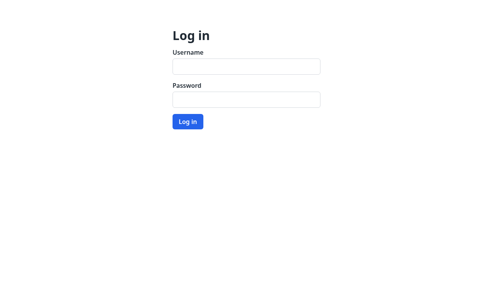
  The login page: "Log in", username and password fields, the button, no sidebar.
  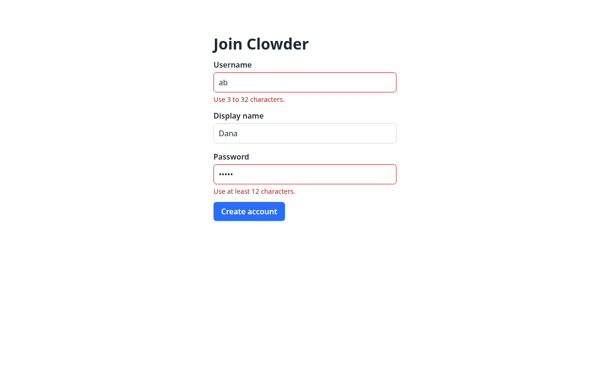
  The sign-up form after a real Datastar submit of `ab` / `Dana` / `short`: the username and password fields are red with "Use 3 to 32 characters." and "Use at least 12 characters." under them, and the display name keeps "Dana".
- **Manual checks:** none
- **Deviations and follow-ups:** A Datastar request that fails gets 200 with the patched errors, because `datastar.js` drops the body of other statuses; full pages and plain form posts get 422/429/404 (written into SPEC §9.1). A refused form keeps what the user typed in the password field (Datastar's morph); the server never sends it back. SPEC §11 gained `-trust-proxy`.

## 2.4 Admin users page and logged-in proofs

- **Date:** 2026-10-27
- **Branch:** feat/step-2.4-admin-users-page
- **Summary:** Admins manage users at `/admin/users`: role switches, disable and enable (no disable button on their own row), errors such as the last admin shown above the table, and an invitation form that shows the link once with a copy button. Admin pages and their POSTs answer 404 to members. The sidebar shows the user's name, Home, Admin (admins only) and Log out. Test servers now get a real base URL (a free port is chosen first, retried once if taken), and `browsertest.LogIn` and `clowder-proof -as` log in through the login form.
- **Main files:** `internal/web/admin.go`, `internal/web/views/admin.templ`, `internal/web/views/sidebar.templ`, `internal/browsertest/{server,login}.go`, `cmd/clowder-proof/main.go`, `internal/app/app.go` (`Role` alias), `internal/app/accounts.go` (`User.IsAdmin`).
- **Tests:** admin page handler tests (page, 404s for members on every route, each action by Datastar and plain post, every failure message, invitations whose links sign up with the chosen role), sidebar views, `User.IsAdmin`, free port and bind retries, `LogIn`; browser tests: alice's sidebar and 404 on the admin page; an admin disables and enables carol, meets the last-admin message, copies an invitation link and opens it in a second browser.
- **Checks:** gofmt ✅ · go vet ✅ · golangci-lint ✅ (both tag sets) · go test -race ✅ · CGO_ENABLED=0 build ✅ · go generate clean ✅ · browser tests ✅ · no process left ✅
- **Proof:**
  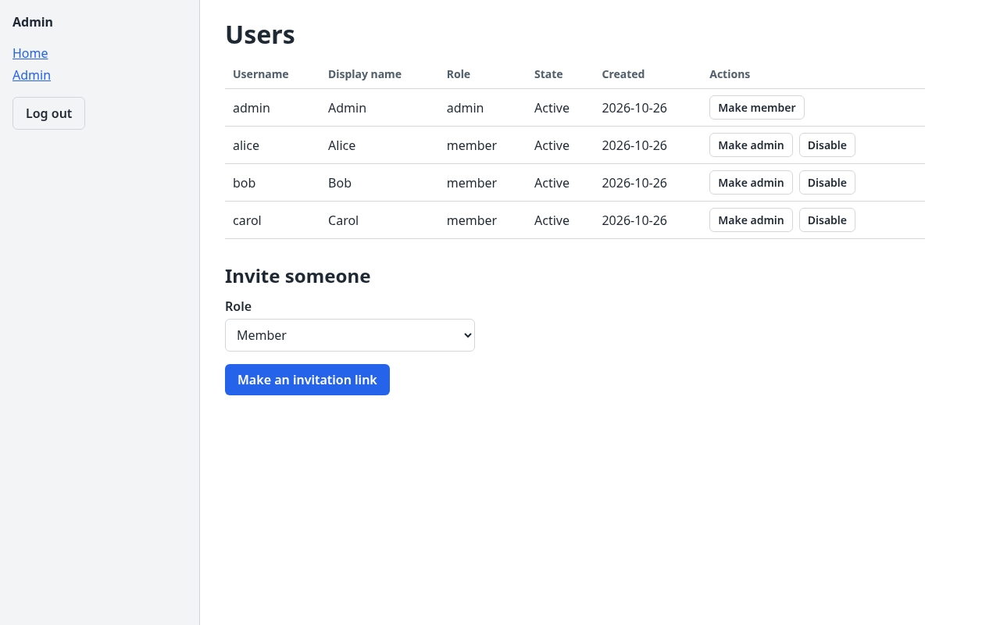
  The admin's view of `/admin/users`: the sidebar (Admin, Home, Admin, Log out), the four demo users with role, "Active" and date, "Make member" on the admin's own row and "Make admin" / "Disable" on the others, and the "Invite someone" form.
- **Manual checks:** none
- **Deviations and follow-ups:** `app.Role` is an alias of `store.Role` (with `RoleAdmin`, `RoleMember`) so that `internal/web` never imports `internal/store`. The admin's own row keeps its role switch, which is how the last-admin rule is reached from the page.

## 3.1 Audit log core

- **Date:** 2026-10-27
- **Branch:** feat/step-3.1-audit-log-core
- **Summary:** Services can record audit events inside their own transactions (`recordAudit`: actor, action, room, entity, a summary readable on its own, JSON details with old and new values, never the text of a body), and admins read them with `Audit.Events`: filters by room, actor, entity type, action and time range, 50 per page, newest first, with the actor's names and the details decoded. The action and entity-type constants are re-exported from `app` so the web layer never imports the store.
- **Main files:** `internal/app/audit.go`, `internal/store/audit_queries.go`.
- **Tests:** about 40 store cases (each filter alone and combined, time bounds, paging, routes, index use) and about 70 app cases (commit and rollback, body details without text, JSON round trip, 14 filter rows, paging at 0/49/50/51/101 events, page numbers, actor names, deleted rooms, permission table, error routes).
- **Checks:** gofmt ✅ · go vet ✅ · golangci-lint ✅ (both tag sets) · go test -race ✅ · CGO_ENABLED=0 build ✅ · go generate clean ✅ · browser tests ✅ · no process left ✅
- **Proof:** none
- **Manual checks:** none
- **Deviations and follow-ups:** Pages are numbered from 1 (a smaller number means 1; a page above 1,000,000 is empty without a query). The time range includes its start and excludes its end.

## 3.2 Rooms service

- **Date:** 2026-10-27
- **Branch:** feat/step-3.2-rooms-service
- **Summary:** `app.Rooms` creates rooms (visible by admins, private by anyone, with the columns To do / In progress / Done), lists visible rooms, the actor's rooms and (admins) all rooms, and handles join, leave, add member (any member adds any active user), remove member (admins), rename and delete (admins and the creator). A private room stays invisible to non-members, admins included (`NotFound`, D29). Every change writes its `room.*` or `member.*` audit event with a summary in names; no-ops and failures write none. The reading helpers (`loadReadableRoom`, `canRead`, `isMember`) work inside transactions for later services. `clowder demo` creates `general`, `random` and the private `secret` (alice, bob).
- **Main files:** `internal/app/rooms.go`, `internal/store/rooms_queries.go`, `cmd/clowder/demo.go`; SPEC D29.
- **Tests:** a permission table per method (admin, admin outside a private room, creator, member, non-member of visible and private rooms, missing room), validation tables (lengths, Unicode, case-insensitive names), every audit event and none for no-ops and failures, default columns, cascades with the audit events kept, empty private rooms, demo rooms; store queries with their routes. Coverage: app 91 %, store 98 %.
- **Checks:** gofmt ✅ · go vet ✅ · golangci-lint ✅ (both tag sets) · go test -race ✅ · CGO_ENABLED=0 build ✅ · go generate clean ✅ · browser tests ✅ · no process left ✅
- **Proof:** none
- **Manual checks:** none
- **Deviations and follow-ups:** Room names are compared with Unicode case folding in Go (the `NOCASE` index only folds a–z and still catches races). `Update` takes the whole form, so an empty description clears it. Member events use the membership row as their entity. `TODO(step 11.1)`: notify an added member. Decision D29 (made by the manager): admins see every room in the admin list but read private rooms only as members.

## 3.3 Rooms pages

- **Date:** 2026-10-27
- **Branch:** feat/step-3.3-rooms-pages
- **Summary:** Every logged-in page has the sidebar with the user's rooms (private ones with a padlock, the current one highlighted), "Browse rooms" and "New room". `/rooms` lists visible rooms with Join; `/rooms/new` creates a room (members always make private ones); `/rooms/{id}` shows the header with join, leave, rename and delete for those allowed, an empty feed, and the members panel with "added by", an add-member picker of active non-members (`Rooms.Candidates`) and remove buttons for admins. A private room's non-member, admins included, gets 404 on the page and every action. The proof tool resolves `{room:name}` from the sidebar.
- **Main files:** `internal/web/rooms.go`, `internal/web/views/{rooms,sidebar}.templ`, `internal/app/rooms.go` (`Candidates`), `cmd/clowder-proof/main.go`, `internal/web/static/app.css`.
- **Tests:** handler tests for every route as Datastar and plain posts (success, 404 tables for private rooms of others, 403 for members making visible rooms, validation patches, missing rooms, bad IDs, sessions, methods, oversized forms); view tests; `Candidates` permissions and content; browser tests: alice creates "plans", adds bob, bob sees it in his sidebar; carol joins "random" from the browse page; room lookup of the proof tool.
- **Checks:** gofmt ✅ · go vet ✅ · golangci-lint ✅ (both tag sets) · go test -race ✅ · CGO_ENABLED=0 build ✅ · go generate clean ✅ · browser tests ✅ · no process left ✅
- **Proof:**
  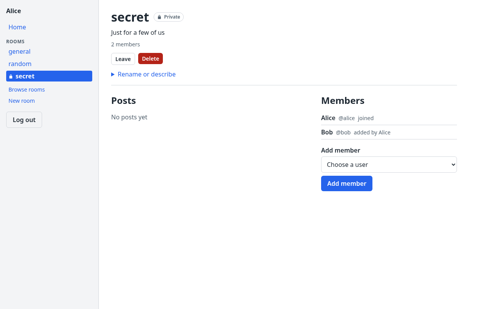
  Alice's view of `secret`: her sidebar with general, random and the highlighted, padlocked secret; the header with the Private badge, "Just for a few of us", 2 members, Leave and Delete, "Rename or describe"; "No posts yet"; the members Alice ("joined") and Bob ("added by Alice") with the add-member picker.
- **Manual checks:** none
- **Deviations and follow-ups:** Admins manage private rooms they are not in only from the admin rooms page of step 3.4 (D29); the `/rooms/{id}/…` routes answer 404 to them. A Datastar action on a room that is gone or hidden redirects to the room's URL, which shows the 404 page. Leaving goes to `/rooms`. Error pages have no sidebar. `TODO(step 4.3)`: the feed.

## 3.4 Audit log page and admin rooms

- **Date:** 2026-10-27
- **Branch:** feat/step-3.4-audit-and-admin-rooms
- **Summary:** The admin pages share a tab bar (Users, Rooms, Audit log). `/admin/rooms` lists every room, private ones included (D29), with visibility, members, creator and date, and lets admins rename, delete and open the members list to remove members (`Rooms.AdminMembers`). `/admin/audit` shows the audit events newest first with actor, room (a link while the room exists, "(deleted)" after), action, summary and a details table of old and new values (a body change shows only its length); filters by room, actor, entity type, action and UTC dates update the table with Datastar and keep a shareable URL; Newer/Older links keep the filters. Members get 404 on all of it.
- **Main files:** `internal/web/{admin_rooms,admin_audit}.go`, `internal/web/views/{admin_rooms,admin_audit,admin}.templ`, `internal/web/views/audit.go`, `internal/app/rooms.go` (`AdminMembers`), `cmd/clowder/serve.go`.
- **Tests:** `AdminMembers` permissions and content; admin rooms page (all rooms, members toggle, rename, delete, remove, gone rooms, 404s for members in both modes); audit page (rows, links, details, body-change shape, 17 filter cases, date edges, paging over 130 events, Datastar patch with URL, 404s, 405s); views; browser tests: the admin filters the log by alice, removes bob from `secret` and finds "Admin removed Bob from #secret"; a member meets 404s.
- **Checks:** gofmt ✅ · go vet ✅ · golangci-lint ✅ (both tag sets) · go test -race ✅ · CGO_ENABLED=0 build ✅ · go generate clean ✅ · browser tests ✅ · no process left ✅
- **Proof:**
  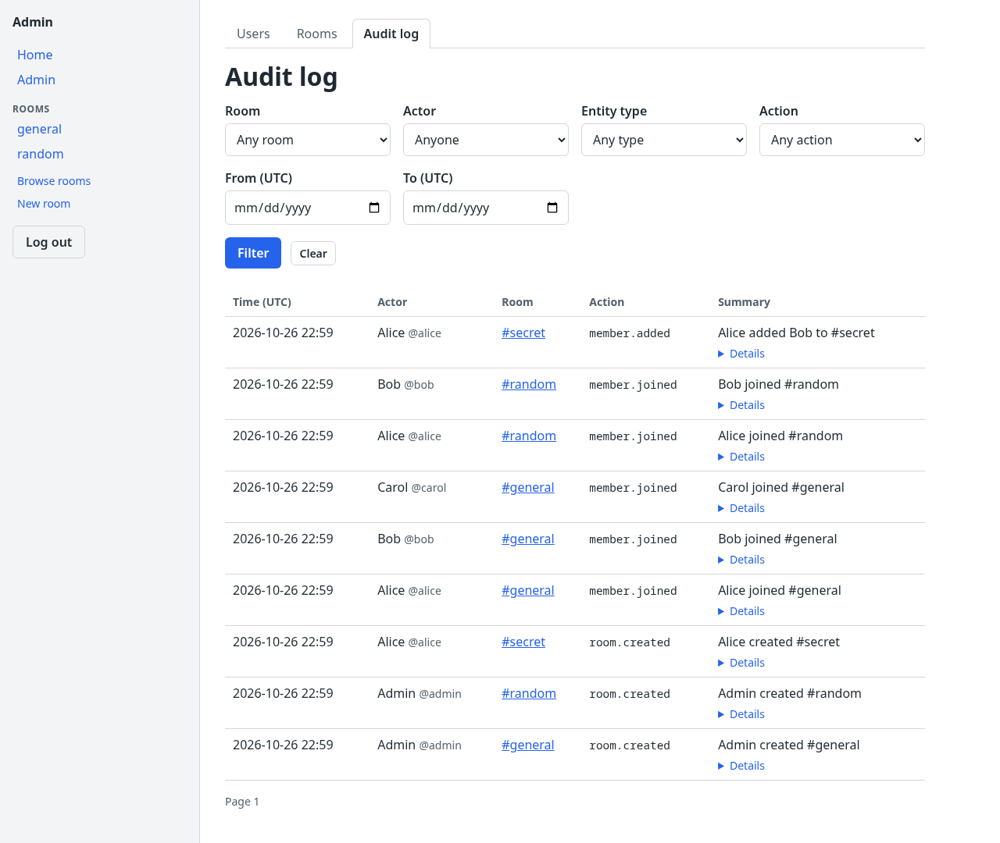
  The audit log of the demo data (1280×1080): the tab bar, the filter form, and the nine events from "Admin created #general" to "Alice added Bob to #secret", with room links and Details toggles.
  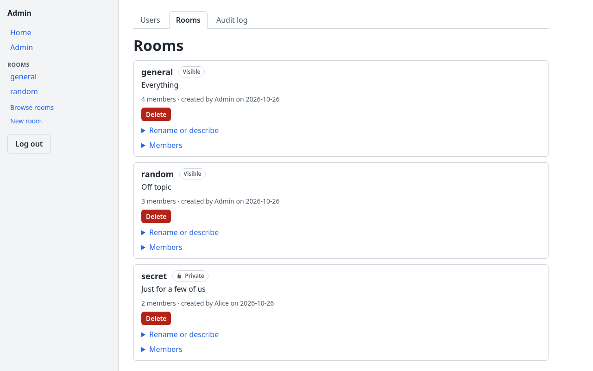
  The admin rooms list: general (Visible, 4 members), random (Visible, 3 members) and secret (Private, 2 members, created by Alice), each with Delete, Rename or describe and Members.
- **Manual checks:** none
- **Deviations and follow-ups:** The audit proof was taken at 1280×1080 so all nine events fit. After a rename, the row's members list closes.

## 4.1 Markdown and text rendering

- **Date:** 2026-10-27
- **Branch:** feat/step-4.1-markdown
- **Summary:** `internal/markdown` renders bodies safely. Markdown goes through goldmark with GFM in safe mode (raw HTML omitted), with its own renderers for links (only http, https, mailto and relative; `rel="nofollow noopener noreferrer"`, `target="_blank"`; other schemes keep their text), images (only http(s), lazy), and headings (shifted down two levels, no ids); task-list boxes are disabled. Text is escaped with paragraphs, line breaks and linked http(s) URLs. `Mentions` returns the `@usernames` of a body, skipping code, link destinations and e-mail addresses.
- **Main files:** `internal/markdown/{doc,markdown,text}.go`.
- **Tests:** 208 cases: 20 markdown features, a 50-row injection table checked by parsing the output's tags and attributes against an allow-list, dropped links, link attributes, 30 text cases and 8 text injections, the unknown-format route, 69 mention cases, 64 concurrent renders under `-race`.
- **Checks:** gofmt ✅ · go vet ✅ · golangci-lint ✅ (both tag sets) · go test -race ✅ · CGO_ENABLED=0 build ✅ · go generate clean ✅ · browser tests ✅ · no process left ✅
- **Proof:** none
- **Manual checks:** none
- **Deviations and follow-ups:** A backslash before `@` cancels a mention. In the text format a mention inside a URL counts (the whole body is scanned, as specified).

## 4.2 Posts service

- **Date:** 2026-10-27
- **Branch:** feat/step-4.2-posts-service
- **Summary:** `app.Posts` creates posts (members of the room; text or markdown; up to 20,000 characters; up to 10 normalized tags), edits them (author only, `EditedAt` from the clock, tags replaced), deletes them (author or admin; a post with replies stays as an empty "deleted" placeholder without tags, reactions, mentions or attachments, D21), lists a room's feed (top-level posts newest first, 30 a page, cursor by ID) and suggests tags from rooms the actor can read. Views carry the rendered HTML, tags, comment count and what the actor may do. Every change writes its audit event without the body text. `clowder demo` writes 8 posts.
- **Main files:** `internal/app/posts.go`, `internal/store/posts_queries.go`, `cmd/clowder/demo.go`.
- **Tests:** permission tables for every method (failures write no audit event), 28 validation rows, edit audit cases with the body never in the stored JSON, D21 with and without replies, feed paging at 0/30/31/61/120 posts, HTML by format, 15 tag-suggestion cases; store queries with the feed's query plan and 21 failure routes; demo posts.
- **Checks:** gofmt ✅ · go vet ✅ · golangci-lint ✅ (both tag sets) · go test -race ✅ · CGO_ENABLED=0 build ✅ · go generate clean ✅ · browser tests ✅ · no process left ✅
- **Proof:** none
- **Manual checks:** none
- **Deviations and follow-ups:** `FeedPage.NextBefore` gives the next cursor. Edit compares tags as sets (a reorder alone is no change). Tag suggestions match the prefix literally (no wildcards). `TODO(step 6.1)`: remove attachment files on delete; `TODO(step 9.1)`: tasks of a kept placeholder; `TODO(step 7.1)`: live events; `TODO(step 11.1)`: mentions.

## 4.3 Editor and feed

- **Date:** 2026-10-27
- **Branch:** feat/step-4.3-editor-and-feed
- **Summary:** Members write posts in a room with the editor (body, Markdown/Text switch, a server-rendered preview, a separate tags field with suggestions; field errors shown in place with the input kept). The room page shows the feed newest first, 30 at a time, and loads older posts when the end comes into view (`data-on-intersect__once` on a sentinel; an "Older posts" link without JavaScript). Posts show author, time, "edited", the rendered body, tag links to the search, the comment count, and edit in place and delete for those allowed. Each post has its own page. Non-members of a visible room are asked to join; private rooms of others answer 404.
- **Main files:** `internal/web/posts.go`, `internal/web/views/{posts.templ,posts.go,rooms.templ}`, `internal/app/posts.go` (`Preview`), `internal/web/login.go` (`parseBodyForm`, 512 KB), `cmd/clowder/serve.go`.
- **Tests:** about 150 cases: create, validation, preview, tag suggestions with private-room exclusion, feed paging and sentinel, edit/cancel/save, delete with and without replies, the post page, every route for non-members and without login, form size; view tests including escaping; browser tests: alice previews, uses a tag suggestion, posts markdown with two tags, edits and deletes it; 35 seeded posts load 30 then 40 on scroll.
- **Checks:** gofmt ✅ · go vet ✅ · golangci-lint ✅ (both tag sets) · go test -race ✅ · CGO_ENABLED=0 build ✅ · go generate clean ✅ · browser tests ✅ · no process left ✅
- **Proof:**
  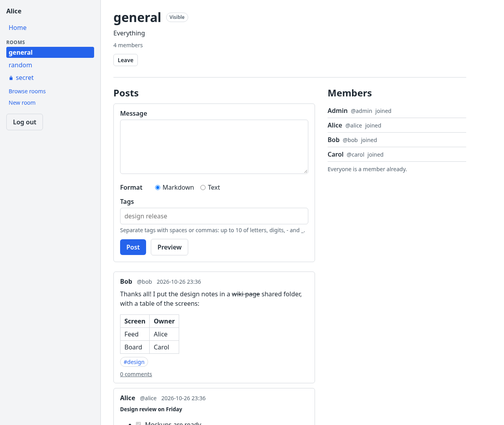
  Alice's view of `general`: the editor with the Markdown/Text switch, tags field, Post and Preview; the members panel; Bob's post rendered with strikethrough, a table and a `#design` tag, and Alice's post below it.
- **Manual checks:** none
- **Deviations and follow-ups:** `Posts.Preview` was added so the web layer never renders markdown itself. Post forms accept up to 512 KB (a 20,000-character body of 4-byte characters). Cancel uses `GET /posts/{id}/view`. `TODO(step 5.2)`: the thread on the post page.

## 5.1 Comments service

- **Date:** 2026-10-27
- **Branch:** feat/step-5.1-comments-service
- **Summary:** `Posts.Reply` writes comments under a post or another comment to any depth, with the same body, format and tag rules, as `Post` rows with `ParentID` and `RootID`. `Posts.Thread` returns a post's whole thread (asked by the post or any comment, which becomes the focus) as a depth-first list, siblings oldest first, with each comment's depth and the author it answers, from one query. Edit and delete work for comments with `comment` audit events; deleting a row also removes deleted placeholders left without replies, up to the post itself. Comment counts skip deleted rows. `clowder demo` writes two threads (three and four levels deep) with a deleted comment kept for its reply.
- **Main files:** `internal/app/posts.go`, `internal/store/posts_queries.go` (`ThreadComments`), `cmd/clowder/demo.go`.
- **Tests:** about 92 cases: permission tables for `Reply`, `Thread`, `Edit`, `Delete`, `Get` on comments; 15 validation rows; replies to deleted rows; `RootID`/`ParentID` at depths 1–4; tree order for seven shapes and the focus; placeholders and six clean-up chains with one audit event per delete; comment counts; store ordering and routes; demo threads.
- **Checks:** gofmt ✅ · go vet ✅ · golangci-lint ✅ (both tag sets) · go test -race ✅ · CGO_ENABLED=0 build ✅ · go generate clean ✅ · browser tests ✅ · no process left ✅
- **Proof:** none
- **Manual checks:** none
- **Deviations and follow-ups:** Clean-ups of empty placeholders write no audit event (their deletion was already recorded). `TODO(step 7.1)`: live events; `TODO(step 11.1)`: reply and mention notifications.

## 5.2 Threads in the UI

- **Date:** 2026-10-27
- **Branch:** feat/step-5.2-threads-ui
- **Summary:** A post's page shows its whole thread: comments indented by depth up to 6 with guide lines, deeper ones capped with "replying to @user", deleted comments as "This comment was deleted." with their replies below. A comment's link opens its root's thread with that comment highlighted and scrolled into view. Every item has Reply, which opens the editor in place; a new comment re-renders the thread at its place. Edit and delete work for comments and keep their indentation; deleting re-renders the thread (placeholders appear or are cleaned up). Feed counts read "N comments" and link to the thread. The proof tool resolves `{post:<text>}`.
- **Main files:** `internal/web/{posts,server}.go`, `internal/web/views/{posts.templ,posts.go}`, `internal/web/static/app.css`, `cmd/clowder-proof/main.go`.
- **Tests:** thread order and depth classes, depth capped at 6, focus by comment ID, reply form and replies in both modes with errors, non-members (no Reply, 403), private rooms of others (404 for every route, admins too), delete with placeholder and clean-up, comment edits; view tests for every comment card variant; browser tests: bob and carol reply in a thread down to depth 4; a comment link focuses its comment in view.
- **Checks:** gofmt ✅ · go vet ✅ · golangci-lint ✅ (both tag sets) · go test -race ✅ · CGO_ENABLED=0 build ✅ · go generate clean ✅ · browser tests ✅ · no process left ✅
- **Proof:**
  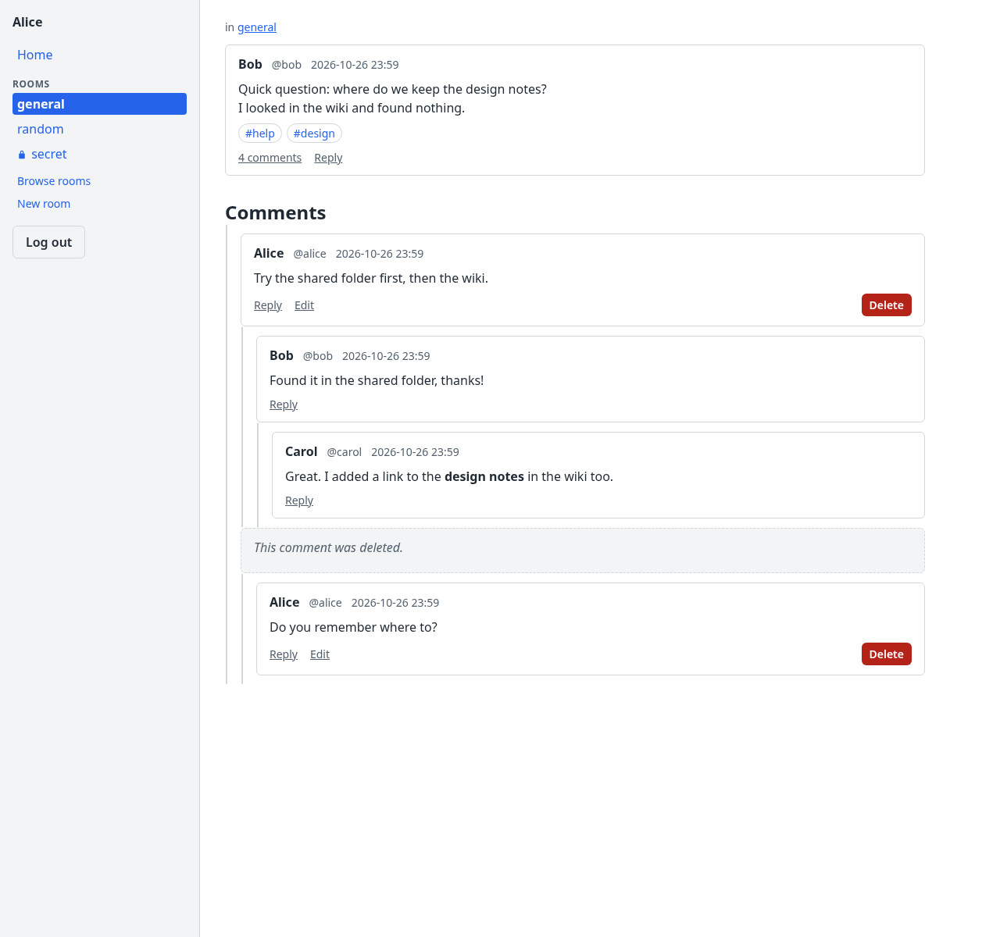
  Alice's view of Bob's "where do we keep the design notes" post: alice's comment, bob's reply and carol's reply indented one level more each, the dashed "This comment was deleted." placeholder, and alice's reply to it below.
- **Manual checks:** none
- **Deviations and follow-ups:** A focused comment is scrolled into view with `data-init` (no scroll plugin in `datastar.js` v1.0.2). Re-rendering the thread after a reply or delete closes any other open editors in it.

## 6.1 Attachment storage and service

- **Date:** 2026-10-27
- **Branch:** feat/step-6.1-attachments-service
- **Summary:** `internal/files` stores uploads under `<data>/files` by random 64-hex keys (validated before any disk access), writes through a temp directory cleaned at start, stops one byte past the size limit (`TooLarge`), sniffs the content type and reads image sizes (PNG, JPEG, GIF, and WebP from its header). `Posts.Upload` saves a file with a cleaned name; posts and comments take uploads (at most 10 per post; the body may be empty when there are attachments), edits keep or remove attachments, and `Posts.Attachment` opens a file for readers of its room only. No orphan files: a failed call removes its uploads, and the files of edited-out attachments, deleted posts, cleaned placeholders and deleted rooms are removed after the commit. Audit details count attachments and list added and removed names. `clowder demo` attaches a PNG and a text file.
- **Main files:** `internal/files/files.go`, `internal/app/{attachments,posts,rooms}.go`, `internal/store/attachments.go`, `cmd/clowder/{serve,demo}.go`.
- **Tests:** files (limits, sniffing and sizes for every type, bad keys including traversal, temp clean-up, cancellation, every route); store queries; app (name cleaning, uploads, limits, empty bodies, failures removing uploads, forged uploads, keep/remove on edit, file removal for posts, chains and rooms, the `Attachment` permission table, views); demo files.
- **Checks:** gofmt ✅ · go vet ✅ · golangci-lint ✅ (both tag sets) · go test -race ✅ · CGO_ENABLED=0 build ✅ · go generate clean ✅ · browser tests ✅ · no process left ✅
- **Proof:** none
- **Manual checks:** none
- **Deviations and follow-ups:** A file that sniffs as an image but whose header cannot be read is stored as `application/octet-stream`. Upload keys are checked to exist with their size and to be unused, so a forged key cannot take or delete another post's file. Failed removals after a commit are logged. Step 6.2 maps `TooLarge` to 413.

## 6.2 Upload and download

- **Date:** 2026-10-27
- **Branch:** feat/step-6.2-upload-download
- **Summary:** The editor sends files as `multipart/form-data` (Datastar sends the form's `FormData`; the form also works without JavaScript); handlers stream the parts to `Posts.Upload` under a whole-request cap, refuse more than the allowed number of files, map `TooLarge` to a field error and 413, and discard saved uploads when they stop early. Editing lists the current attachments with remove boxes. `GET /files/{id}/{name}` serves files to readers of the room only, inline for PNG, JPEG, GIF and WebP and as downloads (`application/octet-stream`) for everything else, with `nosniff`, a sandboxing CSP, RFC 5987 file names, private caching, ranges and `Last-Modified`. Posts and comments show images inline at their stored size (lazy) and other files as links with sizes.
- **Main files:** `internal/web/{uploads,files,posts,errors,server}.go`, `internal/web/views/{posts.templ,posts.go}`, `internal/app/attachments.go` (`DiscardUploads`, `CreatedAt`).
- **Tests:** about 220 cases: multipart create, reply and edit in both modes, empty bodies with files, keep/remove/add, too large (413, nothing left on disk), too many, the request cap, preview without files; download headers per type including fake images and SVG, file names, ranges, 304, HEAD, permission table, deleted posts, missing blobs; views; browser test: alice attaches a PNG and a text file, sees the image at its size, removes the file by editing; carol gets 404 on a `secret` file.
- **Checks:** gofmt ✅ · go vet ✅ · golangci-lint ✅ (both tag sets) · go test -race ✅ · CGO_ENABLED=0 build ✅ · go generate clean ✅ · browser tests ✅ · no process left ✅
- **Proof:**
  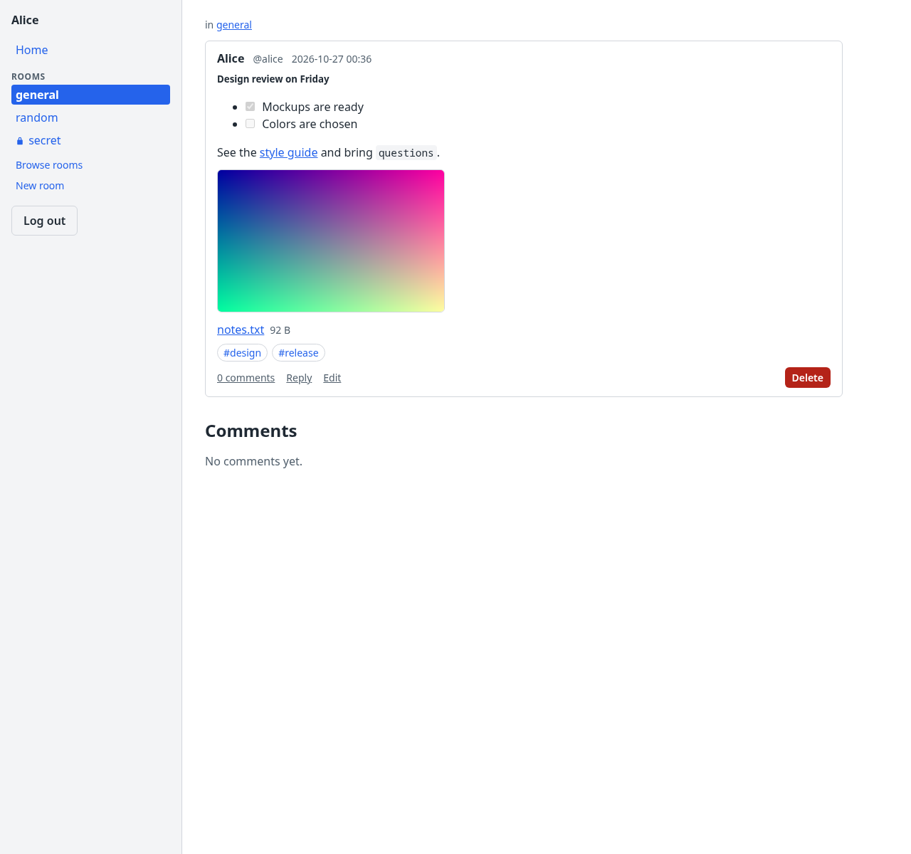
  The demo post "Design review on Friday": the rendered markdown, the 320×200 gradient PNG inline, the `notes.txt` link with "92 B", and the tags.
- **Manual checks:** none
- **Deviations and follow-ups:** The Preview button disables the file input around its request, so previews never upload files. Kept attachments are sent as hidden `keep` fields minus the ticked `remove` boxes. A request over the cap is answered like a file over the limit.

## 7.1 The hub

- **Date:** 2026-10-27
- **Branch:** feat/step-7.1-live-hub
- **Summary:** `internal/live` has the event hub: events carry only a topic, a kind and IDs; `Publish` never blocks and delivers to the subscribers of the topic; each subscription has a buffer of 64 and is closed (`Dropped`) when it fills, so a slow page reconnects instead of holding the hub; cancelling the context or `Close` removes it; the hub runs no goroutines. `Rooms` and `Posts` publish their events (posts and comments to the room and thread topics, memberships to the room and the affected user, room updates and deletions to the room and every former member) only after their transaction committed. `serve` owns one hub and closes it after the server stops. A `Recorder` serves tests.
- **Main files:** `internal/live/{event,hub,recorder}.go`, `internal/app/{publish,rooms,posts}.go`, `cmd/clowder/serve.go`.
- **Tests:** hub fan-out, topics, order, the buffer boundary (64 fit, the 65th drops), cancellation, closing, non-blocking publish, heavy concurrency under `-race`, no goroutine leak; 62 service cases (every publishing method, no-ops and failures publish nothing), publishing only after commit (mutation-checked), store errors publish nothing.
- **Checks:** gofmt ✅ · go vet ✅ · golangci-lint ✅ (both tag sets) · go test -race ✅ · CGO_ENABLED=0 build ✅ · go generate clean ✅ · browser tests ✅ · no process left ✅
- **Proof:** none
- **Manual checks:** none
- **Deviations and follow-ups:** When a clean-up removes the root post, the room gets `post.deleted` instead of `post.updated`. Creating a room publishes nothing (only its creator is in it). `TODO(step 7.2)`: the SSE streams and closing them on shutdown.

## 7.2 Streams of feeds and threads

- **Date:** 2026-10-27
- **Branch:** feat/step-7.2-live-streams
- **Summary:** Room and post pages open a Datastar SSE stream (`retry: 'always'`, `openWhenHidden: true`) that subscribes before its first write and patches the page per subscriber: new posts at the top (remove-then-prepend, so never a duplicate), edits into a `post-content` wrapper (open reply editors and the author's open edit form are never overwritten), deletions, new comments inserted at their place in thread order, comment counts, members, the member count, the composer, the room header and the sidebar. A reconnection (`Last-Event-ID`) re-renders what can be stale; a first connection catches up only if the page is behind. Lost access, a deleted room or an ended session redirects away and ends the stream. A ping every 25 s keeps proxies open and re-checks the session; shutdown closes the hub so streams end at once. The proof tool can act as a second user (`-other`).
- **Main files:** `internal/web/stream.go`, `internal/web/{server,rooms,posts}.go`, `internal/web/views/{layout,posts,rooms}.templ`, `cmd/clowder/serve.go`, `cmd/clowder-proof/main.go`.
- **Tests:** stream tests over a real `httptest` server (feed, room, thread and sidebar patches, access lost, room deleted, non-members, connect modes, pings, session end, hub close, quick shutdown); browser tests: bob sees alice's post live and alice sees one card; alice's comment reaches bob's thread while his reply editor keeps its text; bob is sent away when removed from `secret`; carol's sidebar follows being added. Also fixed a race in the harness test `TestStopServer` (the fake server's trap now comes before its listen line).
- **Checks:** gofmt ✅ · go vet ✅ · golangci-lint ✅ (both tag sets) · go test -race ✅ · CGO_ENABLED=0 build ✅ · go generate clean ✅ · browser tests ✅ (twice) · no process left ✅
- **Proof:**
  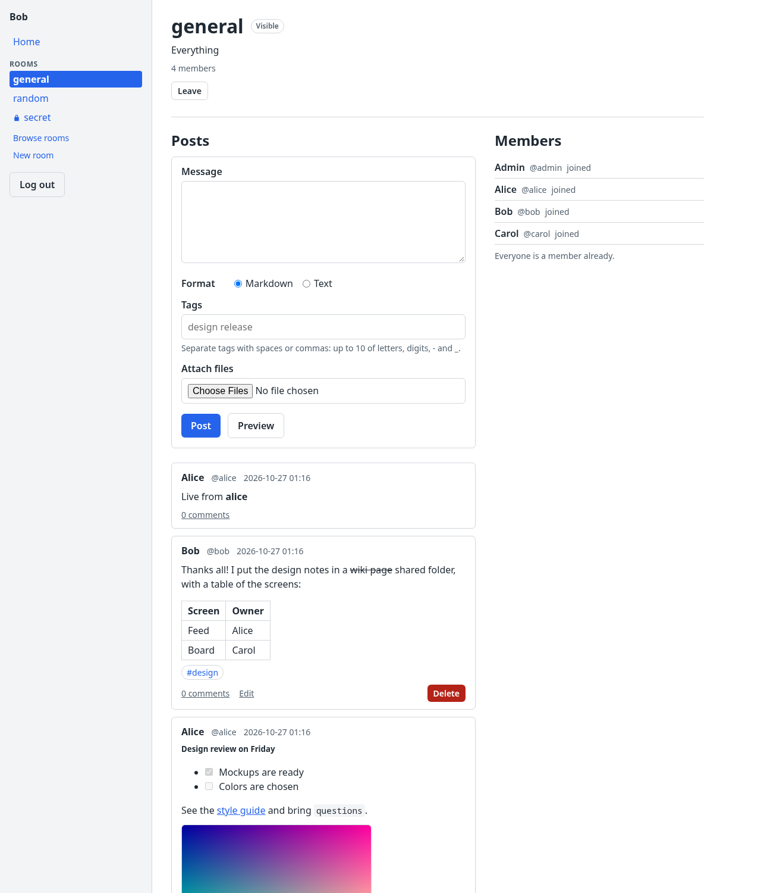
  Bob's view of `general` (1280×1500) after alice posted from another browser: her "Live from **alice**" post at the top of his feed without reload, without Edit/Delete (not his), above his own post which has them.
- **Manual checks:** none
- **Deviations and follow-ups:** The create response also removes-then-prepends, since it can arrive after the stream's event. A reconnection loses loaded older feed pages and open reply editors. Edits made during the gap before a first connection are not caught up (new and removed items are). The keep-alive re-check slides the session while a page is open.

## 8.1 Reactions

- **Date:** 2026-10-27
- **Branch:** feat/step-8.1-reactions
- **Summary:** Members react to posts and comments with an emoji: `Posts.ToggleReaction(ctx, actor, postID, emoji)` adds the (post, user, emoji) row or removes it in one transaction, validates that the emoji is exactly one emoji (trimmed, at most 32 bytes: a unit of an emoji code point with an optional variation selector and skin tone, up to 4 units joined by ZWJ, a flag of two regional indicators, a keycap, or a tag sequence), is not audited, and publishes `reaction.changed` to the room and the thread after the commit. `Post.Reactions` (`ReactionCount{Emoji, Count, Mine, Names}`, ordered by first use) and `Post.CanReact` come with every post of a feed, a thread and `Get`, from one extra query. Every post and comment shows a reaction bar inside its content (chips with counts, highlighted when the viewer reacted, the names as the title; a `<details>` picker of 24 emoji and a field for any emoji); `POST /posts/{id}/reactions` patches `#reactions-N`. The room and post streams re-read the post per subscriber and patch only the chips (`#reactions-N`; the add button and picker are the sibling `#reaction-picker-N`, patched only after the person's own reaction or a mistake in the field), so each viewer sees their own highlighted chips. `clowder demo` adds 13 reactions.
- **Main files:** `internal/app/reactions.go`, `internal/app/posts.go`, `internal/store/reactions.go`, `internal/live/event.go`, `internal/web/{posts,stream,server}.go`, `internal/web/views/{posts.templ,posts.go}`, `internal/web/static/app.css`, `cmd/clowder/demo.go`, `cmd/clowder-proof/main.go`, `docs/SPEC.md` §7.4.
- **Tests:** emoji table (24 picker emoji, skin tones, a family, flags, keycaps, `©️`, about 50 rejected inputs including `👍🎉`, `🇬🇷🇫🇷` and a lone regional indicator, the 32 byte limit); toggle, counts and `Mine` per actor, order by first use, names, post/feed/thread views, the permission table for posts and comments (member, non-member of a visible room 403, private room 404 also for admins), deleted and missing posts, no audit event, events only after commit and none on failure; store queries and failure routes; handler tests for Datastar and plain posts, the picker field error, non-members, comments, bars on the feed and the post page, the 20-name title; stream tests (each subscriber gets their own `Mine`, comments, older pages, thread streams); demo reactions; browser test `TestLiveReactionsReachOtherPages` (alice reacts from the picker, bob and carol see it, bob's open picker and typed text survive alice's reaction, bob clicks it: count 2 and highlighted for him only, a typed emoji, taking it back). About 170 test cases in all.
- **Checks:** gofmt ✅ · go vet ✅ (both tag sets) · golangci-lint ✅ (both tag sets) · go test -race ✅ · go test -tags clowder_browser ✅ · CGO_ENABLED=0 build ✅ · go generate clean ✅
- **Proof:**
  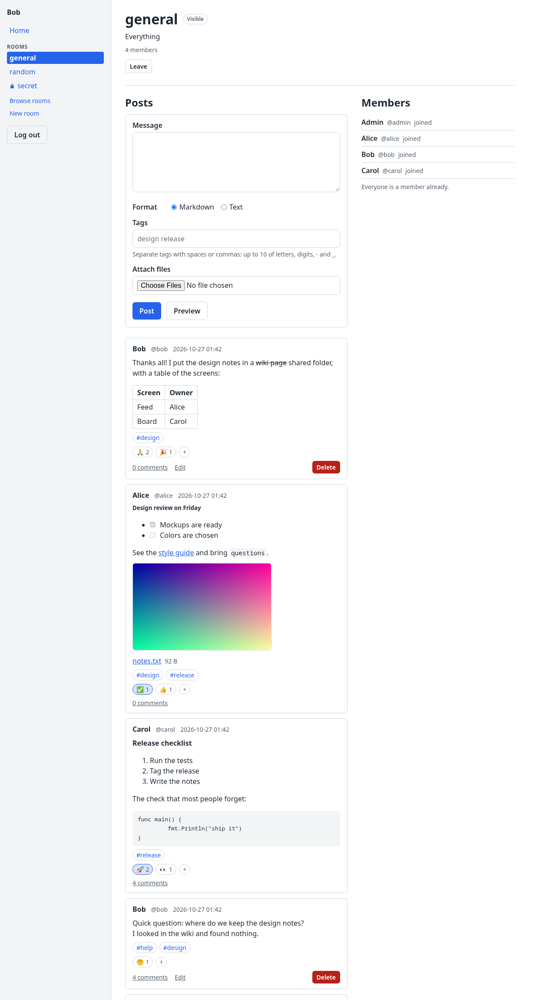
  Bob's view of `general` (1280×2300): the demo's chips under the posts (his own ✅ and 🚀 highlighted) and, on the newest post, the 🎉 chip with count 1 next to the demo's 🙏 2, which alice added from her picker in another browser without a reload.
- **Manual checks:** none
- **Deviations and follow-ups:** The proof tool's `-click` and `-other-click` are now repeatable (a closed picker needs two clicks). A live edit of the post itself (`post-content` patch) still re-renders the picker, which closes it.

## 9.1 Tasks and columns service

- **Date:** 2026-10-27
- **Branch:** feat/step-9.1-tasks-service
- **Summary:** Posts and comments carry tasks (`PostInput.Tasks`: title, assignees who are room members, a due date at midnight UTC; up to 20 per post); new tasks go to the end of the board's first column, edits keep, update, delete and append them by ID, and deleting a post (or keeping it as a placeholder) deletes its tasks. A post may have an empty body when it has tasks. `app.Board` shows a room's board (columns in order with their cards, `Last`, `Overdue` from the clock, `CanEdit`) and lets any member move cards (positions stay dense), update a card's title, assignees and due date, and add, rename, move and delete columns (not one with cards, not the last one; names unique per room). Every change writes its `task.*` or `column.*` audit event with a readable summary and publishes `board.changed` (and the post's update events) after the commit. An assignee who left the room may stay on a task; only new assignees must be members. `clowder demo` adds 9 tasks.
- **Main files:** `internal/app/{tasks,board,posts}.go`, `internal/store/tasks_queries.go`, `internal/live/event.go`, `cmd/clowder/demo.go`.
- **Tests:** task validation, tasks through create/reply/edit/delete and placeholders, former members kept or refused (10 rows), the board view with `Overdue`, permission tables for every board method, a 15-row move table keeping positions dense, column rules, exact audit summaries and details, live events after commit only, store queries, demo tasks.
- **Checks:** gofmt ✅ · go vet ✅ · golangci-lint ✅ (both tag sets) · go test -race ✅ · CGO_ENABLED=0 build ✅ · go generate clean ✅ · browser tests ✅ · no process left ✅
- **Proof:** none
- **Manual checks:** none
- **Deviations and follow-ups:** An edit that changes only tasks counts as a post edit (`EditedAt`, `post.edited` with the tasks added, edited and removed). `DeleteColumn` refuses the last column before checking its cards. No-op moves and patches write and publish nothing. Moving or deleting columns publishes only `board.changed`, so pages showing tasks refresh on it. `TODO(step 11.1)`: notify new assignees. The `internal/app` tests now take about 110 s under `-race`.

## 9.2 Tasks in the editor and in posts

- **Date:** 2026-10-27
- **Branch:** feat/step-9.2-tasks-in-editor
- **Summary:** The editor has a Tasks section: rows with title, assignees (the room's members; a former member already assigned stays selectable, labelled as having left), due date and a hidden ID; "Add task" fetches a new row from `GET /editor/task-row` (Datastar), "remove" drops a row in the page; fields are `tasks[N][id|title|assignees|due]` in both encodings; blank new rows are ignored; errors read "Task N: …" with the rows kept. Editing pre-fills the rows. Posts and comments list their tasks under the body with the column as a badge (done in the last column), assignees, the due date (red when overdue) and a link to the card. Room and thread streams refresh the content of posts with tasks on `board.changed`.
- **Main files:** `internal/web/{tasks,posts,rooms,stream,server}.go`, `internal/web/views/{posts.templ,posts.go}`, `internal/app/board.go` (`TaskCard.Done`), `cmd/clowder/serve.go`.
- **Tests:** create with tasks in both encodings and modes, tasks-only posts, five kinds of task mistakes with routes, row parsing, edit pre-fill and keep/update/remove/add, former members, the task-row route's permissions, display with badges, overdue and done; stream tests for column renames and card moves in rooms and threads; view tests; browser test: alice posts two tasks (one for bob with a due date), then removes one and renames the other.
- **Checks:** gofmt ✅ · go vet ✅ · golangci-lint ✅ (both tag sets) · go test -race ✅ · CGO_ENABLED=0 build ✅ · go generate clean ✅ · browser tests ✅ · no process left ✅
- **Proof:**
  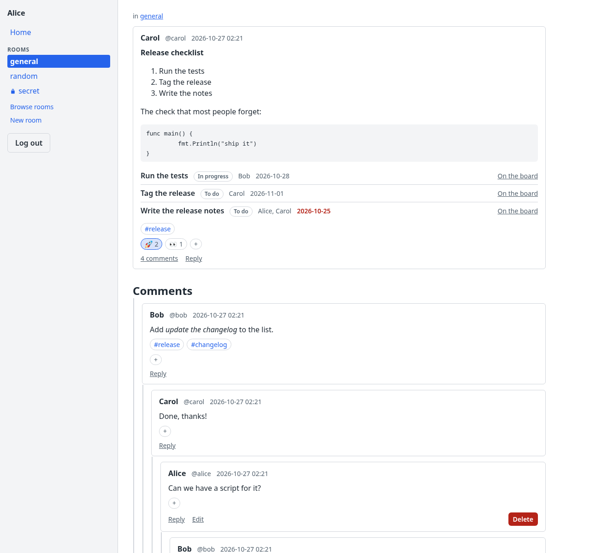
  Carol's "Release checklist" post: "Run the tests" (In progress, Bob, 2026-10-28), "Tag the release" (To do, Carol, 2026-11-01) and "Write the release notes" (To do, Alice and Carol, 2026-10-25 in red), each with "On the board".
- **Manual checks:** none
- **Deviations and follow-ups:** New rows need JavaScript (existing rows submit without it). A row with a task ID is never ignored, so clearing its title is an error rather than a deletion. Board links point to `/rooms/{id}/board#task-N`, the page of step 9.3.

## 9.3 The board

- **Date:** 2026-10-27
- **Branch:** feat/step-9.3-board
- **Summary:** `/rooms/{id}/board` shows the room's Kanban board (Posts / Board links in the header): columns side by side with their cards (title, assignees, due date red when overdue, done cards struck through, a link to the post). Members drag cards with `board.js` (HTML drag and drop with delegated listeners; the drop fills a hidden form that Datastar posts, and the server answers with the columns in its own order) or use each card's "Move to…" select; they edit a card's title, assignees and due date in a separate editor panel, and add, rename, move and delete columns (both conflict messages shown at the top). Non-members of a visible room see it read-only; private rooms of others answer 404. A board stream patches only the columns on `board.changed`, so an open card form or new-column form keeps its text, and a held card freezes the board until the drag ends; the page's version hash avoids a needless first refresh. The proof tool resolves `{board:<room>}`.
- **Main files:** `internal/web/{board,board_stream,server}.go`, `internal/web/views/{board.templ,board.go,rooms.templ}`, `internal/web/static/{board.js,app.css,static.go}`, `cmd/clowder-proof/main.go`.
- **Tests:** handler tests (page, read-only, 404s for private rooms on every route, nine move positions in both modes, the select, card updates with former members and due-date clearing, column add/rename/move/delete and both conflicts), stream tests (moves reaching another member, read-only renders, connect modes, access lost, membership, renames, pings), view tests; browser tests dispatching real drag events: alice drags a card and bob sees it without reload, the select, a held card, columns and a card form surviving a live update, read-only for carol.
- **Checks:** gofmt ✅ · go vet ✅ · golangci-lint ✅ (both tag sets) · go test -race ✅ · CGO_ENABLED=0 build ✅ · go generate clean ✅ · browser tests ✅ · no process left ✅
- **Proof:**
  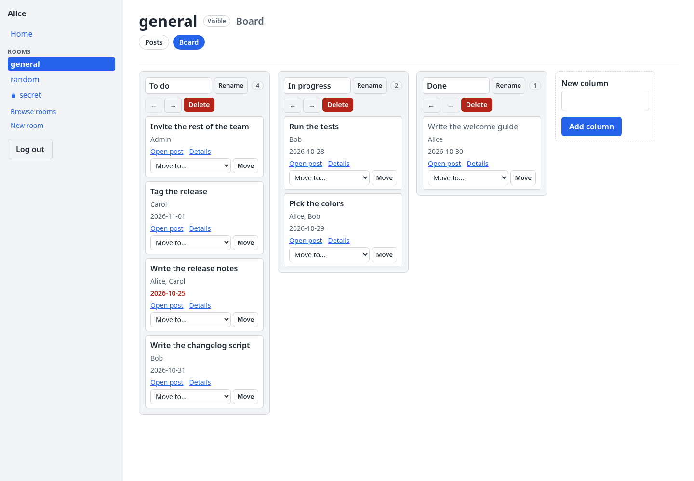
  The board of `general` as alice (1440×1000): To do (4 cards, "Write the release notes" overdue in red), In progress (2), Done (1, struck through), each card with assignees, date, Open post, Details and Move to…, the column controls and the New column form.
- **Manual checks:** none
- **Deviations and follow-ups:** Touch drag is not supported (the select works everywhere). A live update can replace a column's rename field while someone types in it. Skipped patches during a drag are recovered by the drop's answer or a refresh when the drag is cancelled.

## 10.1 Search index and service

- **Date:** 2026-10-27
- **Branch:** feat/step-10.1-search-service
- **Summary:** FTS5 is compiled into the pure-Go SQLite (tested). Migration `0001_posts_fts` creates `posts_fts` (unicode61, diacritics removed; one row per post or comment: body, attachment names and task titles) and backfills existing posts; `ReindexPost` keeps it exact in the same transaction as every create, edit, delete, placeholder, clean-up, task change (also from the board) and room delete. `ParseQuery` reads words (prefix), "phrases", `#tags`, `room:`, `from:`, `after:`, `before:` and `is:post`/`is:comment`, quoting every term so no FTS operator can be injected. `Search.Query` returns 20 results a page from visible rooms and the actor's private rooms only (admins included, D29), ranked by bm25 then newest (newest first without words), with snippets highlighted by private-use markers turned into `<mark>` after escaping.
- **Main files:** `internal/store/{migrations,search}.go`, `internal/app/search.go`, `internal/app/{posts,tasks,rooms}.go`.
- **Tests:** FTS5 availability, the tokenizer, match expressions, reindexing and backfill in two phases, rollback, store-level and service-level injection tables (300 `(` and 300 `"` included), about 70 parser rows and 11 bad dates with routes, permissions for six users, every filter, tags, ordering, pages of 0 to 41 results, snippets with `<script>` and marker characters, diacritics, attachment names, exact index state after every kind of change.
- **Checks:** gofmt ✅ · go vet ✅ · golangci-lint ✅ (both tag sets) · go test -race ✅ · CGO_ENABLED=0 build ✅ · go generate clean ✅ · browser tests ✅ · no process left ✅
- **Proof:** none
- **Manual checks:** none
- **Deviations and follow-ups:** Only the first 500 characters and 32 terms of a query count (FTS5 expression depth). Invalid `#tags`, empty filter values and unknown keys are words; terms without a letter or digit are dropped; the last of a repeated filter wins. `Search` takes a markdown renderer it does not use yet (step 10.2 removes it).

## 10.2 Search page

- **Date:** 2026-10-27
- **Branch:** feat/step-10.2-search-page
- **Summary:** `GET /search` shows the search box with a one-line help, the parsed filters as chips (each with an × link that removes it from the query), and 20 results a page: the room, the author, the time, a "comment" marker, the highlighted snippet, the tags, and a link to the post (or to `/posts/<root>#post-<id>` for a comment). Newer/Older links keep `q`. With Datastar the form patches the results panel and keeps the URL shareable. Without JavaScript the plain GET works. A bad date shows the field message (Datastar 200, plain 422). The sidebar has a search box on every page except `/search`, so tag links in posts land here. `app.NewSearch` takes only the store; `web.Services.Search` is built by `serve`. The flaky `TestAliceWritesAndEditsAPost` had two causes. The first was a real race: the create answer and the room stream each did "remove the card, then prepend it", and the client could interleave the two into two cards. Both now prepend, then remove `#post-N ~ #post-N`. The second was a stale tag-suggestion answer moving the feed under a click; the test now sets the second tag in one step.
- **Main files:** `internal/web/{search,posts,stream,server}.go`, `internal/web/views/{search.templ,search.go,sidebar.templ}`, `internal/web/static/app.css`, `internal/app/search.go`, `cmd/clowder/serve.go`.
- **Tests:**
  - Handler tests: the empty query, words with highlight, tag links, filters and chip removal, no results, bad dates in both modes, pagination, private rooms hidden from non-members (admins included), comment anchors, escaped `<b>`, the sidebar box, the login redirect, and the duplicate-removal patch on create.
  - View tests.
  - Browser test: alice follows `#design`, adds a word and removes the chip; carol finds nothing from `secret`.
  - The fixed post test failed 0 of 100 runs under CPU load.
- **Checks:** gofmt ✅ · go vet ✅ · golangci-lint ✅ (both tag sets) · go test -race ✅ · CGO_ENABLED=0 build ✅ · go generate clean ✅ · browser tests ✅ (5 consecutive full runs) · no process left ✅
- **Proof:**
  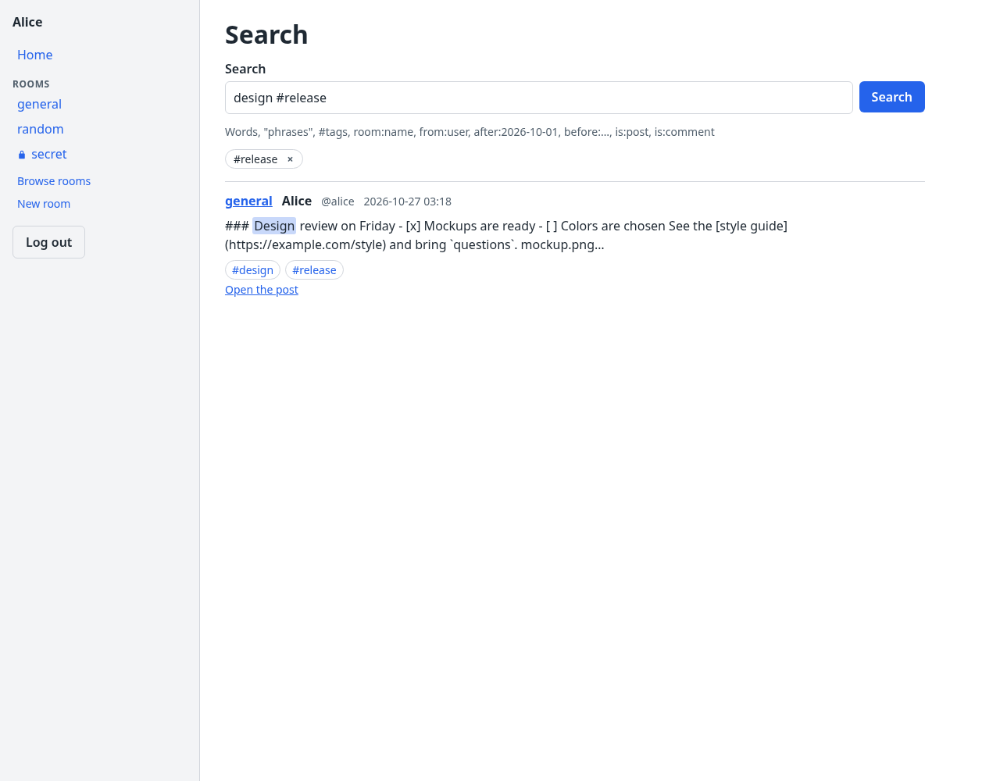
  The search page as alice for `design #release`: the `#release ×` chip and one result in `general` with "Design" highlighted, its tags and its link.
- **Manual checks:** none
- **Deviations and follow-ups:** Results update on submit, not while typing. A tag-suggestion answer that arrives after a post is made can still show a stale list in the fresh editor until the next keystroke (harmless).
